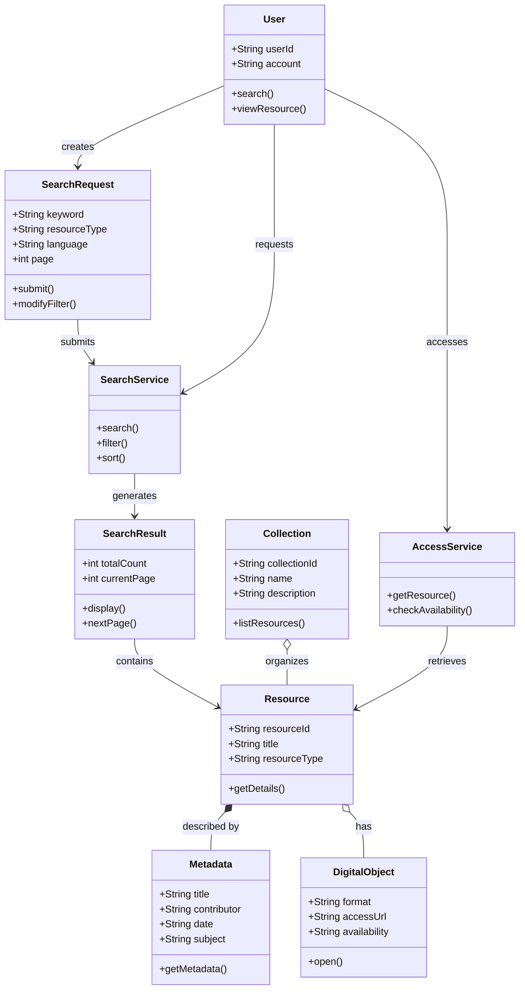
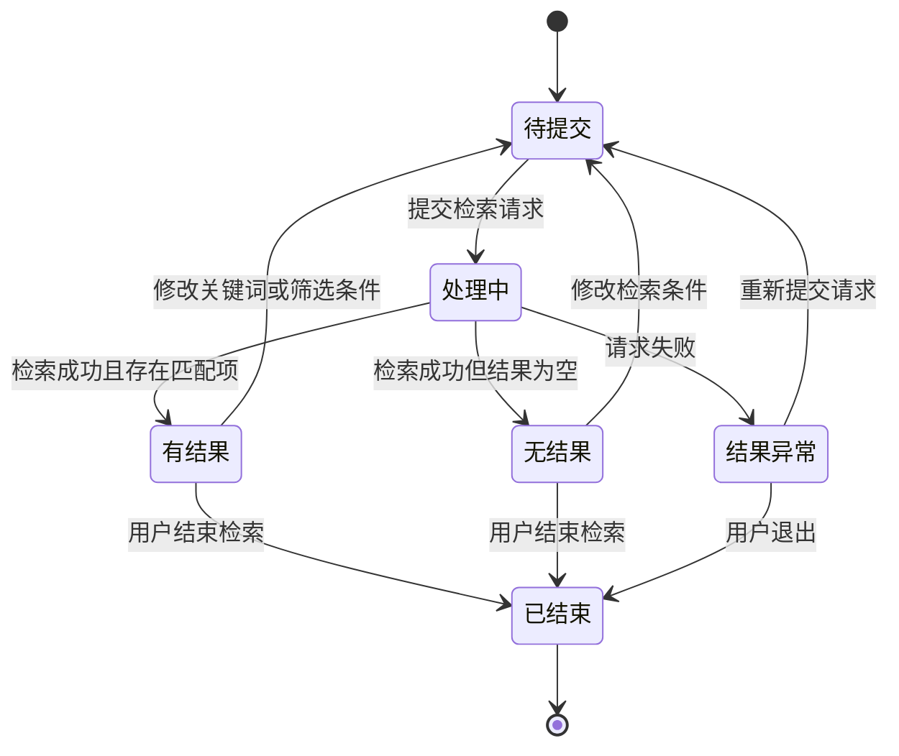
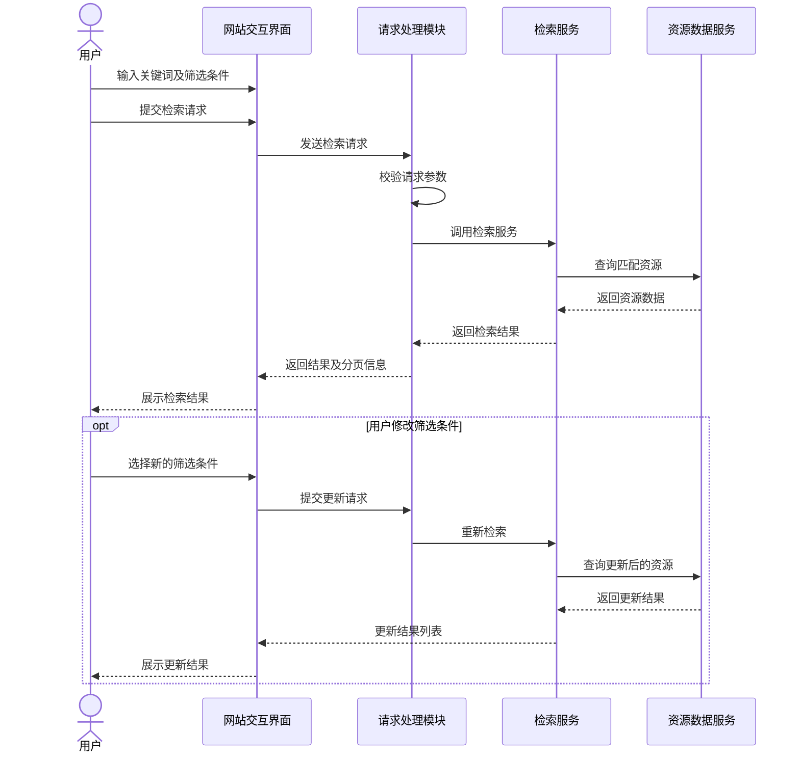
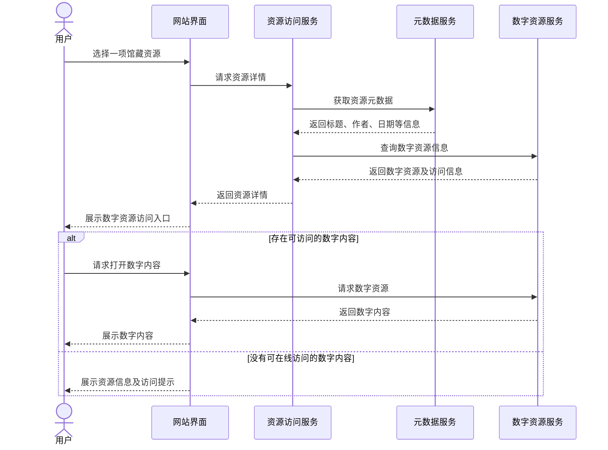
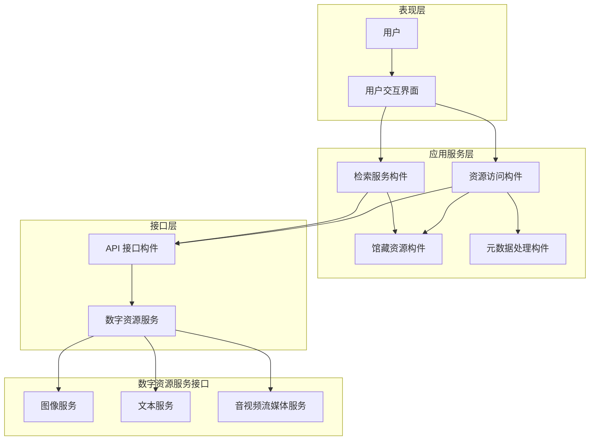
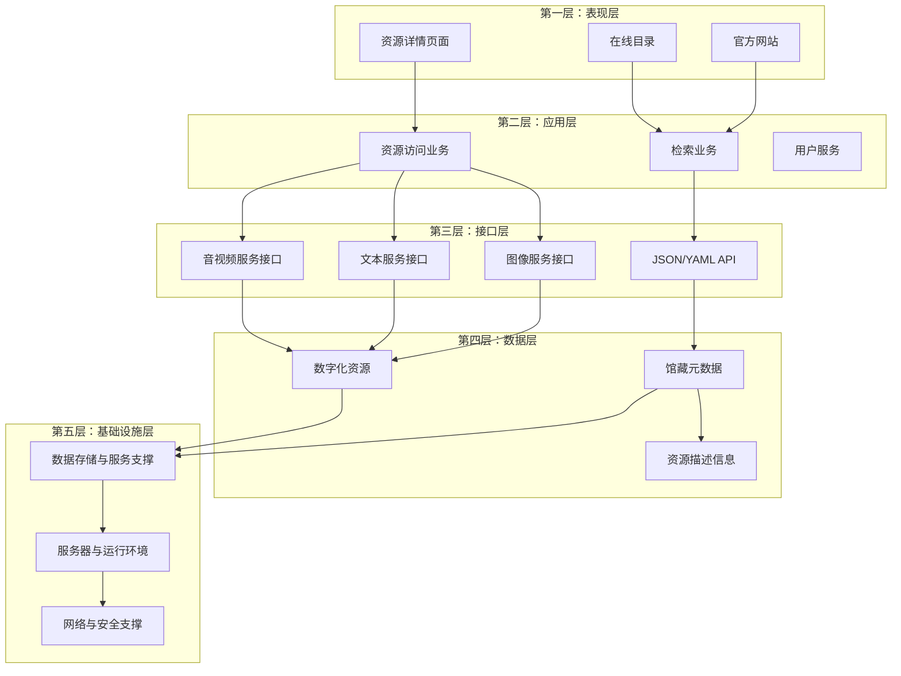

# 美国国会图书馆网站系统分析与设计报告

课程：信息系统分析与设计｜研究对象：Library of Congress｜资料检索日期：2026年11月13日

## 一、研究背景与研究对象

### 1.1 研究对象介绍

美国国会图书馆（Library of Congress，简称 LOC）是美国国会的研究机构，也是世界上规模最大的图书馆之一。其官方网站不仅提供图书馆机构信息，还承担馆藏资源检索、数字资源展示、在线访问和研究支持等功能。

本次分析主要涉及三个网站及平台：

| 研究对象                                  | 主要功能                                           |
| ----------------------------------------- | -------------------------------------------------- |
| [LOC 官方网站](https://www.loc.gov/)      | 提供数字馆藏、专题内容、机构信息及资源访问入口     |
| [LOC 在线目录](https://catalog.loc.gov/)  | 提供图书、期刊、地图、手稿等馆藏资源的检索与发现   |
| [LOC API 服务](https://www.loc.gov/apis/) | 为开发者和研究人员提供结构化数据及数字资源访问接口 |

需要特别说明，LOC 于2025年6月30日推出新一代在线目录。该目录属于 Library Collections Access Platform（LCAP）项目的重要成果，LCAP 旨在逐步替代旧有系统，统一支持馆藏资源的发现、描述和管理。

因此，本报告将 LOC 网站作为整体研究对象，但会区分 loc.gov 的数字馆藏服务与 catalog.loc.gov 的新一代在线目录，避免将两者的技术实现混为一谈。

### 1.2 主要业务流程

LOC 网站的核心业务可以概括为：

1. 用户进入网站。
2. 用户通过关键词、资源类型或分类条件检索馆藏。
3. 系统根据检索条件返回资源列表。
4. 用户通过筛选条件缩小检索范围。
5. 用户选择具体资源，查看详细信息。
6. 对于提供数字化内容的资源，用户可以进一步访问图像、文本、音视频等数字材料。

LOC 的公开 API 支持资源检索、集合查询和单项资源详情获取，并提供 JSON/YAML 等结构化数据。

## 二、领域对象建模与 UML 类图分析

### 2.1 领域对象识别

领域对象建模是从实际业务出发，识别系统中的核心业务实体，明确其属性、行为及相互关系。

结合 LOC 的馆藏检索业务，可以识别以下领域对象：

| 领域对象                  | 主要属性                   | 主要职责             |
| ------------------------- | -------------------------- | -------------------- |
| User（用户）              | 用户标识、账户信息         | 发起检索、浏览资源   |
| SearchRequest（检索请求） | 关键词、筛选条件、页码     | 保存用户的检索条件   |
| SearchResult（检索结果）  | 结果总数、当前页、资源列表 | 保存和展示检索结果   |
| Resource（馆藏资源）      | 资源编号、标题、资源类型   | 表示馆藏中的具体资源 |
| Collection（馆藏集合）    | 集合编号、名称、简介       | 组织相关馆藏资源     |
| Metadata（元数据）        | 标题、作者、日期、主题     | 描述资源的基本信息   |
| DigitalObject（数字对象） | 文件类型、访问地址、格式   | 表示资源的数字化内容 |
| SearchService（检索服务） | 检索规则、查询接口         | 处理检索请求         |
| AccessService（访问服务） | 资源标识、访问状态         | 处理资源访问请求     |

其中，Resource 是核心领域对象。用户通过 SearchRequest 发起检索，SearchService 处理请求并产生 SearchResult。用户进一步选择 Resource 后，可以获取 Metadata 和相关 DigitalObject。

这里需要注意：LOC 官方 API 文档明确区分资源列表响应、单项资源响应和数字资源响应，因此上述领域模型与其公开业务接口具有对应关系，但这些类名是本报告建立的逻辑模型，并非 LOC 公布的内部源代码类名。

### 2.2 UML 类图



图1：美国国会图书馆馆藏检索业务逻辑类图

### 2.3 类图分析

该类图体现了以下设计思想：

第一，职责划分明确。

User 负责发起操作，SearchRequest 负责记录查询条件，SearchService 负责处理检索业务，SearchResult 负责保存查询结果，各对象的职责相对独立。

第二，封装原则。

Resource 将资源编号、标题、资源类型等属性与资源详情获取行为组织在一起。其他对象通过其提供的操作访问资源信息，而不必了解内部实现。

第三，高内聚、低耦合。

检索逻辑集中在 SearchService 中，资源访问逻辑集中在 AccessService 中，避免将所有业务功能集中在一个类中。

第四，合理划分对象关系。

Resource 与 Metadata 之间采用组合关系作为分析模型，表示资源描述信息属于资源整体的一部分；Resource 与 DigitalObject 采用聚合关系，表示一个资源可能关联多个数字化文件。

以上关系是为了表达业务逻辑而建立的 UML 抽象，不代表 LOC 实际数据库中的物理关联关系。

## 三、UML 状态图分析

### 3.1 分析对象选择

本报告选择 SearchRequest（检索请求）作为状态图的分析对象。

相比直接将网页页面切换作为状态变化，检索请求具有更明确的业务处理过程，适合使用状态图进行建模。

### 3.2 状态识别

| 状态     | 含义                     |
| -------- | ------------------------ |
| 初始状态 | 用户尚未提交检索请求     |
| 待提交   | 用户已经输入检索条件     |
| 处理中   | 系统正在处理请求         |
| 有结果   | 系统成功返回检索结果     |
| 无结果   | 检索成功，但没有匹配资源 |
| 结果异常 | 请求处理过程中出现错误   |
| 已结束   | 用户结束当前检索过程     |

### 3.3 UML 状态图



图2：检索请求生命周期 UML 状态图
## 四、UML 交互图分析

### 4.1 交互场景一：馆藏资源检索

用户通过 LOC 网站输入关键词，系统接收请求并调用检索服务，最终返回检索结果。

该过程涉及用户、前端界面、检索请求处理模块、检索服务和资源数据服务。



图3：馆藏资源检索 UML 时序图

交互过程分析：

1. 用户通过表现层提交检索条件。
2. 请求处理模块负责接收请求并进行参数校验。
3. 检索服务负责处理关键词和筛选条件。
4. 资源数据服务提供相应的资源数据。
5. 检索结果经过处理后返回前端。
6. 用户可以进一步修改筛选条件，重新执行检索。

该交互过程体现了表现层、业务处理层和数据服务之间的职责划分，也说明了模块之间需要通过明确的接口实现协作。

### 4.2 交互场景二：数字资源访问

用户在检索结果中选择某项资源，系统进一步获取资源详情及数字化内容。



图4：数字资源访问 UML 时序图

交互过程分析：

该过程主要体现资源访问服务与元数据服务、数字资源服务之间的协作。

元数据服务负责提供资源描述信息，数字资源服务负责提供数字化内容的相关访问能力。

LOC 的公开 API 提供了单项资源详情和资源文件相关信息，也提供专门的图像、文本及音视频服务。

因此，将资源元数据获取与数字内容访问划分为不同的逻辑职责，有利于提高系统的模块化程度。

### 4.3 交互图综合评价

两幅时序图分别描述了资源检索和数字资源访问两个核心业务过程。

第一幅图重点体现检索请求如何在不同模块之间传递，第二幅图重点体现资源详情与数字内容如何协同提供。

两者共同说明：一个完整的数字图书馆业务并不是由单一功能模块完成的，而是需要多个职责明确的模块通过接口相互协作。

## 五、系统应用架构与 UML 构件图分析

### 5.1 系统功能模块划分

根据 LOC 网站的主要业务，可以将其抽象为以下逻辑构件：

| 构件             | 主要职责                             |
| ---------------- | ------------------------------------ |
| 用户界面构件     | 提供检索、浏览和资源展示界面         |
| 检索服务构件     | 处理关键词检索、筛选和排序           |
| 馆藏资源构件     | 管理和提供馆藏资源信息               |
| 元数据处理构件   | 提供资源描述信息                     |
| 数字资源访问构件 | 提供图像、文本、音视频等资源访问能力 |
| API 接口构件     | 为外部应用提供结构化数据接口         |
| 外部服务构件     | 对接相关外部数据和服务               |

这里采用的是逻辑功能划分。尤其需要注意，LOC 官方公开资料确实提供 JSON/YAML API、文本服务、图像服务和流媒体服务，但并没有完整公布所有内部构件的部署和依赖关系。

### 5.2 UML 构件图



图5：LOC 网站逻辑构件及依赖关系图（课程分析模型）

### 5.3 构件图分析

（1）模块化设计

系统将检索、资源访问、元数据处理和数字资源服务划分为不同构件，每个构件负责相对独立的业务功能。

例如，用户进行关键词检索时，主要涉及检索服务构件；用户访问数字化图片时，则需要数字资源访问相关服务。

这种划分有利于降低单一模块的复杂程度。

（2）高内聚、低耦合

检索服务集中处理检索请求，数字资源服务负责内容访问，不同模块之间通过接口传递数据。

这种方式可以避免各模块直接依赖彼此的内部实现。

（3）可复用性

LOC 的 API 为外部开发者和研究人员提供了结构化数据访问能力。不同应用程序可以调用相应接口获取馆藏信息，而不必完全依赖网站页面进行数据抓取。

（4）可扩展性

图像、文本和音视频服务具有不同的业务特点。将其作为不同的逻辑服务进行分析，可以更清楚地理解不同资源类型的处理需求，也有利于未来增加新的资源服务。

### 5.4 构件设计与第四章原则的对应

| 教材理论原则 | LOC 业务中的体现                             |
| ------------ | -------------------------------------------- |
| 模块化       | 检索、资源访问、元数据处理等功能划分         |
| 高内聚       | 检索模块集中处理检索相关业务                 |
| 低耦合       | 不同服务通过接口协作                         |
| 可复用       | 公开 API 支持外部程序获取资源信息            |
| 可扩展       | 图像、文本、音视频服务支持不同类型的资源访问 |
| 可维护       | 不同业务职责分开，便于独立分析和维护         |

## 六、接口层设计分析

### 6.1 LOC 公开 API 体系

接口层设计的核心任务是明确不同系统或模块之间如何进行信息交换。

LOC 提供了较为丰富的公开 API。根据官方文档，可以将其主要接口分为以下几类：

| 接口类型           | 主要功能                            | 应用场景           |
| ------------------ | ----------------------------------- | ------------------ |
| JSON/YAML API      | 提供馆藏资源结构化数据              | 检索及资源信息获取 |
| Sitemap            | 提供网站页面及资源 URL 信息         | 搜索引擎索引       |
| Text Services      | 提供 OCR 全文、词语坐标和上下文片段 | 文本内容处理       |
| Image Services     | 提供符合 IIIF 标准的图像服务        | 图像访问和处理     |
| Streaming Services | 提供音视频流媒体服务                | 音视频资源访问     |

以上接口类型均可在 LOC 官方 API 文档中查到。

### 6.2 接口调用示例

LOC 的 JSON API 支持通过 URL 参数完成资源检索。

例如：

```http
GET https://www.loc.gov/search/?q=history&fo=json
```

其中：

- `GET`：表示获取资源。
- `q=history`：表示检索关键词为 history。
- `fo=json`：表示返回 JSON 格式的数据。

此外，系统还支持通过筛选参数缩小结果范围，例如：

```http
GET https://www.loc.gov/search/?q=history&fa=language:english&fo=json
```

这里通过 `fa` 参数增加语言筛选条件。

LOC 官方文档还提供了 `c` 参数控制每页返回数量、`sp` 参数指定页码，以及 `sb` 参数指定排序方式等功能。

需要特别注意：loc.gov 的 JSON API 并不等同于 catalog.loc.gov 的新目录接口。官方文档明确指出，JSON/YAML API 并不包含新目录中的全部目录记录。因此，不能用上述 API 示例代表新目录所有功能的内部调用方式。

### 6.3 接口层设计原则分析

（1）接口职责明确

LOC 将不同类型的数据和服务通过不同接口提供。

例如，JSON API 主要负责提供结构化资源数据，而 Image Services 主要负责图像访问与处理。

这种划分使接口具有相对明确的功能边界。

（2）接口标准化

LOC 使用 JSON、YAML 等结构化数据格式提供信息，并通过符合 IIIF 标准的图像服务支持数字图像访问。

统一的数据格式和服务规范能够降低不同应用之间的数据交换难度。

（3）接口可复用

LOC 的 API 不仅用于网站自身的数据展示，也可以供开发者、数字人文研究人员和其他应用程序调用。

因此，接口并非只服务于某一个网页，而是可以支持多种应用场景。

（4）接口安全性与可靠性

LOC 的公开 JSON API 无须 API Key 或身份验证即可访问，但存在访问频率限制，超过系统能够承受的请求速率时，请求可能被阻止。

此外，API 对深度分页也存在限制，例如不支持超过第100,000条结果的深度分页。官方建议通过筛选条件缩小结果范围。

这体现了接口设计中对访问控制、服务稳定性和系统资源保护的考虑。

### 6.4 接口层综合评价

LOC 的公开 API 体系具有较强的开放性和标准化特点。

通过将馆藏信息、图像、文本和音视频服务分别提供，系统能够适应不同的数据访问需求。

同时，统一的数据格式和明确的接口参数降低了外部应用调用系统服务的难度。

不过，不同平台之间的数据覆盖范围并不完全一致，使用者需要根据实际业务选择合适的接口，而不能将所有 API 视为统一的数据入口。
## 七、软件架构体系分析

### 7.1 软件架构整体分析

从系统总体设计角度，可以将 LOC 网站抽象为五层逻辑架构：

1. 表现层。
2. 应用层。
3. 接口层。
4. 数据层。
5. 基础设施层。

这种分层方式有利于分析各部分的职责及依赖关系，但需要强调：这是本报告根据公开业务功能建立的逻辑架构模型，不代表 LOC 官方公布的真实部署架构。

### 7.2 软件分层架构图



图6：美国国会图书馆网站逻辑分层架构图

### 7.3 各层职责分析

（1）表现层

表现层直接面向用户，负责展示网站页面和接收用户操作。

LOC 的官方网站、在线目录及资源详情页面都属于用户可见的交互入口。

这一层的设计重点是页面结构清晰、操作方便，以及不同资源类型能够得到合理展示。

（2）应用层

应用层负责处理具体业务逻辑。

例如：

- 处理用户检索请求。
- 根据条件筛选资源。
- 组织检索结果。
- 获取资源详情。
- 处理数字资源访问请求。

该层将用户操作转化为系统业务请求。

（3）接口层

接口层负责不同业务模块之间及系统与外部应用之间的数据交换。

LOC 的 JSON/YAML API、图像服务、文本服务和音视频服务均为这一分析提供了实际依据。

（4）数据层

数据层主要涉及馆藏资源数据、元数据以及数字化资源。

数字图书馆具有资源类型多样、数据来源复杂的特点，因此需要对不同类型的数据进行组织和管理。

需要注意，公开资料不足以确认 LOC 全部数据的实际物理存储结构。

（5）基础设施层

基础设施层为系统运行提供必要的技术支持，包括服务器、网络、数据存储及运行环境。

由于 LOC 没有在上述公开资料中完整披露本研究范围内的部署拓扑，因此本层只作为通用架构分析，不对其具体技术选型作未经证实的判断。

### 7.4 架构设计原则评价

| 设计原则 | 分析                                     |
| -------- | ---------------------------------------- |
| 模块化   | 不同业务功能可以按照职责划分             |
| 高内聚   | 检索、数字资源访问等业务具有明确功能边界 |
| 低耦合   | 不同功能通过接口协作                     |
| 可扩展性 | 公开 API 和多种资源服务支持不同访问需求  |
| 可复用性 | API 可以被网站及外部应用使用             |
| 可维护性 | 逻辑分层有助于理解系统职责和定位问题     |

### 7.5 LCAP 与新一代架构演进

LOC 的新一代馆藏访问平台 LCAP 是本次分析中值得重点关注的内容。

根据 LOC 2025年8月19日发布的官方公告，LCAP 是图书馆馆藏发现、描述和管理业务的重要平台，其目标是逐步替代传统系统。

新目录支持通过资源类型、语言等筛选条件动态缩小检索结果范围。LOC 还表示，LCAP 采用开放源代码的 FOLIO 平台，以便根据图书馆自身需求进行定制和扩展。

这一变化体现出以下设计思路：

- 通过现代化平台逐步替代旧有系统。
- 提高馆藏发现和访问功能的整合程度。
- 利用开放源代码平台提高系统定制能力。
- 为未来增加新功能预留空间。

需要注意，FOLIO 的使用可以由官方资料证实，但不能因此直接认定 LOC 的所有网站和数字资源服务都采用了 FOLIO。

## 八、设计模式分析

设计模式是针对软件开发中反复出现的问题所形成的成熟解决方案。通过合理使用设计模式，可以提高系统的可维护性、可复用性和扩展能力。

结合 LOC 的业务特点，可以从以下几个方面进行分析。

### 8.1 MVC 模式

基本思想：

MVC 将系统划分为模型（Model）、视图（View）和控制器（Controller）三个部分。

- Model：负责业务数据及相关处理。
- View：负责向用户展示信息。
- Controller：负责接收用户请求并协调业务处理。

LOC 中的应用分析：

以馆藏资源检索为例：

- View：用户看到的检索页面和结果列表。
- Controller：接收用户输入的关键词和筛选条件。
- Model：表示检索请求、馆藏资源和检索结果等业务数据。

这种职责划分可以使页面展示与业务处理相对独立。当检索页面需要调整时，不必同步修改所有业务逻辑。

评价：

MVC 可以作为分析 LOC 网站前端与业务处理关系的设计模式，但目前公开资料不足以证实 LOC 整体采用了某一具体 MVC 框架。

### 8.2 分层架构模式

基本思想：

按照系统功能和职责，将软件划分为多个层次，各层承担不同的任务。

LOC 中的应用分析：

用户通过网站界面提交检索请求，应用业务负责处理请求，接口层负责提供数据访问能力，底层数据服务提供资源信息。

这种职责分离有利于降低系统复杂程度。

评价：

分层架构适合解释 LOC 网站的整体逻辑结构，但本报告的分层模型属于课程分析抽象，不能据此认定 LOC 内部一定采用完全相同的物理分层结构。

### 8.3 策略模式

基本思想：

将一组可以相互替换的算法或处理规则封装起来，使调用方能够根据不同情况选择不同策略。

LOC 中的应用分析：

馆藏检索存在不同的查询方式和筛选需求。

例如：

- 按关键词检索。
- 按资源类型筛选。
- 按语言筛选。
- 按日期排序。

可以将不同的检索和排序规则设计为独立策略，由检索服务根据用户选择调用。

评价：

策略模式有助于提高检索功能的可扩展性。当增加新的筛选或排序方式时，可以尽量避免修改原有核心检索逻辑。

这里分析的是适合 LOC 检索业务的设计方案，并非已确认的内部实现。

### 8.4 适配器模式

基本思想：

适配器模式用于解决不同系统或模块之间接口不兼容的问题，通过适配器将一种接口转换为另一种接口。

LOC 中的应用分析：

数字图书馆需要处理不同类型的馆藏数据和数字资源。

例如，不同来源的资源可能具有不同的数据格式和描述方式。系统可以通过适配器，将不同数据源的信息转换为统一的数据访问形式。

LOC 提供 JSON/YAML、IIIF 图像服务以及其他机器可读数据服务，这些公开接口体现了多种数据访问标准和服务形式。

评价：

适配器模式适合解决不同资源服务之间的数据格式和接口差异问题，可以提高系统集成能力。但不能仅凭接口种类较多，就断言 LOC 内部一定采用了适配器模式。

### 8.5 门面模式

基本思想：

门面模式为复杂的子系统提供统一的访问入口，隐藏内部多个模块之间的复杂关系。

LOC 中的应用分析：

用户不需要了解资源检索、元数据处理和数字内容访问的具体实现，只需要通过网站提供的统一操作入口完成资源查找和访问。

在设计上，可以设置统一的资源访问服务，由其协调不同的后台服务。

评价：

门面模式可以降低前端与后台多个服务之间的直接依赖，提高系统的易用性和可维护性。

### 8.6 工厂模式

基本思想：

工厂模式将对象创建过程集中管理，避免客户端直接依赖具体对象的创建细节。

LOC 中的应用分析：

LOC 馆藏资源类型丰富，包括书籍、图片、地图、音视频、手稿等。

在系统设计中，可以根据资源类型选择不同的资源处理对象，例如：

- 图像资源处理对象。
- 文本资源处理对象。
- 音视频资源处理对象。

通过工厂模式，可以统一资源对象的创建过程。

评价：

工厂模式有助于降低资源类型增加时对原有代码的影响，符合开闭原则。但这是根据资源多样性提出的适用方案，不代表 LOC 已公开使用工厂模式。

### 8.7 设计模式综合比较

| 设计模式   | 主要应用场景     | 解决的问题         | 主要优势     |
| ---------- | ---------------- | ------------------ | ------------ |
| MVC        | 网站交互界面     | 页面与业务逻辑耦合 | 便于维护     |
| 分层架构   | 整体系统结构     | 职责混乱           | 结构清晰     |
| 策略模式   | 检索与排序       | 算法变化频繁       | 易于扩展     |
| 适配器模式 | 多种资源数据接口 | 接口不兼容         | 提高集成能力 |
| 门面模式   | 资源访问入口     | 子系统调用复杂     | 降低耦合     |
| 工厂模式   | 多类型资源处理   | 对象创建复杂       | 方便扩展     |

### 8.8 设计模式与第四章理论的联系

上述设计模式并不是孤立存在的，而是服务于系统总体设计的具体目标。

- MVC 和分层架构有利于实现模块化。
- 策略模式有利于提高系统的可扩展性。
- 适配器模式有利于降低不同数据服务之间的耦合。
- 门面模式有利于简化模块之间的接口调用。
- 工厂模式有利于提高对象创建过程的灵活性。

因此，设计模式可以看作领域对象建模、系统应用架构设计和接口层设计原则在具体软件开发中的进一步体现。

## 九、系统总体设计原则的综合评价

### 9.1 领域对象建模方面

LOC 网站涉及大量不同类型的馆藏资源，资源之间存在复杂的描述、分类和访问关系。

通过领域对象建模，可以将实际业务转化为 User、Resource、Metadata、Collection 等核心对象，并明确各对象的职责和联系。

这有助于降低复杂业务的理解难度，为后续类设计和业务功能实现提供基础。

### 9.2 系统应用架构方面

LOC 的公开服务体现出不同业务能力的划分。

例如，JSON/YAML API 负责提供结构化馆藏信息，图像服务负责图像访问，文本服务负责文本内容获取，音视频服务负责流媒体访问。

这些不同的服务能力有利于从逻辑上实现职责划分，并支持不同业务场景。

此外，LCAP 项目采用 FOLIO 平台，体现了 LOC 在馆藏访问平台现代化和系统演进方面的投入。

### 9.3 接口层设计方面

LOC 通过公开 API 提供机器可读的馆藏信息，使外部应用能够以标准化方式获取资源数据。

这种设计减少了外部应用对网页展示形式的依赖，提高了资源数据的可访问性和复用能力。

同时，接口访问限制也体现出系统对服务稳定性和资源保护的考虑。

### 9.4 UML 图示之间的联系

| UML 图示 | 分析对象       | 在本次研究中的作用       |
| -------- | -------------- | ------------------------ |
| 状态图   | 检索请求       | 描述业务对象生命周期     |
| 时序图   | 用户与系统模块 | 描述业务交互顺序         |
| 类图     | 领域对象       | 描述对象属性、行为和关系 |
| 构件图   | 系统功能模块   | 描述模块组成和依赖关系   |

四种 UML 图从不同角度描述同一个系统：

- 类图关注系统有哪些对象。
- 状态图关注对象在业务过程中的变化。
- 时序图关注对象之间如何协作。
- 构件图关注系统由哪些模块构成。

结合软件架构图，可以进一步理解这些对象和模块在整体系统中的组织方式。

### 9.5 综合评价

美国国会图书馆网站具有业务范围广、资源类型多、数据结构复杂和服务对象多样等特点。

从本次分析来看，其公开服务体系体现了以下值得借鉴的设计思想：

1. 通过不同服务能力划分，实现业务职责分离。
2. 通过公开 API 提高数据的可访问性和复用能力。
3. 通过不同类型的数字资源服务满足多样化访问需求。
4. 通过新一代 LCAP 平台推动传统馆藏系统的现代化演进。
5. 通过开放源代码平台提高系统定制与扩展能力。

但本次分析主要依据公开网站行为和官方技术资料，无法完整还原 LOC 内部的软件架构、数据库结构及设计模式实现。

因此，报告中的 UML 图和部分设计模式属于基于实际业务的逻辑分析，而不是对内部代码结构的直接复现。

## 十、结论

本次研究以美国国会图书馆网站为对象，围绕领域对象建模、系统应用架构设计和接口层设计三个方面，对其业务功能及软件设计进行了分析。

首先，通过领域对象建模识别用户、检索请求、馆藏资源、元数据和数字对象等核心对象，并使用 UML 类图描述对象之间的关系。通过状态图和时序图，进一步分析了资源检索和数字资源访问过程中的业务状态变化及模块交互。

其次，通过 UML 构件图和软件分层架构图，对系统功能模块及其协作关系进行了分析，说明模块化、高内聚、低耦合、可扩展性和可复用性等原则在数字图书馆系统设计中的重要作用。

最后，通过 LOC 公开 API 和数字资源服务分析了接口层设计，并结合 MVC、策略模式、适配器模式、门面模式等设计模式，讨论了数字图书馆系统中常见的软件设计方法。

总体而言，LOC 网站的研究表明，复杂的信息系统需要通过合理的领域对象建模明确业务结构，通过模块化应用架构组织系统功能，并通过标准化接口实现模块之间及系统之间的协作。这三个方面相互联系，共同构成系统总体设计的重要基础。

## 参考资料

以下均为美国国会图书馆及其官方研究指南的公开资料。

1. Library of Congress. Welcome to the New Library of Congress Catalog.  
   [Catalog Help and Documentation](https://guides.loc.gov/catalog)。

2. Library of Congress. Library of Congress Reaches Major Milestone in Bringing Collections to Users. 2025-08-19.  
   [LCAP 官方项目进展公告](https://www.loc.gov/item/prn-25-056)。

3. Library of Congress. APIs at the Library of Congress.  
   [LOC API 官方文档](https://www.loc.gov/apis/)。

4. Library of Congress. JSON/YAML for LoC.gov.  
   [JSON/YAML API 说明](https://www.loc.gov/apis/json-and-yaml)。

5. Library of Congress. Making API Requests.  
   [API 请求方法说明](https://www.loc.gov/apis/json-and-yaml/requests/)。

6. Library of Congress. API Request Parameters.  
   [API 参数说明](https://www.loc.gov/apis/json-and-yaml/requests/parameters/)。

7. Library of Congress. Understanding API Responses.  
   [API 响应结构说明](https://www.loc.gov/apis/json-and-yaml/responses/)。

8. Library of Congress. Additional APIs and Data Services.  
   [其他 API 与数据服务](https://www.loc.gov/apis/additional-apis/)。

9. Library of Congress. Annual Report of the Librarian of Congress, FY2025.  
   [2025 财年年度报告](https://www.loc.gov/static/portals/about/reports-and-budgets/documents/annual-reports/annual-report-fy2025.pdf)。

10. Library of Congress. Mapping the Way through the New Catalog. 2025-07-25.  
    [新目录相关介绍](https://blogs.loc.gov/maps/2025/07/mapping-the-new-catalog/)。