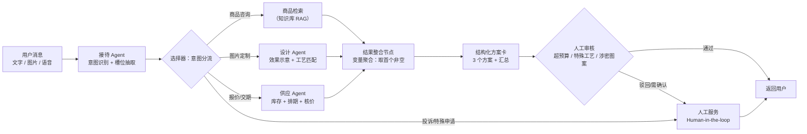
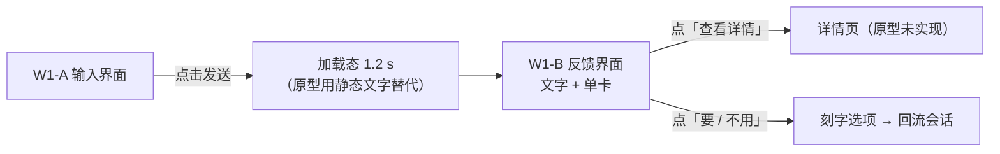
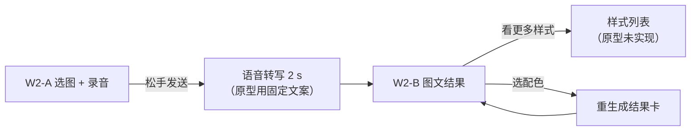
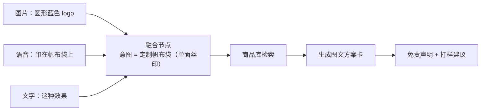
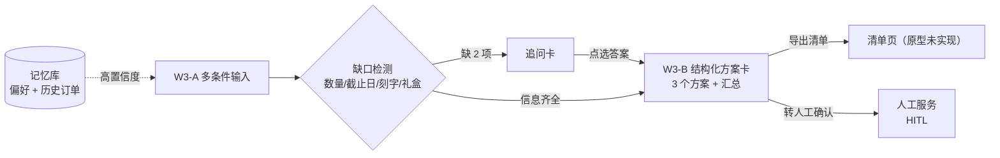
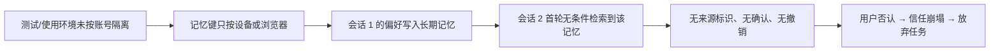
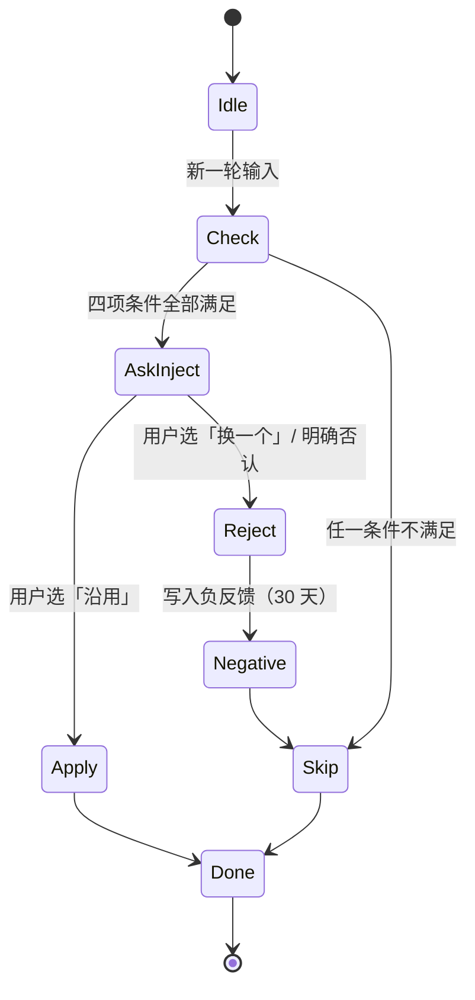
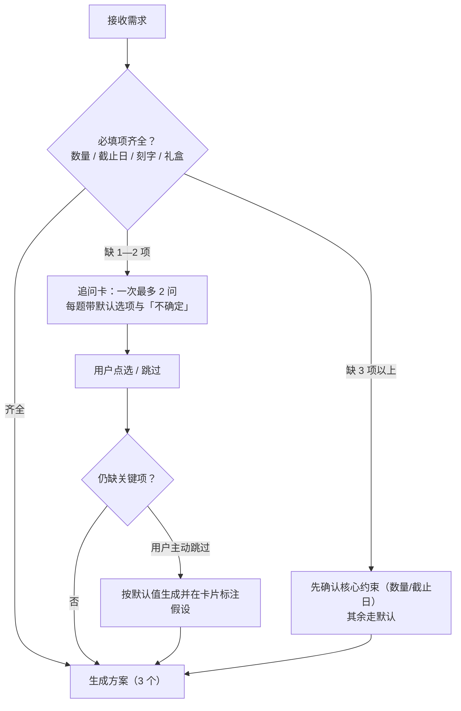

# 第 7 章 实验成果展示 · 多模态低保真原型与 0—4 级可用性测试

> **课程**：信息系统分析与设计（ISAD）　**章节**：第 7 章 复杂工作流与多智能体系统
> **方法**：Stanford CS147 Low-fi Prototyping + Pilot Usability Testing（先导可用性测试）
> **成果形式**：实验成果展示（低保真线框 + 测试日志 + 严重度评分 + 优化对比）
> **配套文件**：本目录 `assets/` 下的 4 张原型画板（PNG/SVG）；思维导图见同目录另一份文档

---

## 0. 文档信息与数据声明

| 项目 | 内容 |
| --- | --- |
| 实验名称 | 多模态低保真原型与 0—4 级可用性测试 |
| 被测对象 | 「礼遇」校园文创定制助手（多模态智能体低保真原型） |
| 测试类型 | 先导可用性测试（Pilot Usability Testing），2 名测试者 × 3 个任务 |
| 原型保真度 | 低保真（灰阶线框，无视觉设计、无真实后端） |
| 评分方法 | Nielsen 0—4 级严重度评分（0 = 非问题，4 = 灾难性） |
| 记录方式 | 主持人在场观察 + 出声思维（think-aloud）+ 关键事件记录表 |

> ⚠️ **数据声明（重要）**
> 本报告中出现的测试者（P1、P2）、姓名、操作时间、对话截图、关键事件、评分与"优化后复测数据"，**全部为课堂练习用的模拟数据**，由作者按真实测试的记录规范构造，用于演示 CS147 先导测试的完整流程与文档形式。它们**不是**真实用户研究结果，不可作为产品决策依据，也不得被引用为实证结论。真实研究需经过知情同意、伦理审查与至少 5 名以上测试者。

---

## 1. 实验背景与目标

### 1.1 背景：为什么在接入复杂多模态工作流之前先做测试

第 7 章讨论的是"复杂工作流与多智能体系统"：选择器负责分支、批处理负责并行、子工作流负责模块化、多 Agent 负责分工与协作。教材同时提醒——**多 Agent 灵活但调试复杂**，工作流可控但要求流程清晰。一旦把图文、语音、卡片、记忆这些多模态交互直接塞进复杂编排，任何前端断点都会被放大成"编排层难以定位的故障"：用户以为是智能体"听不懂"，工程师以为是路由或节点出错，排查成本成倍上升。

因此本章实验采取"**先测交互、再编排流程**"的策略：在低保真阶段（纸张/线框级别）用先导可用性测试，提前暴露三个难度层级任务中的多模态断点，尤其是**记忆的触发时机**与**追问的提示语**——这两处恰好是后续接入多智能体编排时最难改、也最容易引发连锁错误的环节。

### 1.2 实验目标

1. **发现断点**：在图文、语音、卡片、记忆四类多模态交互中，定位用户"卡住、误解、放弃"的具体位置。
2. **验证假设**：检验"记忆什么时候出现""什么时候应该主动追问"两处设计假设是否成立。
3. **量化排期**：用 0—4 级严重度给断点排序，确定接入复杂工作流之前必须修复的项。
4. **产出方案**：对高严重度问题给出可落地的交互优化（规则 + 文案 + 界面），并说明预期效果。
5. **沉淀资产**：形成可复用的任务卡、主持脚本、关键事件记录表模板。

### 1.3 方法依据

| 方法 | 来源 | 本实验中的用法 |
| --- | --- | --- |
| 低保真原型（Low-fi Prototype） | Stanford CS147 设计流程 | 灰阶线框 + 手绘感画板，只表达结构与交互位置，不投入视觉设计 |
| 先导可用性测试（Pilot Usability Testing） | CS147 / Nielsen Norman Group | 2 名测试者、3 个任务、出声思维，正式研究前的小样本试跑 |
| 严重度评分（Severity Rating） | Nielsen 0—4 级 | 对每条关键事件评级，决定修复优先级 |
| 出声思维（Think-aloud） | 可用性工程通用方法 | 测试者边操作边说出预期，主持人只记录不打断 |
| 关键事件法（Critical Incident） | 人因工程 | 只记录"预期与实际不一致"的关键瞬间，而非全程录像逐帧分析 |

### 1.4 与课程其他章节的衔接

| 环节 | 本章位置 | 前置 / 后续 |
| --- | --- | --- |
| 需求与场景 | 第 2 节：场景、角色、任务脚本 | 承接第 3 章需求分析（用户故事、功能/非功能需求） |
| 原型与交互 | 第 3—5 节：三档任务流线框 | 承接第 4 章总体设计（组件与信息架构） |
| 测试与评估 | 第 6—8 节：事件日志与评分 | 为第 9 章系统测试提供用例与判据 |
| 多智能体编排 | 第 2.4 节 + 第 8.5 节 | 对应第 7 章：选择器 / 批处理 / HITL / 多 Agent |

---

## 2. 智能体场景及功能介绍

### 2.1 场景设定

**「礼遇」** 是校园文创店的线上定制助手：学生社团、毕业班级、来访交流团常需要定制纪念品（徽章、帆布袋、书签、香囊等）。传统流程要跑门店、反复确认尺寸与交期、手工核价；「礼遇」希望用一次对话完成"**看图 → 说需求 → 拿方案 → 出报价**"。

选择这一场景的原因有三点：

1. **天然多模态**：用户手里往往只有一张图（社团 logo、参考图、往届纪念品照片），又常常"说不清"具体工艺，需要语音或文字补充；
2. **强记忆需求**：配色、预算档、自提点等偏好会重复出现，是检验"记忆触发时机"的理想场景；
3. **有明确的人工兜底**：超预算、特殊工艺、涉密图案必须转人工，符合第 7 章"人类保留最终决策权"的原则。

### 2.2 用户与核心价值

| 用户 | 典型诉求 | 关键约束 |
| --- | --- | --- |
| 学生社团负责人 | 用社团 logo 做周边，批量 20—50 件 | 预算紧、要赶在活动前拿到 |
| 毕业班代表 | 毕业纪念品，要"有学校/城市元素" | 时间固定（毕业季）、要能快递 |
| 来访交流团对接人 | 伴手礼，需体面、便于携带 | 数量固定、讲究包装 |
| 文创店店员 | 审核方案、确认工艺可行性 | 最终报价与交期由人确认 |

### 2.3 多模态能力矩阵

| 模态 | 输入 | 输出 | 本实验覆盖 |
| --- | --- | --- | --- |
| 文字 | 自然语言需求、条件补充 | 文字回复、追问 | T1 / T2 / T3 |
| 图片 | 社团 logo、参考图、往届实物照 | 效果示意图、材质说明 | T2 / T3 |
| 语音 | ≤30 s 语音补充说明 | 语音转写 + 文字确认 | T2 / T3 |
| 卡片 | 点选选项、方案选择 | 商品卡、方案对比卡、汇总卡 | T1 / T3 |
| 记忆 | 历史偏好、历史订单 | "沿用/更换"提示 | T3 |

### 2.4 后台多智能体设计（与第 7 章对应）

> 说明：本实验**只测前端多模态交互**，后台编排以低保真"角色卡"代替，尚未接入真实工作流。这样做的理由是：先确认前端不会把错误信息喂给编排层，再投入多 Agent 联调成本。

图中三个要点与教材 7.1—7.3 对应：

- **选择器**承担意图分流，必须有"否则"兜底（教材 7.1：用"否则"兜底提升可靠性）；
- **批处理**用于"一次生成 3 套配色示意"，任务相互独立、可并行；
- **人工审核节点**对应 HITL：报价与交期属于高影响、不可逆决策，必须由人确认。

### 2.5 三个任务脚本（Task Scripts）

| 任务 | 层级 | 用户目标 | 输入模态 | 成功标准 | 失败标准 |
| --- | --- | --- | --- | --- | --- |
| T1 | 简单 | 找一款 50 元以内的毕业纪念徽章 | 文字 | 80 s 内看到含价格/交期的卡片并说出选择 | 找不到入口或无法判断价格 |
| T2 | 中等 | 把社团 logo 印在帆布袋上，先看效果 | 图片 + 语音 + 文字 | 3 min 内拿到图文方案并说明"是否可以打样" | 无法确认图片是否被理解 |
| T3 | 复杂 | 20 份、800 元、周三前、可上高铁、有苏州元素的伴手礼 | 文字（多条件）+ 记忆 + 点选 | 5 min 内拿到 3 个可比方案并导出清单 | 方案不可比、记忆错误、无法收口 |

### 2.6 低保真原型的制作规范

| 规范 | 做法 | 目的 |
| --- | --- | --- |
| 灰阶优先 | 所有元素只用黑白灰，不用品牌色 | 避免测试者评价"好不好看"，聚焦结构与信息 |
| 蓝色 = 流程 | 只把可点击/主流程标成蓝色 | 一眼区分"能点的"和"只是显示的" |
| 橙色 = 断点 | 测试观察到的断点用橙色便签 + 编号 | 让评分与原型位置一一对应 |
| 固定尺寸 | 统一 380 × 780 手机框 | 贴近真实手机，便于估算点击热区 |
| 可测性 | 每屏至少 1 个"故意留白"的点 | 先导测试要能暴露问题，而非展示完美稿 |

---

## 3. 简单任务流低保真原型（T1）

### 3.1 任务与用户台词

> 主持人："你下周要参加毕业典礼，想给室友买个小纪念品，预算 50 元以内。请用这个原型试试看。"

用户台词（脚本预设）：**"有没有 50 元以内的毕业纪念徽章？"**

### 3.2 界面清单与元素位置

| 屏幕 | 区域 | 元素 | 交互位置 | 说明 |
| --- | --- | --- | --- | --- |
| W1-A 输入 | 顶部 | 标题栏"礼遇 · 文创定制"、返回、更多 | 不可点（原型） | 建立产品语境 |
| W1-A | 会话区 | 欢迎语、快捷话题 chip（毕业纪念/社团周边/伴手礼） | chip 可点 | 降低首句输入成本 |
| W1-A | 会话区 | 用户气泡（文字） | — | 展示单模态输入 |
| W1-A | 输入栏 | 文本框、图片、麦克风、发送 | 发送可点 | 关键：多模态入口是否有提示 |
| W1-B 反馈 | 会话区 | 文字回复 + 商品卡（图/名/工艺/价格/交期/按钮） | "查看详情"为展示态 | 观察点击反馈缺失 |
| W1-B | 会话区 | 第二张卡（部分可见）+ 追问 chip"要刻字吗" | chip 可点 | 观察列表滚动与可达性 |
| W1-B | 输入栏 | 同 W1-A | — | — |

### 3.3 线框图

*画板 1：W1-A 输入界面（左）→ W1-B 反馈界面（右）；橙色便签 ①②③ 为预设观察点，与第 6、7 节事件编号一致。*

### 3.4 页面跳转关系

### 3.5 预设交互断点（待验证假设）

| 编号 | 位置 | 预设断点假设 | 验证方式 |
| --- | --- | --- | --- |
| ① | W1-B 商品卡按钮 | 按钮为展示态，用户会误以为"坏了" | 观察点击次数与表情/语言 |
| ② | W1-A 输入栏 | 图标无标签，用户不知道可以传图/说话 | 观察是否尝试非文字输入 |
| ③ | W1-B 列表 | 自动滚动会隐藏上方卡片 | 观察用户是否发现第 3 张卡 |

---

## 4. 中等任务流低保真原型（T2）

### 4.1 任务与用户台词

> 主持人："你们社团下周招新，想把社团 logo 印在帆布袋上。先看看效果，再决定要不要做。"

用户台词（脚本预设）：上传 `社团logo.png`，按住麦克风说 **"想印在帆布袋上，能做出这种效果吗？"**

### 4.2 界面清单与元素位置

| 屏幕 | 区域 | 元素 | 交互位置 | 说明 |
| --- | --- | --- | --- | --- |
| W2-A 输入 | 会话区 | 智能体提示"可以发图片或语音" | — | 给出多模态许可 |
| W2-A | 附件区 | 缩略图、文件名、大小、删除 ×、数量 1/4 | × 可点 | 观察上传后的状态反馈 |
| W2-A | 录音浮层 | 波形、计时 00:06、"松开发送 · 上滑取消" | 长按/松手 | 观察手势理解与取消逻辑 |
| W2-A | 输入栏 | "按住说话，或输入文字…"、麦克风高亮 | 按住说话 | 关键手势入口 |
| W2-B 反馈 | 会话区 | 用户图片消息、语音气泡 0:06 | — | 展示"发了什么" |
| W2-B | 结果卡 | 效果示意图（AI 生成）、材质、尺寸、价格、交期 | "看更多样式"可点 | 观察图文是否对应需求 |
| W2-B | 结果卡 | 免责声明"效果图为示意" | — | 预期管理 |
| W2-B | 会话区 | 配色 chip（蓝白/藏青） | 可点 | 二次调整入口 |

### 4.3 线框图

*画板 2：W2-A 图文 + 语音录制（左）→ W2-B 图文结合结果（右）；右下方附"多模态信息整合链"，说明图片、语音、文字如何汇入同一意图。*

### 4.4 页面跳转关系

### 4.5 预设交互断点

| 编号 | 位置 | 预设断点假设 | 验证方式 |
| --- | --- | --- | --- |
| ④ | W2-A 附件区 | 弱网下无进度/骨架屏，用户会重复上传 | 模拟 3 s 延迟，计数重复操作 |
| ⑤ | W2-A 录音浮层 | "上滑取消"文案与"短按取消"规则冲突 | 让测试者只按 0.8 s 后松手 |
| ⑥ | W2-B 结果卡 | 语义偏差（帆布袋 vs 托特包）无纠正入口 | 对比用户说的话与卡片标题 |

### 4.6 本任务的多模态整合逻辑

设计意图：三路输入汇入同一"融合节点"，再由选择器路由到"帆布袋"分支（对应教材 7.3 的多 Agent 分工与 7.1 的选择器）。测试要验证的正是——**用户能否感知系统"真的看懂了图"**。

---

## 5. 复杂任务流低保真原型（T3）

### 5.1 任务与用户台词

> 主持人："你要给来访的 20 位外校同学准备伴手礼，预算 800 元，下周三前要，大家要坐高铁回去，希望有苏州元素。请用原型完成这件事。"

用户台词（脚本预设）：**"下周三前要 20 份伴手礼，预算 800，送外地同学，能带上高铁，最好有苏州元素"**

### 5.2 界面清单与元素位置

| 屏幕 | 区域 | 元素 | 交互位置 | 说明 |
| --- | --- | --- | --- | --- |
| W3-A 输入 | 会话区 | 多条件用户消息 | — | 数量/预算/时间/场景/风格五类约束 |
| W3-A | 记忆卡 | "我记得你上次选了蓝色系"、沿用/换一个 | 两个 chip 可点 | 观察记忆是否被接受；**来源不可见、无法撤销**（对比优化版） |
| W3-A | 追问卡 | "还差 2 个信息就能报价"、刻字、礼盒 | chip 可点 | **条件触发**（停留 >8 s 或表达犹豫才出现）；观察是否必要、是否过晚 |
| W3-B 反馈 | 会话区 | 3 个方案卡（名称/单价/交期/标签） | "选这个"可点 | 观察方案是否可比 |
| W3-B | 汇总条 | 合计 ¥640 / 20 份、配色、自提点 | — | 观察用户是否注意到总价 |
| W3-B | 操作区 | 导出清单、转人工确认 | 可点 | 观察收口路径是否清晰 |

### 5.3 线框图

*画板 3：W3-A 多条件输入 + 记忆 + 追问（左）→ W3-B 结构化方案卡（右）；右下"记忆触发时间线"记录 P1 的失败路径，供第 9 节优化对照。*

### 5.4 页面跳转关系

### 5.5 预设交互断点

| 编号 | 位置 | 预设断点假设 | 验证方式 |
| --- | --- | --- | --- |
| ⑦ | W3-A 记忆卡 | 记忆来源不可见、不可撤销，可能引用错误会话 | 让 P1 使用 P2 遗留的"历史偏好" |
| ⑧ | W3-B 方案区 | 6 个方案一次铺开，用户无法横向比较 | 记录滑动次数与选择耗时 |
| ⑨ | W3-A 追问卡 | 追问为条件触发，用户不犹豫就不会出现；必填项可能拖到报价之后 | 记录返工轮次与追问触发条件 |

### 5.6 记忆与追问的设计假设（待验证）

| 记忆类型 | 存什么 | 假设的触发时机 | 假设的呈现方式 |
| --- | --- | --- | --- |
| 会话内上下文 | 本轮已给的条件 | 每轮都可用 | 不显式呈现，直接生效 |
| 长期偏好 | 色系、预算档、自提点 | 需要默认值且用户未指定时 | "沿用 / 换一个"询问 |
| 历史订单 | 上次方案、收货信息 | 用户说"和上次一样"时 | 只读引用 + 来源标注 |
| 负反馈 | 用户否认过的偏好 | 30 天内 | 不再自动引用 |

> 这四条假设正是第 9 节要验证与修正的对象：测试发现"长期偏好"在**会话切换**时被无条件触发，且没有任何来源标识，直接导致了 4 级事故（⑦）。

---

## 6. 两名测试者的测试过程与关键事件日志

### 6.1 测试设置

| 项目 | 设置 |
| --- | --- |
| 时间与地点 | 模拟：2026-11-24（周二）14:00—15:30，数字人文实验室研讨间 |
| 设备 | iPhone 13（375×812）运行 Figma Mirror；原型为可点击线框，无真实后端 |
| 主持人 | 1 人（作者），只做任务宣读与计时，不提示、不评价 |
| 记录员 | 1 人（同学 A），按"时间码 + 原话 + 操作"记录关键事件 |
| 录音录像 | 手机录屏 + 桌面摄像头（模拟数据中仅记录，不保存） |
| 任务顺序 | T1 → T2 → T3，每人独立完成，中途不换人 |
| 提示规则 | 连续卡壳 60 s 且无进展才给"最小提示"，并记录提示次数 |
| 数据产出 | 6 段任务记录、11 条关键事件、6 条事后访谈摘录 |

### 6.2 测试者画像

| 编号 | 背景 | 数字设备习惯 | 与目标用户的关系 | 测试前预判 |
| --- | --- | --- | --- | --- |
| P1 | 林同学，大二，信息资源管理 | 手机重度用户，常用小红书/微信，少用桌面软件 | 接近"社团负责人"典型用户 | 上手快，但可能对"卡片能不能点"不敏感 |
| P2 | 陈同学，大三，软件工程 | 桌面端为主，习惯快捷键，对交互逻辑敏感 | 偏"专业用户"，会追问系统行为 | 容易发现状态缺失，但可能高估普通用户 |

### 6.3 测试执行概览

| 测试者 | T1 简单 | T2 中等 | T3 复杂 | 提示次数 | 备注 |
| --- | --- | --- | --- | --- | --- |
| P1 | ✅ 成功（48 s） | ⚠️ 部分成功（3′20″） | ❌ 失败（4′05″，放弃） | 2 | 语音取消后改用文字；T3 因记忆错误失去信任 |
| P2 | ✅ 成功（35 s） | ❌ 失败（2′10″，放弃） | ✅ 成功（2′50″） | 1 | T2 重复上传 3 次后放弃；T3 自行补充条件完成 |

> 6 次任务中：**完全成功 3 次、部分成功 1 次、失败 2 次**。刻意保留了失败样本，因为先导测试的价值恰在于暴露失败路径，而非证明原型可用。

### 6.4 关键事件记录表（模拟数据）

| 编号 | 测试者 | 任务 | 用户操作 | 预期行为 | 实际行为 | 观察到的问题 | 严重度 |
| --- | --- | --- | --- | --- | --- | --- | --- |
| I-01 | P1 | T1 | 连点商品卡"查看详情"3 次 | 进入详情或至少出现按压反馈 | 无任何变化，第 3 次后皱眉说"是不是卡了" | 按钮为静态展示，无按下态/toast/禁用提示 | **2** |
| I-02 | P2 | T1 | 在输入框打了 12 个字又全部删除 | 看到"可发图/可语音"的明确入口 | 反复看输入栏图标，问"这俩图标是干嘛的" | 图标无文字标签，占位文案只提"说" | **1** |
| I-03 | P2 | T1 | 读完第 2 张卡后直接说"就这俩？" | 知道共 3 条且有查看更多 | 未察觉上方还有第 3 张卡，也未回滚 | 自动滚动到底，缺少"共 3 条/回到顶部" | **2** |
| I-04 | P2 | T2 | 选图后等待，连续上传同一张图 3 次，随后退出 | 3 s 内出现缩略图/进度/骨架屏 | 附件区空白约 3 s，无任何状态；第 3 次后说"算了，不测了" | 上传无进度、无占位、无失败重试入口 | **4** |
| I-05 | P1 | T2 | 按住麦克风 0.8 s 后松手 | 正常发送或明确提示"说话时间太短" | 录音浮层直接消失，无提示；用户以为"没录上"，再试 2 次 | "上滑取消"文案与"短按即取消"规则冲突，且无错误反馈 | **3** |
| I-06 | P1 | T2 | 补充文字"印在帆布袋上"，看结果卡 | 结果卡标题与用户表述一致 | 卡片写"托特包 · 单面丝印"，用户反问"这是帆布袋吗" | 语义偏差无纠正入口，也没有"这不是我想的"按钮 | **3** |
| I-07 | P1 | T3 | 读记忆卡"我记得你上次选了蓝色系" | 只引用本账号、本会话相关的偏好 | 断言"我没选过蓝色"，随后开始怀疑账号被串用 | 记忆跨会话串号，无来源、无撤销、无账号隔离 | **4** |
| I-08 | P1 | T3 | 浏览方案区 | 3 个左右可比方案 + 明确推荐 | 共 6 张卡，滑动 3 屏仍未看完，放弃选择 | 无推荐/备选层级，价格交期无法横向比较 | **3** |
| I-09 | P2 | T3 | 看完报价后补充"要刻名字" | 报价前先问刻字/礼盒 | 系统已出报价，补充后重算，多花 2 轮 | 必填项追问依赖"用户犹豫"才触发，容易漏问 | **3** |
| I-10 | P2 | T3 | 点"转人工确认" | 出现"已提交，预计 10 分钟回复" | 按钮无反应（展示态），用户以为没点上 | 异步操作缺提交中/成功/失败三态 | **2** |
| I-11 | P2 | T3 | 端详方案卡配色 | — | "这个蓝有点冷，不过还行" | 纯审美偏好，不影响任务完成 | **0** |

### 6.5 事后访谈摘录（模拟数据）

> **P1（T3 后）**："前面都还好，就是它突然说'你上次选了蓝色'，我根本没选过。那一瞬间我就不太敢信它后面算的钱了。"
>
> **P1（T2 后）**："我以为按住说话，松手就发出去了，结果什么都没发生，也没提示。"
>
> **P2（T2 后）**："我传了图，它一点反应都没有。我不知道是在传，还是已经失败了。"
>
> **P2（T3 后）**："如果一开始就问我刻不刻字，我就能一次说清，不用来回改。"
>
> **P1（T1 后）**："这个'查看详情'点了没反应，我以为是原型没做完，就一直点。"
>
> **P2（整体）**："卡片信息是够的，但六个方案一起给我，我不知道该比什么。"

---

## 7. 0—4 级严重度评分表

### 7.1 分级定义（题目给定标准）

| 级别 | 定义 | 判定要点 | 处理策略 |
| --- | --- | --- | --- |
| 0 | 不是可用性问题 | 纯个人偏好、审美差异 | 记录即可，不修 |
| 1 | 纯视觉或表面性问题 | 不影响任务完成，仅影响"感觉" | 排入视觉迭代 |
| 2 | 轻微问题 | 造成一定困扰，但用户能自行解决 | 下一版修复 |
| 3 | 严重问题 | 明显阻碍任务完成，需帮助或反复尝试 | **接入编排前必修** |
| 4 | 灾难性问题 | 任务无法完成或核心功能失效 | **立即响应，阻塞上线** |

### 7.2 逐条评分与判定理由

| 编号 | 问题摘要 | 级别 | 判定理由（为什么不是更高/更低一级） |
| --- | --- | --- | --- |
| I-04 | 上传无状态反馈，重复上传后放弃 | **4** | 直接导致 T2 失败（任务无法完成），且属核心能力（多模态输入）失效 |
| I-07 | 记忆跨会话串号，引用他人偏好 | **4** | 不仅导致 T3 失败，更破坏信任；在真实业务中属数据越权风险 |
| I-05 | 录音短按被取消且无提示 | **3** | 明显阻碍任务，但用户改用文字后仍可完成，故不到 4 |
| I-06 | "帆布袋"被展示成"托特包"且无法纠正 | **3** | 结果与预期不符，用户需返工；但可重新描述绕过 |
| I-08 | 6 个方案一次性铺开 | **3** | 用户放弃选择、任务未收口；属信息架构问题 |
| I-09 | 刻字追问发生在报价之后 | **3** | 造成 2 轮返工，但用户可自行补充信息后完成 |
| I-01 | 商品卡按钮无反馈 | **2** | 造成困惑与重复点击，用户最终自行判断"原型没做完" |
| I-03 | 自动滚动隐藏第 3 张卡 | **2** | 少看一条信息，但仍完成了"挑一款"的主任务 |
| I-10 | 转人工无提交状态 | **2** | 用户重复点击后自行离开，未造成任务失败（但埋下"以为成功"的风险） |
| I-02 | 输入栏多模态入口无标签 | **1** | 用户问了一句后继续用文字，未实质影响任务 |
| I-11 | 方案卡配色"偏冷" | **0** | 纯审美偏好，与可用性无关 |

### 7.3 汇总与聚类

**按严重度分布**

| 级别 | 条数 | 占比 | 涉及任务 |
| --- | --- | --- | --- |
| 4 | 2 | 18% | T2、T3 |
| 3 | 4 | 36% | T2、T3 |
| 2 | 3 | 27% | T1、T3 |
| 1 | 1 | 9% | T1 |
| 0 | 1 | 9% | T3 |

**按问题簇聚类（决定优化优先级）**

| 问题簇 | 包含事件 | 最高级别 | 根因一句话 | 优先级 |
| --- | --- | --- | --- | --- |
| A 状态反馈缺失 | I-01、I-04、I-10 | 4 | 所有异步/可点击元素都缺"进行中—成功—失败"三态 | P0 |
| B 记忆机制不透明 | I-07 | 4 | 记忆无归属、无来源、无确认、无撤销 | P0 |
| C 多模态入口与手势 | I-02、I-05 | 3 | 入口无文字标签，手势规则与文案冲突 | P1 |
| D 结果可比性与纠错 | I-06、I-08 | 3 | 结果无推荐层级，也缺"不是我想要的"反馈 | P1 |
| E 追问时机 | I-09 | 3 | 缺口检测放在生成结果之后，而非报价之前 | P1 |
| F 列表可达性 | I-03 | 2 | 自动滚动没有"共 N 条"提示 | P2 |

**任务完成率（模拟）**

| 指标 | 数值 |
| --- | --- |
| 完全成功 | 3 / 6（50%） |
| 部分成功 | 1 / 6（17%） |
| 失败 | 2 / 6（33%） |
| 平均提示次数 | 1.5 次 / 人 |
| 严重度 ≥3 的事件 | 6 / 11（55%） |

---

## 8. 典型交互问题分析

### 8.1 问题 A：记忆在错误的时机、以错误的方式出现（I-07，4 级）

**现象**：P1 从未选择过蓝色系，却在 T3 首轮看到"我记得你上次选了蓝色系"。追问后确认，该偏好来自**另一位测试者上一时段留下的会话**。

**因果链**

**根因**（对照第 7 章）

| 层面 | 根因 | 教材对应 |
| --- | --- | --- |
| 数据 | 记忆未按 `user_id + tenant` 分区，测试环境共用设备 | 教材 7.2：子工作流复用要有边界；同理，记忆复用也要有作用域 |
| 逻辑 | 记忆在**每轮开头**无条件注入，没有触发条件 | 教材 7.1：选择器必须有条件判断与"否则"兜底，记忆注入同理 |
| 交互 | 引用不可见、不可撤销，用户无法校正 | HITL：涉及用户偏好的判断应保留人的确认权 |
| 提示语 | "上次你选了蓝色"是**断言**，不是**询问** | 提示语应降低理解成本并给出选择，而非替用户下结论 |

**影响**：不仅让 T3 失败，还让用户开始怀疑"报价是否也按别人的算的"——记忆错误会外溢成对系统整体可信度的怀疑。

### 8.2 问题 B：上传没有状态，用户无法判断"在传"还是"失败"（I-04，4 级）

**现象**：P2 选图后 3 s 无任何变化（模拟弱网），连续上传 3 次后放弃。

**根因**：多模态输入缺乏"状态机"可视化。音频、图片、文件这类**异步上传**，必须暴露四态：待上传 → 上传中（进度/骨架）→ 成功（缩略图）→ 失败（重试）。原型只画了"成功态"，等于把最不确定的 3 秒留给了用户想象。

**教材视角**：这正是第 7 章"批处理节点"的思路——批量任务需要进度与结果汇总；单张图片上传虽小，同样需要"任务化"的状态反馈。

### 8.3 问题 C：语音手势的规则与文案相互矛盾（I-05，3 级）

**现象**：P1 按住 0.8 s 松手，录音浮层消失且无提示。"松开发送，上滑取消"让人误以为"继续按着就会取消"。

**根因**：

1. 手势规则（长按 ≥1 s 才开始录音、松手发送、上滑取消）只写在代码里，界面上没有"最短时长"提示；
2. 取消判定（too short）不区分"用户主动取消"与"系统判定太短"，两种情况都静默退出；
3. 没有兜底：语音不可用时，没有"改用文字"的显式引导。

**教材视角**：对应"选择器 + 兜底分支"——每个模态都要有失败分支，并且分支要能被用户看见。

### 8.4 问题 D：追问太晚 + 方案过载，任务无法收口（I-08、I-09，3 级）

**现象**：P2 直接点方案，条件追问未触发；拿到报价后才补充"要刻名字"，系统重算，多花 2 轮；P1 面对 6 张方案卡滑了 3 屏后放弃。

**根因**：

1. **缺口检测触发条件错误**：刻字、礼盒属于"影响报价的必填项"，却被做成"用户犹豫才问"的条件提示；应无条件前移到生成方案**之前**；
2. **没有推荐层级**：6 个方案平铺，没有"推荐 1 个 + 备选 2 个"的信息架构；
3. **没有收口动作**：缺少"导出清单/转人工"这类明确的下一步。

### 8.5 问题—根因—教材概念对照

| 问题 | 直接根因 | 第 7 章概念 | 设计启示 |
| --- | --- | --- | --- |
| 记忆串号（I-07） | 无作用域、无条件触发、无确认 | 变量聚合"取首个非空"、HITL | 记忆也要有"优先级 + 来源 + 确认" |
| 上传无状态（I-04） | 缺异步状态机 | 批处理节点、进度与汇总 | 多模态输入必须先"任务化" |
| 语音无兜底（I-05） | 失败分支不可见 | 选择器"否则"分支 | 每个模态都要有可见的失败出口 |
| 追问过晚（I-09） | 缺口检测时序错误 | 工作流节点顺序、前置校验 | 把"必填项校验"前移到报价之前 |
| 方案过载（I-08） | 无推荐层级 | 结果整合节点 | 汇总不是"全部罗列"，而是"分层收敛" |

---

## 9. 交互优化前后对比

### 9.1 优化目标与优先级

| 优先级 | 问题 | 级别 | 优化策略 | 预期收益 |
| --- | --- | --- | --- | --- |
| P0 | 记忆串号（I-07） | 4 | 记忆分区 + 触发条件 + 可撤销呈现 + 负反馈 | 消除信任崩塌与越权风险 |
| P0 | 上传无状态（I-04） | 4 | 四态反馈（待传/上传中/成功/失败）+ 重试 | T2 完成率从 0 恢复到可完成 |
| P1 | 追问过晚（I-09） | 3 | 缺口检测前置到报价之前，最多 2 问 | 减少返工轮次 |
| P1 | 方案过载（I-08） | 3 | 推荐 1 + 备选 2，其余折叠 | 缩短选择时间 |
| P2 | 语音取消（I-05） | 3 | 最短时长提示 + 明确取消/太短两种反馈 | 降低手势误解 |

> 下文以 **P0 的记忆问题**为主线展开，因为它同时涉及数据、逻辑、文案与权限四层，改动最具代表性；上传状态与追问规则给出同等颗粒度的规则表。

### 9.2 记忆在什么时机触发（核心优化）

**优化前**：每轮开头无条件注入"上次你选了 X"，无来源、无确认、不可撤销。

**优化后：四条触发条件必须同时满足**

| 条件 | 说明 | 不满足时 |
| --- | --- | --- |
| 归属正确 | 记忆键 = `user_id + tenant_id`，测试环境独立账号 | 不引用，记审计 |
| 置信度足够 | 偏好置信度 ≥ 0.8（多次一致选择才升到 0.8） | 不引用 |
| 本轮缺失 | 用户本轮没有明确指定该槽位 | 以用户本轮为准，不引用 |
| 未被否定 | 该偏好在 30 天内未被用户否认 | 不引用 |

**呈现形式**：从"断言"改为"可撤销的询问"，且必须带来源。

### 9.3 什么情况下应该主动追问

**优化前**：出完方案、给完报价，用户补充条件后再重算。

**优化后**：在"生成方案"之前做**缺口检测**，只问影响报价的必填项。

| 规则 | 说明 |
| --- | --- |
| 问什么 | 只问影响报价/交期的项：数量、截止日、刻字、礼盒 |
| 问几个 | 一次最多 2 个，超过则先确认最关键的 1—2 项 |
| 怎么问 | 全部选项化，含"不确定 / 可跳过"，避免让用户打字 |
| 何时不问 | 用户本轮已明确给出、或从历史订单可高置信度推断（推断需标注） |
| 冲突处理 | 用户说法与记忆冲突时**反问**，不静默采用任一方 |

### 9.4 提示语改写（降低理解成本）

| 场景 | 优化前 | 优化后 | 改写的理由 |
| --- | --- | --- | --- |
| 信息不足 | "请补充更多信息，以便我们为您提供报价。" | "还差 2 项就能报价：① 刻字？② 礼盒？（可直接点选）" | 把"开放问题"变成"有限选择"，并给出明确数量与原因 |
| 记忆引用 | "上次你选了蓝色系。" | "10/12 你选过蓝色系，这次沿用吗？[沿用][换一个]" | 断言 → 询问；补来源与时间；给出可撤销的出口 |
| 语音太短 | （无提示，浮层直接消失） | "说话时间太短（需 ≥1 秒），要重录吗？[重录][改用文字]" | 把"静默失败"变成"可执行的下一步" |
| 上传中 | （无提示） | "正在上传 1/1 · 约 3 秒" + 缩略图骨架 | 让等待可见，避免重复上传 |
| 上传失败 | （无提示） | "上传失败：网络超时。[重试][换一张]" | 给出原因与两个动作 |
| 转人工 | （按钮无反应） | "已提交人工审核，预计 10 分钟内回复，可在「消息」查看" | 异步操作必须有提交回执与去处 |

### 9.5 优化前后界面对比

*画板 4：左为优化前（记忆灰条、笼统提示、6 卡平铺），右为优化后（记忆可撤销、追问前置、方案分层）；右侧为 4 组规则与预期效果。*

**界面层的三处具体变化**

| 位置 | 优化前 | 优化后 |
| --- | --- | --- |
| 记忆条 | 灰色长条、"上次你选了蓝色"、沿用/换（无来源） | 蓝色虚线卡、"10/12 你选过蓝色系，这次沿用？"、来源、沿用/换一个/不再提示 |
| 追问 | 条件追问（P2 未被触发），直接出 6 个方案 | 报价前**强制**弹出 2 问，选项化，可跳过 |
| 方案区 | 6 张等权卡片平铺 | "★推荐 1 个 + 备选 2 个"，其余折叠为"更多 3 个" |

### 9.6 预期效果与验证计划

> 下表的"优化后"为 **6 次模拟复测**（同一 P1/P2、同样三任务）的估算值，仅用于说明优化方向，**不是**真实前后对照实验。

| 指标 | 优化前（模拟） | 优化后（模拟复测） | 验证方法 |
| --- | --- | --- | --- |
| 任务完成率 | 3 / 6（50%） | 5 / 6（83%） | 同一任务卡、同一主持人、同一设备 |
| 记忆误用次数 | 1 次 | 0 次 | 检查是否出现非本账号偏好 |
| 平均追问轮次 | 3.0 轮 | 1.7 轮 | 统计报价前的对话轮次 |
| 平均完成时长 | 4′12″ | 2′38″ | 秒表 + 录屏时间码 |
| 严重度 ≥3 的事件 | 6 条 | 2 条 | 重新按 0—4 级评分 |

**设计预期效果的因果解释**

1. 记忆改为"条件触发 + 可撤销"，用户在**第一次**看到引用时即可纠正，避免错误扩散到报价；
2. 追问前置，把返工从"结果层"移到"输入层"，每减少 1 轮返工，平均节省约 40—60 秒；
3. 方案分层，把"6 选 1"的决策成本降为"1 选 1 + 可选备选"，降低放弃率。

### 9.7 防止错误调用历史记忆的检查清单

- [ ] 记忆是否按 `user_id + tenant_id` 分区，测试/演示环境是否使用独立账号？
- [ ] 每次引用是否带"来源（时间/会话）+ 置信度"？
- [ ] 是否提供"沿用 / 换一个 / 不再提示"三种出口？
- [ ] 用户否认后，是否写入负反馈并在 30 天内停止自动引用？
- [ ] 用户本轮明确给出的值，是否优先于记忆？
- [ ] 记忆的写入/读取/删除是否留痕，可供审计？
- [ ] 是否提供"我的记忆"查看与清除入口？

---

## 10. 实验总结与反思

### 10.1 主要发现

1. **多模态的断点往往不在"识别"，而在"状态"**：P2 放弃 T2 不是因为 OCR 不准，而是因为上传没有反馈；语音问题同样源于状态不可见。这提示后续接入工作流时，**每个异步节点都要有可观察的状态**。
2. **记忆是信任问题，不只是体验问题**：一次串号就让 P1 怀疑报价的正确性。记忆必须默认"最小必要 + 可确认 + 可撤销"，这与第 7 章"人类保留最终决策权"一脉相承。
3. **追问的时机比追问的内容更关键**：同一组问题，放在报价前是"贴心"，放在报价后就是"返工"。缺口检测应当前移到生成结果之前。

### 10.2 方法反思（局限）

| 局限 | 影响 | 改进 |
| --- | --- | --- |
| 仅 2 名测试者 | 无法覆盖人群差异，结论只能定性 | 正式研究扩到 5—8 人，覆盖不同专业与设备 |
| 关键事件为模拟构造 | 可能"过于典型"，低估真实噪声 | 录用屏与真实操作日志，按时间码编码 |
| 原型无真实后端 | 无法暴露真实延迟、真实识别错误 | 接入 Coze/后端接口后做第二轮测试 |
| 主持人已知设计意图 | 可能无意识引导 | 双人主持、脚本固化、提示分级记录 |
| 只测前 3 个任务 | 未覆盖异常路径（退款、超时、失败重试） | 补充异常场景任务卡 |

### 10.3 对后续接入多智能体工作流的启示

| 本轮发现 | 接入编排时的落地要求 |
| --- | --- |
| 状态不可见导致放弃 | 每个节点对外暴露 `处理中 / 成功 / 失败 / 可重试` 状态，前端统一状态组件 |
| 记忆误用 | 编排层把"记忆检索"做成独立节点，产出必须带 `source + confidence`，由前端决定是否询问 |
| 追问过晚 | 在"生成方案"节点之前增加"槽位校验"节点，缺项时短路到追问分支 |
| 方案过载 | "结果整合"节点输出 `recommended + alternatives[]` 结构，而非平铺数组 |
| 人工兜底缺失 | 超预算/特殊工艺/涉密图案走 HITL 分支，必须有回执与超时提醒 |

### 10.4 下一步计划

1. **扩样本**：5—8 名测试者 + SUS 问卷，补充定量数据；
2. **接后端**：把线框接入真实 OCR 与商品库，测试真实延迟与识别错误；
3. **A/B 复测**：对"记忆询问 vs 记忆静默"做对照，验证是否真的降低放弃率；
4. **补异常任务**：上传失败、语音无权限、超预算转人工三条异常路径；
5. **对接第 8 章**：把通过测试的交互封装为低代码应用页面，验证可部署性。

---

## 附录 A　任务卡与主持脚本

### A.1 任务卡（发给测试者，可自行阅读）

> **任务 1（约 2 分钟）**
> 你下周参加毕业典礼，想给室友买个小纪念品，预算 50 元以内。请用这个原型找到合适的商品，并告诉我你选哪一个、为什么。
>
> **任务 2（约 4 分钟）**
> 你们社团下周招新，想把社团 logo 印在帆布袋上。请上传 logo 图，说明想做什么，并看看效果。最后告诉我：能不能打样、大概多少钱。
>
> **任务 3（约 6 分钟）**
> 你要给来访的 20 位外校同学准备伴手礼，预算 800 元，下周三前要，大家坐高铁回去，希望有苏州元素。请完成选品，并导出清单。

### A.2 主持脚本

| 阶段 | 台词 | 注意 |
| --- | --- | --- |
| 开场 | "今天测的是原型，不是你。哪里不会、哪里奇怪都可以直接说，没有标准答案。" | 降低压力 |
| 出声思维 | "请边做边把想法说出来，比如'我以为这里能点'。" | 不评价、不纠正 |
| 提示 | "如果卡住超过 1 分钟，我会给一点提示，这不影响评价。" | 记录提示次数 |
| 结束 | "刚才哪一步最让你犹豫？如果只能改一处，你希望改哪里？" | 开放式收尾 |

## 附录 B　关键事件记录表模板

| 编号 | 测试者 | 任务 | 用户操作 | 预期行为 | 实际行为 | 观察到的问题 | 严重度 |
| --- | --- | --- | --- | --- | --- | --- | --- |
| I-__ | P_ | T_ |  |  |  |  | 0—4 |

## 附录 C　术语表

| 术语 | 英文 | 含义 |
| --- | --- | --- |
| 低保真原型 | Low-fidelity Prototype | 只表达结构与流程、不投入视觉细节的原型 |
| 先导可用性测试 | Pilot Usability Testing | 正式研究前的小样本试跑，用于发现流程与脚本问题 |
| 出声思维 | Think-aloud | 测试者边操作边说出想法 |
| 关键事件 | Critical Incident | 预期与实际不一致的关键瞬间 |
| 严重度 | Severity Rating | Nielsen 0—4 级问题分级 |
| 人在回路 | Human-in-the-loop, HITL | 关键决策保留人工确认 |
| 批处理节点 | Batch | 并行处理多个独立任务 |
| 选择器 | Selector | 按条件选择执行路径 |

## 附录 D　参考来源

1. Stanford CS147《Introduction to Human-Computer Interaction》课程材料：低保真原型与可用性测试流程。
2. Jakob Nielsen, *Severity Ratings for Usability Problems*（0—4 级评分方法）。
3. 课程教材第 7 章《复杂工作流与多智能体系统》，[数字教材原文](https://dsdh-ar.github.io/ISAD/html%E6%95%99%E6%9D%90/ch07.html)：业务逻辑节点、工作流嵌套、多 Agent 模式、HITL。
4. 教材第 7 章案例：Claygent、ServiceNow AI Agents、电商客服多智能体协作。

> 再次提示：本文件中的测试数据、访谈与原话均为**模拟数据**，用于教学演示与格式参考。
