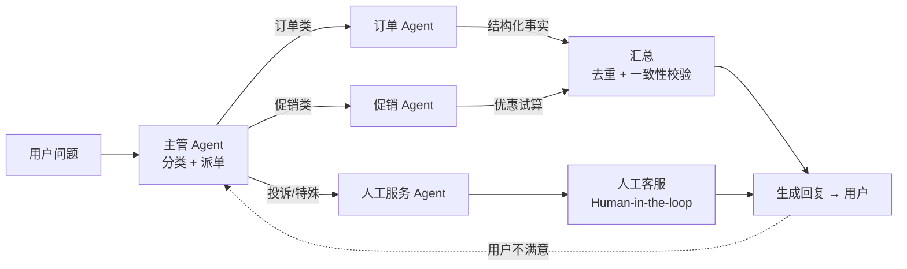
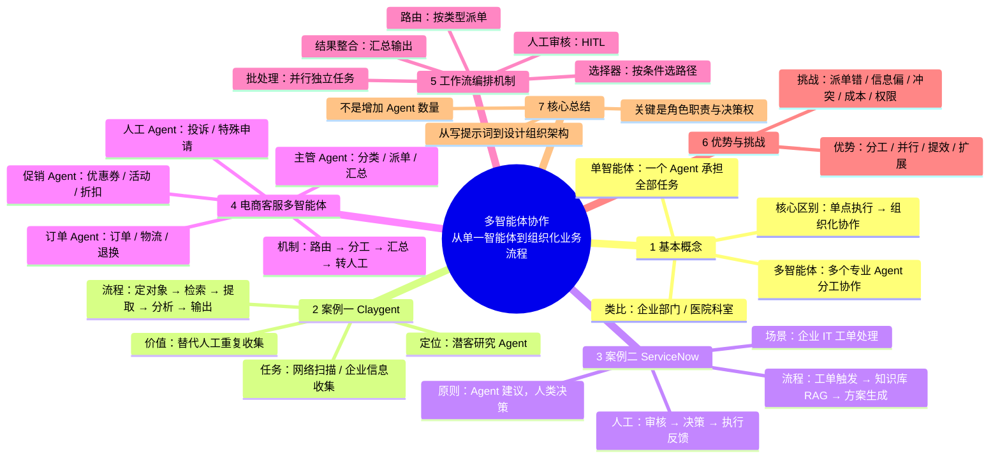

# 第 7 章 思维导图 · 多智能体协作：从单一智能体到组织化业务流程

> **课程**：信息系统分析与设计（ISAD）　**章节**：第 7 章 复杂工作流与多智能体系统
> **用途**：课堂展示 · 知识复习 · 项目讨论时的"一页纸全局图"
> **形式**：一张完整的中文思维导图（矢量 SVG + 高清 PNG），文末附可编辑的 Mermaid 结构源

---

## 一、导图总览

*彩色思维导图（2600 × 1560，PNG 为 2 倍高清图，SVG 可无损放大或改字）。中心为「多智能体协作」，左右共 7 条主分支：左侧是**应用案例**与**技术机制**（橙色、绿色、琥珀色），右侧是**基本概念、两个典型案例与核心总结**（蓝灰、青色、紫色、深灰）。*

### 阅读路径（建议按此顺序看）

| 步 | 分支 | 一句话 | 颜色 |
| --- | --- | --- | --- |
| 1 | ① 基本概念 | 从"一个 Agent 全包"到"多个 Agent 分工" | 蓝灰 |
| 2 | ② 案例一 Claygent | 潜客研究：扫描网络、收集企业信息、输出研究结论 | 青色 |
| 3 | ③ 案例二 ServiceNow | IT 工单：知识库 RAG 出建议，**人来决策** | 紫色 |
| 4 | ④ 应用案例 · 电商客服 | **重点**：主管 Agent 派单给订单/促销/人工三个专家 | 橙色 |
| 5 | ⑤ 工作流编排机制 | 批处理、选择器、路由、HITL、结果整合——**节点不是角色** | 绿色 |
| 6 | ⑥ 优势与挑战 | 分工带来效率，也带来派单错误与协作成本 | 琥珀 |
| 7 | ⑦ 核心总结 | 不是"加 Agent"，而是"设计组织架构" | 深灰 |

---

## 二、七个分支要点速记

### ① 基本概念

| 模式 | 谁干活 | 特点 | 类比 |
| --- | --- | --- | --- |
| 单智能体 | 一个 Agent 承担全部任务 | 简单、可控，但复杂任务容易"顾此失彼" | 一人公司，什么都要自己干 |
| 多智能体 | 多个专业 Agent 分工协作 | 专业分工、并行处理，但需要编排与治理 | 企业部门 / 医院科室 |

**核心区别**：从**单点执行**转向**组织化协作**——难点不在"多"，而在"怎么组织"。

### ② 案例一：Claygent（潜客研究）

- **定位**：面向潜在客户研究的智能体。
- **任务**：网络信息扫描、企业信息收集、潜客研究。
- **流程**：确定研究对象 → 网络信息检索 → 信息提取 → 潜客分析 → 输出研究结果。
- **价值**：把销售/市场人员"翻网页、抄公司信息"的重复劳动交给机器。

### ③ 案例二：ServiceNow AI Agents（IT 工单）

- **场景**：企业 IT 服务工单处理。
- **流程**：工单触发 → 知识库 RAG 检索 → 获取相关解决方案 → 智能体生成处理建议 → **人类工作人员审核与决策** → 执行处理并反馈。
- **关键原则**：智能体负责辅助分析与建议，**人类保留最终决策权**。

### ④ 应用案例：电商客服多智能体协作（重点展开）

| 角色 | 职责 | 典型输入 | 输出 | 无法处理时 |
| --- | --- | --- | --- | --- |
| **主管 Agent** | 接收用户问题、识别问题类型、分配任务、整合结果 | 用户原始问题 + 上下文 | 派单指令 / 最终回复 | 无法分类时自问一轮澄清 |
| **订单 Agent** | 查询订单状态、物流信息、退换货规则 | 订单号、用户 ID | 结构化订单事实 | 信息缺失 → 回传主管 |
| **促销 Agent** | 查询优惠券、活动规则、折扣计算 | 商品、会员、活动 | 可用优惠与试算结果 | 规则冲突 → 转人工 |
| **人工服务 Agent** | 处理复杂投诉、特殊申请及需人工判断的问题 | 转接工单 + 对话摘要 | 人工处理结论 | 升级主管/主管经理 |

**协作机制**：任务分类与路由 → 专业智能体分工 → 结果汇总与反馈 → 无法处理的问题转交人工。

### ⑤ 工作流编排机制（技术分支，**不是智能体角色**）

| 机制 | 作用 | 本导图中的例子 | 常见误区 |
| --- | --- | --- | --- |
| 批处理 Batch | 并行处理多个**相互独立**的任务 | 一次生成 100 张商品文案 | 误当成一个"文案 Agent" |
| 选择器 Selector | 根据输入条件选择执行路径 | "能答 / 转人工"的分流 | 误当成"路由 Agent" |
| 路由 Routing | 按问题类型把任务分配给对应智能体 | 订单→订单 Agent、促销→促销 Agent | 与选择器混为一谈 |
| 人工审核 HITL | 在关键环节保留人工确认权 | 退款、超预算、涉密图案 | 误以为"AI 全自动" |
| 结果整合 | 汇总多个智能体的处理结果 | 多 Agent 返回后统一口径 | 误以为可以简单拼接 |

> 一句话：**批处理与选择器是"流水线的阀门与传送带"，不是"工位上的工人"。**

### ⑥ 优势与挑战

| 维度 | 内容 |
| --- | --- |
| 优势 | 专业分工、并行处理、提高效率、便于扩展（新增一个专家 Agent 不影响其他） |
| 挑战 | 任务分配错误、信息传递偏差、结果冲突、协作成本上升、权限与安全问题 |

### ⑦ 核心总结

1. 多智能体**不是简单地增加智能体数量**；
2. 关键在于明确**角色、职责、协作关系和决策权限**；
3. 从"写提示词"升级到"**设计组织架构**"；
4. 从"单一工具使用"升级到"**业务流程设计**"。

---

## 三、三个案例不要混为一谈

| 维度 | Claygent | ServiceNow AI Agents | 电商客服多智能体 |
| --- | --- | --- | --- |
| 领域 | 销售/市场：潜客研究 | 企业 IT 服务 | 电商售后 |
| 主要动作 | 网络扫描 + 信息提取 + 分析 | 工单触发 + 知识库 RAG + 建议生成 | 分类派单 + 多专家协作 + 汇总 |
| 是否有多个 Agent | 以单体为主（扫描+分析流水线） | 以单体为主（工单流程助手） | **是，主管 + 3 个专业 Agent** |
| 人的位置 | 人使用研究结论 | **人审核并做最终决策** | 复杂问题转人工，人工兜底 |
| 与本导图的关系 | 说明"能自动收集信息" | 说明"建议与决策分离" | 说明"组织化协作" |
| 易混点 | 不要与"客服"混为一谈 | 不要与"完全自动"混为一谈 | 不要与"单个万能 Agent"混为一谈 |

---

## 四、必须记住的一条原则

> **智能体负责辅助分析与建议，人类保留最终决策权。**

对应到导图上有三处体现：③ ServiceNow 分支的"人类审核 → 决策 → 执行反馈"、④ 电商客服分支中虚线框的"人工审核（HITL）· 最终决策"、以及底部的橙色原则横幅。落到系统设计上就是：**高影响、不可逆、涉权限的动作必须由人确认**，且系统要留下可审计的确认记录。

---

## 五、与教材第 7 章的对应关系

| 导图分支 | 教材位置 | 关键概念 |
| --- | --- | --- |
| ① 基本概念 | 7.3 多 Agent 模式、7.4 多 Agent vs 工作流 | 父 Agent 调度、子 Agent 专长、跳转机制 |
| ② Claygent / ③ ServiceNow | 第三部分"知识拓展与前沿"生产级 Agentic Workflow | 生产级案例、建议与决策分离 |
| ④ 电商客服 | 案例 · 电商客服多智能体协作 | 主管按问题类型派单，复杂业务拆给专家 |
| ⑤ 编排机制 | 7.1 业务逻辑节点家族 | 选择器、批处理、循环、代码节点、变量聚合 |
| ⑤ 结果整合 | 7.1 变量聚合、7.5 组合落地 | "取首个非空值"避免分支读空 |
| ⑥ 优势与挑战 | 7.3 MetaGPT vs AutoGen、7.4 选型 | SOP 流水线 vs 对话驱动；灵活性与调试成本 |
| ⑦ 核心总结 | 本章小结 | 模块化、组织化、可治理 |

---

## 六、附：可编辑的 Mermaid 结构源

> 说明：Mermaid 的 mindmap 渲染器会自动分配配色，因此**正式展示请用上方 PNG/SVG**；下面的源码用于二次编辑（改字、增删分支）与版本管理。把代码复制到 Mermaid Live Editor 即可重新渲染。

## 七、附：源文件与使用建议

| 文件 | 用途 |
| --- | --- |
| `assets/mindmap.png` | 2 倍高清位图，适合插入 Word/PPT、微信发送 |
| `assets/mindmap.svg` | 矢量源，适合打印 A3/A2、投影、或改字改色 |

**使用建议**：

1. **课堂展示**：投影时先只显示中心节点与 7 个分支标题，逐条展开讲；讲到 ④ 时切到流程图，讲"主管派单 → 并行处理 → 汇总 → 人工兜底"。
2. **复习自测**：遮住子节点，只留 7 个一级分支，尝试复述每支的 3—5 个关键词。
3. **项目讨论**：把"⑥ 优势与挑战"当检查表——你的方案是否明确了角色、职责、协作方式与决策权？
