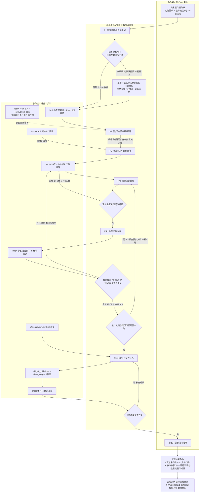
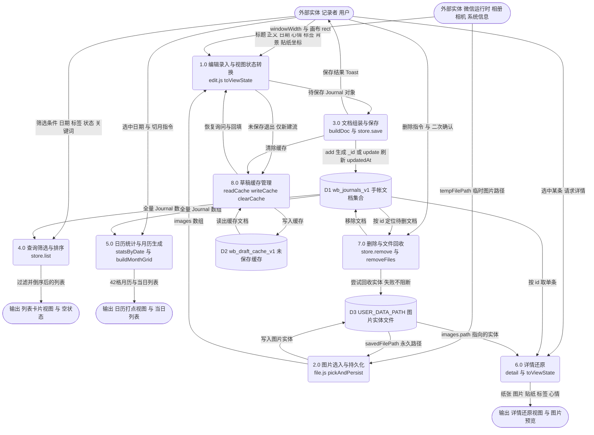
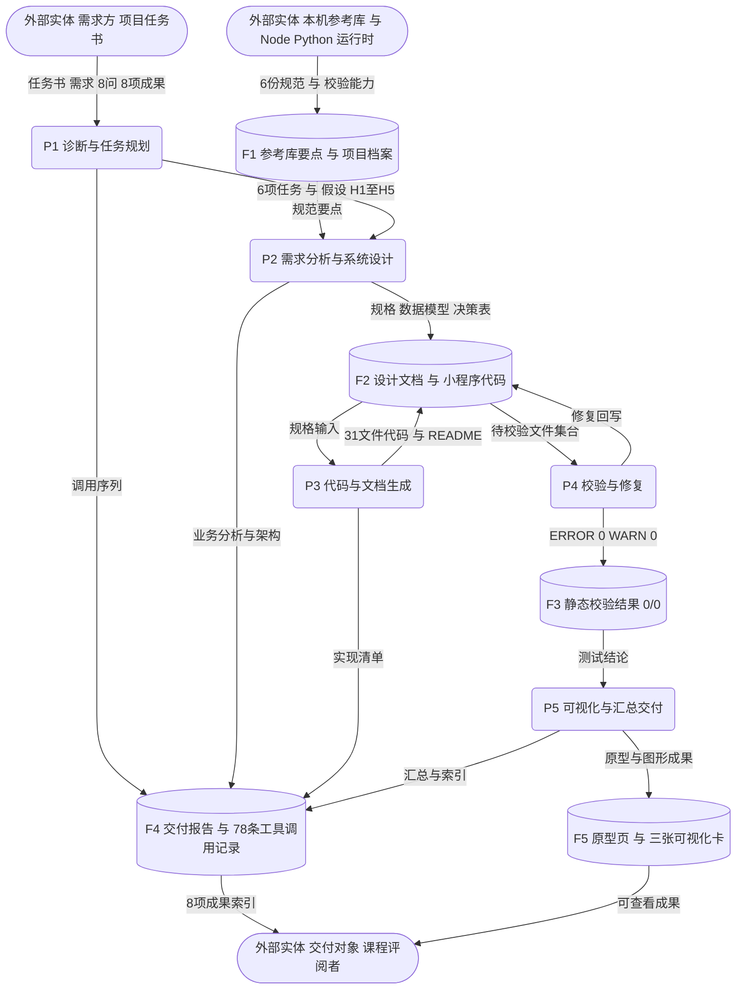

# 业务流程与数据流分析报告

## 作业基本信息

| 项目 | 内容 |
|---|---|
| **作业名称** | 《信息系统分析与设计》课程作业：业务流程分析与数据流分析 |
| **项目名称** | 拾光手帐 · 电子手帐微信小程序（v1.0 基础版） |
| **课程名称** | 信息系统分析与设计 |
| **报告日期** | 2026-11-06 |
| **技术栈** | 微信原生 WXML / WXSS / JavaScript / JSON；本地 Storage 持久化 |
| **分析依据** | 本会话已完成的开发任务、需求分析与系统设计文档、78 条真实工具调用记录、生成的项目代码与静态校验结果 |
| **姓名 / 学号 / 班级** | （提交时由本人填写；本报告不填写，不虚构个人信息） |
| **文档版本** | v1.0 |

> 本报告是对**已完成开发任务**的分析与整理，不重新执行开发、不重复生成代码。所有结论均来自本会话中真实存在的文件与调用记录；凡记录未载明者，一律标注「当前记录中无法确认」。

---

## 分析对象界定与证据来源

本报告涉及两个层次的系统，先作界定以免混淆：

| 层次 | 名称 | 在本报告中的角色 |
|---|---|---|
| 层次一 | **开发交付系统**：需求方 + AI 智能体 + 外部工具链 | 第一部分业务流程分析的主要对象；第三部分第 1 题业务流程图所描述的对象 |
| 层次二 | **目标信息系统**：被交付的「拾光手帐」小程序 | 第二部分数据流分析的主要对象；第三部分第 2 题数据流图主图所描述的对象 |

层次一的产出物（31 个文件的可运行项目与三份分析文档）正是层次二被分析的系统；层次一的流程记录又成为第三部分工具清单的证据。

**证据来源（均为本会话已生成的真实产物）：**

| 编号 | 证据 | 主要内容 |
|---|---|---|
| E1 | `01_需求分析与系统设计.md` | §0 假设、§1 需求、§2 业务流程 8 问、§3 架构、§4 数据存储、§5 核心逻辑、§6 技术限制 |
| E2 | `02_交付报告.md` | §6 共 78 条真实工具调用记录、§7 数据流图文字版与三方一致性对照、§8 测试结论与未测项 |
| E3 | `小程序项目档案.md` | 开发阶段位置与待办清单 |
| E4 | `journal-miniapp/`（31 文件 / 148KB） | `utils/store.js`、`utils/file.js`、`pages/edit/edit.js` 等实际代码 |
| E5 | `preview.html`（36KB / 33,798 bytes） | 4 屏可交互浏览器原型 |
| E6 | 对话内三张可视化卡片 | 功能模块思维导图、核心业务流程图、智能体执行数据流图（图形版） |

**口径与边界声明：**

1. 工具调用记录以 E2 §6.3 已归档的编号 **#1–#78** 为准（外部能力调用 61 次、内部任务编排 17 次）。整理本报告期间发生的读取、写入、校验与呈现调用不改变被分析的项目代码，按口径不并入该编号序列，也不改写 78 次的总数。
2. 下列事项**当前记录中无法确认**，本报告不作推测性补写：真实工时与费用、token 消耗、工具调用的精确时间戳、并行调用的具体批次、平台底层调用日志、微信开发者工具编译与真机运行结果、Storage 与本地目录容量上限的具体数值、性能量化指标。
3. 代码层面的若干发现来自对 `store.js`、`file.js`、`edit.js` 的静态阅读，属「静态阅读发现」，**未经运行时验证**，文中已逐条注明。
4. 静态校验结果为自写脚本所得 **ERROR 0 / WARN 0**，仅说明结构与语法层面通过，不等同于编译运行通过或审核通过；E2 §8.4 已逐条列出未测项。

---

# 第一部分　业务流程分析

## 1. 有哪些业务流程？各自目的或想达到的目标是什么？

**答：** 本次开发任务中实际存在两组流程。

**（1）开发交付流程（本部分主要分析对象）。** 依据 E2 §6.2 的阶段索引，由六个首尾相接的阶段构成，触发来自用户提交的项目任务书（含功能需求、业务流程 8 问、8 项交付成果要求）。

| 流程编号 | 流程名称 | 目的 / 目标 | 成功判据 |
|---|---|---|---|
| F1 | 需求诊断与规划 | 把范围宽泛的任务书转成可执行、可追踪的工作分解，并显式标注未明确的前提 | 形成 6 项任务（#9–#14）、5 条默认假设 H1–H5 与《小程序项目档案》 |
| F2 | 需求分析与系统设计 | 把需求转成数据模型、决策表、模块划分与页面跳转规格 | 产出 `01_需求分析与系统设计.md`（32KB，#17） |
| F3 | 代码与文档生成 | 把规格转成可导入微信开发者工具的项目 | 产出 `journal-miniapp/` 31 文件（#21–#53、#60） |
| F4 | 校验与修复 | 验证结构与语法正确性，保证文档与实现口径一致 | 静态校验 ERROR 0 / WARN 0（#61）；修复 F1–F6 共 6 处（#54–#59） |
| F5 | 可视化与交付汇总 | 把分散产物组织成可查看、可提交的成果集合 | 三张可视化卡片（#66–#68）、`preview.html`（#64）、`02_交付报告.md`（#76） |
| F6 | 后续联调与提审（**未执行**） | 在真实运行时验证并上线 | E2 §8.4 明确列为未完成，本轮不作为已达成的流程 |

**（2）产品运行时业务流程（被开发对象）。** E1 §1.2 归纳出 8 项业务活动与三条主线：

| 主线 | 活动 | 用户目标 |
|---|---|---|
| 写入流 | A4 创建、A5 编辑、A6 保存 / 存草稿 | 把当下生活与心情变成一篇带装饰、且不会丢失的记录 |
| 组织流 | A1 浏览、A2 按日期查阅、A3 按标签分类、A7 删除 | 快速定位、整理与清理既有记录 |
| 消费流 | A8 回顾详情 | 按编辑时的版式还原纸张、图片与贴纸，实现沉浸式回顾 |

三条主线的总体目标是：以「一次录入、多处复用」的方式替代纸质手帐，同时保留拼贴装饰的审美体验（E1 §1.1）。

---

## 2. 这个业务流程是如何完成的？有哪些任务并经过哪些步骤完成？活动执行（开始、结束）的条件是什么？

**答：**

### 2.1 开发交付流程的步骤与起止条件

| 阶段 | 任务与步骤（按真实调用顺序） | 开始条件 | 结束条件 |
|---|---|---|---|
| P1 诊断与规划（#1–#15） | ① `Skill` 加载参考库索引 → ② `Bash` 检查工作区与参考目录 → ③ `Read` 逐份读取 6 份参考（项目结构、组件模板、业务场景、合规、云开发、性能优化）→ ④ 四维诊断闸门 → ⑤ `TaskCreate`×6 建立任务 → ⑥ `TaskUpdate` 置 #1 进行中 | 收到项目任务书 | 6 项任务建立、假设 H1–H5 写入档案与设计文档 |
| P2 分析与设计（#16–#19） | `Write` 建档 → `Write` 输出需求分析与系统设计全文 → 关闭任务 #1、#2 | P1 产物（参考库要点 + 任务列表）已入上下文 | `01` §0–§8 覆盖任务书 §三 的 8 个问题与 §四 的 7 项设计任务 |
| P3 实现（#20–#31、#33–#53、#60） | `Bash mkdir` 建 9 个目录 → 写根配置 5 个 → 写 `styles/paper.wxss` 与 `app.wxss` → 写 4 个 utils → 写组件四件套 → 写 4 个页面各四件套 → 写 `README.md` | 目录存在、数据模型与 DAO 接口签名已定义 | 31 个文件落盘，`app.json` 注册的 4 个页面四件套齐全 |
| P4 校验与修复（#54–#59、#61） | 代码通读自检 → 3 处代码 `Edit`（移除 `libVersion`、修正 `removeFiles` 条件、拆分 `wx:for`/`wx:if`）→ 3 处文档 `Edit` 反向同步 → `Bash` 运行自写 Python 静态校验脚本 | P3 代码可读 | ERROR 0 / WARN 0，且设计文档 §2.2 / §2.3 / §5.2 与 `edit.js onUnload` 口径一致 |
| P5 可视化与交付（#62–#78） | `Write` 原型页 → `widget_guidelines` 加载规范 → `show_widget`×3 → `Bash` 校验内联 JS 并统计体积 → 更新档案 3 处 → `Write` 交付报告 → `TaskUpdate` 收尾 → `present_files` 呈现 | P4 校验结果、P1–P4 的完整调用序列可用 | 8 项成果齐全、任务 #6 完成、结果已呈现 |

**全流程开始条件**：需求方提交项目任务书（E1 §0.1 记载任务书已覆盖功能、页面、业务流程、交付物）。
**全流程结束条件**：8 项成果交付齐全 + 静态校验 0 error / 0 warn + 调用记录、数据流图与业务分析完成三方对照（E2 §7.1）。
**明确的排除项**：E2 §8.4 已注明微信开发者工具编译、真机权限、`saveFile` 重启持久化、iOS/Android 渲染差异、长列表压测、提审合规实测**均未执行**，因此「流程结束」不等于「系统已上线或已通过审核」。

### 2.2 产品运行时流程的步骤与起止条件（E1 §2.2）

- **创建流**：首页 tab → 点「＋写手帐」→ `edit?mode=create` → 若存在 `draft_cache` 则询问恢复 → 初始化空白文档 → 逐项录入 → 点「保存」或「存草稿」→ `store.save` → 清缓存 → Toast → 返回或跳详情。开始条件：用户进入首页并触发新建；结束条件：文档写入 `wb_journals_v1` 并返回。
- **编辑流**：长按菜单或详情页「编辑」→ `edit?mode=edit&id` → `store.get(id)` 回填 → 改动标记 `_dirty` → 保存走 update 分支 → 返回，各页 `onShow` 重读。开始条件：`id` 查得到；查不到则 Toast 并返回（E1 §2.3）。
- **保存流**：显式保存要求标题或正文至少一项非空；显式存草稿不校验内容；意外退出时仅当 `mode=create && _dirty && !_saved` 写 `draft_cache`。
- **删除流**：长按或详情页触发 → `wx.showModal` 二次确认 → `store.remove` → 尝试回收图片实体 → Toast → 刷新 / 回首页。结束条件：文档从数组移除且写回成功。

---

## 3. 这个业务流程有谁参与？各自完成流程中的哪些活动？

**答：**

### 3.1 开发交付流程的参与者

| 参与者 | 类型 | 承担的活动 | 证据 |
|---|---|---|---|
| 需求方 / 用户 | 外部实体（人） | 提交项目任务书；接收并查看交付结果 | 任务书原文；`#78 present_files` |
| AI 智能体 | 主要执行者 | 诊断、拆解任务、作默认假设、写设计与代码、通读自检、撰写报告、决定修复与口径同步 | E1 §0.1；E2 §6.5 |
| 参考库（专家知识） | 外部知识源 | 提供项目结构、组件模板、合规、云开发、性能等规范 | `#1 Skill`、`#3–#8 Read` |
| 文件与校验工具 | 外部工具 | `Read`/`Write`/`Edit` 读写文件；`Bash` 建目录、运行静态校验、统计体积 | E2 §6.3 |
| 可视化与呈现工具 | 外部工具 | 加载设计规范、渲染三张图、呈现交付文件 | `#65–#68`、`#78` |
| 内部任务编排 | **不属于外部参与者** | `TaskCreate`/`TaskUpdate` 仅改变智能体内部状态，不读写用户文件、不访问外部系统 | E2 §6.5 |
| 微信开发者工具 / 真机 / 审核方 | **本流程未参与** | 编译、真机验证、提审均列为未执行 | E2 §8.4、E1 §7 |

**需要特别说明的事实**：E1 §0.1 记载「需求描述已覆盖功能、页面、业务流程、交付物，信息充足，按专家规则『先给一版并显式标注假设』，不打断执行流程」。也就是说，本流程中**需求方没有参与假设确认或阶段评审**这一活动；H1–H5 由智能体单方作出并记录。需求方事后是否认可这些假设，**当前记录中无法确认**。

### 3.2 产品运行时的参与者

| 参与者 | 承担的活动 |
|---|---|
| 记录者（终端用户） | 录入文本与元信息、选图、拖动贴纸、保存/存草稿、筛选查询、删除确认、回顾 |
| 小程序视图层与页面逻辑层 | 渲染、表单状态维护、路由、交互反馈 |
| `utils/store.js`（唯一数据入口） | 增查改删、统计聚合、草稿缓存读写 |
| 微信运行时 | 提供 `chooseMedia`/`chooseImage`、Storage、`FileSystemManager`、`previewImage`、`SelectorQuery`、系统信息 |
| 本地文件系统（用户目录） | 保存图片实体文件 |

本版**无服务端、无登录、无管理员、无其他用户、无第三方 API**（E1 §0.2 H2、E1 §2.6），参与者集合是封闭的。

---

## 4. 流程中有哪些控制流（如判断、同步分支与会合等）？多个不同流程之间有什么关系？

**答：**

### 4.1 开发交付流程的控制流

| 类型 | 判断 / 分支 | 实际走向 | 依据 |
|---|---|---|---|
| 判断（诊断闸门） | 项目类型、技术栈、后端方案、当前阶段四维是否明确 | 前三维明确；**后端方案未明确** → 走默认假设 H1（本地 Storage）并写入档案，不中断流程 | E1 §0.1 |
| 判断（修复回路） | 代码通读是否发现疑似问题 | 是 → 3 处 `Edit`（#54–#56）；随后才运行静态校验 | E2 §8.3 明确 F1–F3 是主动通读发现，非工具报错触发 |
| 判断（校验回路） | 静态校验 ERROR / WARN 是否 > 0 | 本轮结果为 0 / 0，**「非零 → 回修复」分支设计存在但本轮未触发**（不得记为已执行） | E2 §8.2 |
| 判断（一致性回路） | 设计文档与实现口径是否一致 | 否 → 3 处反向 `Edit` 同步（#57–#59），属于**实际发生的反馈回路** | E1 §5.2、E2 §8.3 F4–F6 |
| 状态机 | 6 个任务 `pending → in_progress → completed` | 11 次 `TaskUpdate` 顺序推进 | E2 §6.3 |
| 同步分支 | 6 份参考文件读取结果会合到 P2 设计文档与 P3 代码 | 汇合点为 `#17` 与 `#22–#53` | E2 §6.4 |
| 同步分支 | 四页四件套 + 组件 + utils 会合到静态校验 | 汇合点为 `#61` | E2 §6.4 |
| 同步会合 | 校验结果 + 调用序列 + 三张图节点语义会合到交付报告 | 汇合点为 `#76` | E2 §6.4、§7.1 |
| 顺序分支 | 三张可视化图共享一次规范加载后顺序生成 | `#65 → #66 → #67 → #68` | E2 §6.3 |

### 4.2 产品运行时的控制流

E1 §2.3 决策表列出 13 条判断，主要包括：`mode` 为 create / edit；`draft_cache` 是否存在及是否恢复；保存时内容是否为空；`_id` 是否存在决定 add / update；按钮类型决定 `status`；`wx.canIUse('chooseMedia')` 决定选图 API 分支；`saveFile` 成功/失败分支；删除 Modal 确认/取消；筛选结果是否为空；贴纸坐标是否越界（clamp）；`onShow` 触发重读。

### 4.3 多个流程之间的关系

```
开发交付流程：  P1 → P2（规格）→ P3（实现）→ P4（校验）→ P5（交付）
                     ↑___________________________↓  P4 反向回写 P2 文档（#57–#59）

产品运行时：    写入流 ──产出 journals[]──▶ 组织流 ──选中某条──▶ 消费流
                    ▲                          │                    │
                    └────── 详情/列表再进入编辑 ──┘                    │
                日历打点 ←── statsByDate() 与列表同源，无双写            │
                删除流 ──▶ 同时影响 journals[]、打点数据、图片实体、draft_cache
```

两层流程之间还有一个耦合点：P2 的 §2 / §4 是 P3 的规格输入，而 P3 的实现细化（「意外退出缓存仅新建流启用」）又反向修订 P2，形成一条跨层次反馈边（E2 §6.4）。E1 §2.6 说明产品侧三条主线统一经 `store.js` 单入口读写，页面靠 `onShow` 重读同步，不依赖跨页事件总线，因此「写完列表立刻能查到、删完日历立刻掉点」。

---

## 5. 流程用了哪些方式或手段来完成？

**答：**

### 5.1 开发交付流程的手段

| 手段 | 具体做法 | 对应的实际问题 |
|---|---|---|
| 参考库驱动 | `Skill` 先取索引，再有选择地 `Read` 6 份规范 | 避免凭通用印象臆造 `app.json` 字段、审核规则与性能做法 |
| 显式假设 + 二选一对比 | H1–H5 写入档案；E1 §0.2 给出「本地 Storage vs 云开发」9 维对比表 | 需求方未指定后端，先给一版可运行方案，同时保留切换路径 |
| 工作分解与状态机 | 6 项任务 + 11 次状态推进 | 使 78 次调用可归入 P1–P5 阶段，便于追溯 |
| 分层架构与单点封装 | 视图 / 页面逻辑 / 业务服务 / 存储四层；页面**禁止**直接调 `wx.setStorageSync`，一律经 `store.js` | 保证列表与日历同源；云开发迁移只改一个文件 |
| 零外部依赖策略 | 背景用 7 款纯 CSS 纸纹、贴纸用 Emoji、tabBar 用纯文字 | 无 AppID、无云环境、无素材、无 npm 也能导入编译 |
| 自写静态校验脚本 | Python 扫描器覆盖 10 个 JS `node --check`、8 个 JSON、页面四件套、`usingComponents`、`@import`/`require`、5 个 WXML 标签闭合、`wx:for`+`wx:if` 同标签歧义 | 在没有微信开发者工具的环境里取得可核查的质量结论 |
| 双向文档同步 | 代码细化后 3 处 `Edit` 回写设计文档 | 保持业务分析与实现一致（E2 §8.3 F4–F6） |
| 双通道预览 | 对话内 SVG 可视化卡片 + 浏览器 4 屏交互原型 `preview.html` | 无运行时也能展示界面与分析结论 |
| 边界声明 | E2 §8.4 逐条列出未测项；E1 §6 对未核实的官方数值标注「需核实」 | 避免把静态校验通过表述为已上线、已过审 |

### 5.2 产品运行时的手段

WXML 数据绑定与 `wx:for` 条件渲染、`picker`/`input`/`textarea` 采集、`chooseMedia` 能力检测与 `chooseImage` 降级、`saveFile` 持久化临时图片、`SelectorQuery` 取画布 rect、touch 事件配合局部路径 `stickers[i].x/y` 更新、`statsByDate()` 一次遍历生成打点 map、`onShow` 重读数据、`showModal` 二次确认、`sitemap.json` 全站 disallow 保护隐私。

---

## 6. 完成任务所用的资源（物理、人力、知识）及其成本如何？流程各环节的增值作用如何？

**答：**

### 6.1 资源清单

| 类别 | 本任务实际使用的资源 | 未使用的资源 |
|---|---|---|
| 物理 / 计算 | 本地文件系统；`Bash`（mkdir、`node --check`、Python3 扫描器、`du`）；浏览器（打开 `preview.html`）；工作区产出 31 文件 / 148KB 项目、32KB 设计文档、36KB 原型、交付报告与档案 | 微信开发者工具、真机、云开发环境、AppID（测试号除外）、服务器域名、外部图片/字体素材、npm 依赖 |
| 人力 | 需求方 1 人（提交任务书）、智能体 1 个（承担分析、设计、编码、自检、文档、呈现） | 无独立 UI 设计师、测试工程师、后端工程师、运维人员 |
| 知识 | 6 份实际读取的专家参考库（项目结构配置、组件页面模板、业务场景模板、审核合规、云开发、性能优化）；微信小程序框架与 WXML/WXSS 约束；分层架构与 DAO 设计；Node/Python 静态校验；Mermaid/SVG 可视化 | 8 份参考库中的另 2 份未被读取（具体是哪两份及其内容，**当前记录中无法确认**） |

### 6.2 成本

**可从记录中确认的量化成本：**

| 指标 | 数值 | 依据 |
|---|---|---|
| 工具调用总数 | 78 次（外部 61 + 内部编排 17） | E2 §6.3 精确计数表 |
| 按类型 | `Write` 35、`TaskUpdate` 11、`Edit` 9、`Read` 7、`TaskCreate` 6、`Bash` 4、`show_widget` 3、`Skill` 1、`widget_guidelines` 1、`present_files` 1 | 同上 |
| 生成文件 | 小程序项目 31 个 + 工作区文档与原型若干 | E2 §8.1 |
| 返工成本 | 代码修复 3 处 + 文档同步 3 处 = 6 次 `Edit` | E2 §8.3 |
| 质量结果 | ERROR 0 / WARN 0 | E2 §8.2 |

**当前记录中无法确认的成本项**：真实 wall-clock 工时、各次调用的时间戳与耗时、模型推理与 token 消耗、费用金额、并行调用的具体批次划分。E2 §6.1 说明记录按「真实发起顺序编号，同一消息内并行发起的调用按排列顺序编号」，但未记录时刻；平台侧的模型推理、HTTP 传输、工具内部子调用与鉴权调度日志本会话无法获取。因此本报告不给出任何工时或费用数字。

### 6.3 各环节的增值作用

| 环节 | 输入形态 → 输出形态 | 增值性质 |
|---|---|---|
| P1 诊断与规划 | 自然语言任务书 → 6 项任务 + 5 条显式假设 + 参考库要点 | **消歧增值**：把「后端未明确」转成可执行的默认决策并记录风险 |
| P2 分析与设计 | 任务书 + 参考规范 → 14 项需求矩阵、8 项活动、13 条决策表、文档模型、DAO 接口 | **规格化增值**：把模糊愿望转成可实现、可验收的字段与分支 |
| P3 实现 | 规格 → 31 文件可运行代码 + 4 屏原型 | **实现增值**：产生唯一真正可交付使用的资产 |
| P4 校验与修复 | 代码 → 修复后的代码 + 0/0 校验结论 + 同步后的文档 | **质量与一致性增值**：使「能跑」变为「有证据地可核查」 |
| P5 可视化与汇总 | 分散文件 + 调用序列 → 8 项成果索引、3 张图、交付报告 | **可用性增值**：使成果可被查阅、可被提交、可复盘 |

**增值较弱或属于开销的环节**：P2 先行定稿导致 P4 需 3 次反向同步（返工）；`preview.html` 与真实 WXML/WXSS 是两套独立实现（重复劳动，且无自动一致性校验）；17 次内部任务编排只改变状态、不产生可验收产物；35 次细粒度 `Write` 带来调用开销，但换来了逐文件可追溯性——这是效率与可追溯性的取舍，而非纯粹浪费。

---

## 7. 流程中是否存在瓶颈或阻塞排队现象？

**答：** 分两类说明，并区分「记录中已实际发生的阻塞」与「设计文档已识别但未经量化的潜在风险」。

### 7.1 已实际发生的阻塞 / 排队

| # | 现象 | 性质 | 证据 |
|---|---|---|---|
| B1 | **无微信开发者工具与小程序运行时**，编译、真机权限、`saveFile` 重启持久化、多机型渲染差异、长列表压测、提审均无法执行 | 环境资源缺失造成的**硬阻塞**，流程在此形成未闭合的出口；交付结论只能停留在静态校验 | E2 §8.4；E1 §6 L10 |
| B2 | 串行依赖链：`mkdir`（#21）→ 35 次 `Write` → 静态校验（#61）→ 报告（#76）→ 呈现（#78），后一步必须等前一步产物落盘 | 关键路径长，无法整体并行 | E2 §6.4 |
| B3 | 文档先行造成返工排队：P2 定稿 → P3 细化 → P4 发现口径不一致 → 3 次 `Edit` 回写 | 反馈型返工 | #57–#59、E2 §8.3 F4–F6 |
| B4 | 三张可视化图共享一次规范加载（#65）后顺序渲染（#66–#68） | 共享前置资源形成的顺序约束 | E2 §6.3 |
| B5 | 原型页与小程序代码两套实现，只校验了原型内联 JS 语法（#69），未校验视觉一致性 | 结果一致性无法闭环 | E2 §8.2 T8 |
| B6 | 假设 H1–H5 未见需求方确认动作即进入 P3 | 若假设有误，错误会在编码之后才暴露，返工成本高 | E1 §0.1 |

### 7.2 产品运行时的潜在瓶颈（E1 §2.7 已识别，本轮未量化）

| # | 环节 | 现象 | 本版对策 |
|---|---|---|---|
| P1 | 选图 | 大图占内存、临时路径重启失效、本地目录容量上限 | 压缩选图、`saveFile`、`lazy-load` |
| P2 | 贴纸拖动 | 每次 `touchmove` 全量 `setData` 会卡顿 | 局部路径更新 + 坐标 clamp |
| P3 | 长列表 | 篇数增多后首页一次性渲染变慢 | `wx:key` + 卡片局部更新；分页/虚拟列表列入待办 |
| P4 | 日历切月 | 每次重算 42 格 + 扫描全量文档 | `statsByDate()` 一次遍历生成 map，切月 O(42) |
| P5 | 反复进出页面 | `onShow` 触发全量同步 `readAll()` | 数据量小可接受 |
| P8 | 兼容 | 低基础库无 `chooseMedia`、iOS/Android 渐变差异 | `wx.canIUse` 降级；真机复核列为未测 |

**代码阅读补充发现（静态阅读，未经运行时验证）**：`utils/file.js` 的 `pickAndPersist()` 用 `for` 循环逐个 `await persist(temps[i])`，配合 `edit.js onAddImage` 的 `wx.showLoading({ mask: true })`，多图选入时会形成**用户可感知的排队与界面阻塞**：用户在处理完成前无法操作，且图片越多等待越久。这是本次实现中最具体的排队现象。

**当前记录中无法确认**：上述瓶颈的量化程度（帧率、`setData` 耗时、Storage 容量上限具体数值、200 篇压测结果），因为 E2 §8.4 已明确长列表与多图压测、真机手感测试未执行。

---

# 第二部分　数据流分析

> 本部分以被交付的「拾光手帐」小程序为分析主体；每题末尾必要时给出开发交付系统的对照说明。

## 1. 系统作为信息处理器主要完成什么功能？最重要的输入和输出数据是什么？

**答：** 系统的本质是一个「**非结构化生活记录 → 结构化文档 → 多视图重组输出**」的本地信息处理器：把用户在编辑页输入的内容与装饰元素组装为统一的 `Journal` 文档，写入本地存储，再按列表、日历、详情三种视图重新组织后呈现。系统不产生新的事实性数据，只做格式转换、条件过滤、排序与聚合。

| 项 | 内容 |
|---|---|
| **最重要输入** | ① 编辑页表单与装饰数据：`title`、`content`、`date`、`mood`、`tags[]`、`background`、`stickers[{id,emoji,x,y,rotate}]`；② 相册/相机返回的 `tempFilePath`（经 `saveFile` 变为 `savedFilePath`）；③ 用户的查询意图：`filterDate`、`filterTag`、`filterStatus`、`keyword`、日历选中的 `date` |
| **最重要输出** | ① **持久化输出**：`wb_journals_v1` 中的 `Journal[]`（所有视图都由它派生，是系统的核心数据资产）；② **界面输出**：按条件筛选并排序后的列表卡片、42 格月历打点视图、详情页 1:1 还原的纸张与图片预览；③ **反馈输出**：Toast / Modal / 空状态引导 |
| 核心变换 | `toViewState()` 把存储文档转成视图状态（WXML 不能调 JS 函数，标签颜色/中文日期在此预处理）；`buildDoc()` 把视图状态转回文档；`store.list()` 过滤排序；`statsByDate()` 聚合；`date.buildMonthGrid()` 生成 42 格 |

**对照（开发交付系统）**：其输入是项目任务书与 6 份参考库，输出是 31 文件代码、3 份分析文档、4 屏原型与 3 张图；核心变换是「需求 → 规格 → 代码 → 校验结论 → 报告」（E2 §7 文字版数据流图）。

---

## 2. 系统作为一个整体，和外界环境存在什么关系？

**答：**

| 外部实体 | 与系统的数据交换 | 边界性质 |
|---|---|---|
| 记录者（用户） | 输入：录入内容、选图操作、筛选条件、删除确认；输出：列表 / 日历 / 详情视图、Toast / Modal 反馈 | 唯一的数据生产者与消费者 |
| 微信运行时（相册·相机·Storage·FileSystem·系统信息） | 输入：临时图片路径、`getSystemInfoSync` 的 `windowWidth`、`boundingClientRect`；输出：`saveFile` 请求、`setStorageSync` 请求、`previewImage` 请求 | 能力提供者，不产生业务内容 |
| 本地用户目录 `wx.env.USER_DATA_PATH` | 存放图片实体文件，文档中以 `images[].path` 引用 | 系统内部的持久化介质，但位于 Storage 之外 |
| 浏览器（`preview.html`） | 仅用于界面演示，**不与小程序共享数据**，原型中的操作不写入 `wb_journals_v1` | 交付辅助环境，非运行时环境 |
| 微信开发者工具 / 公众平台 / 审核规范 | 导入编译、隐私指引配置、类目与搜索收录规则 | 上线前置环境，**本轮未接入** |

**关系特征**：基础版**无服务端、无网络请求、无登录、无第三方 API、无跨设备同步**（E1 §0.2 H2、E1 §2.6），数据不出端；`sitemap.json` 主动配置为全站 `disallow`，切断微信搜索这一外部收录渠道。因此系统与外界是一条「端内闭环」关系：输入来自用户与系统相册，输出回到用户界面与本地存储。

**环境约束**：相册/相机权限需在公众平台配置「用户隐私保护指引」；本地 Storage 与用户目录存在容量上限；`chooseMedia` 有基础库版本门槛。以上三者的**具体数值或版本要求当前记录中无法确认**，E1 §6 L1/L3/L9 与 E2 §9 均已标注「需以微信官方文档核实」。

---

## 3. 系统功能复杂，是否能够分解为几个相对独立又有联系的子系统或子功能？

**答：** 可以。E1 §3.2 把系统划分为 5 个功能模块，E1 §3.1 把它们组织为 4 层架构。

| 模块 | 职责 | 主要输入 | 主要输出 | 与其他模块的联系 |
|---|---|---|---|---|
| ① 首页与浏览 | 倒序列表、近 7 天条、日期/标签/状态/关键词筛选、新建入口 | `store.list(filter)` 结果、用户筛选动作 | 卡片列表、空状态、路由参数 | 消费 ⑤ 的数据；向 ② 发 `mode=create`、向 ④ 发 `id` |
| ② 编辑创作 | 文本、元信息、背景、图片、贴纸、标签、双草稿 | 用户输入、相册临时路径、`store.get(id)` 回填 | `Journal` 文档、`draft_cache` | 向 ⑤ 提交文档；被 ③ 的「编辑」动作调用 |
| ③ 管理与检索 | 长按菜单、编辑回填、删除二次确认、标签分类、按日期查询 | 用户操作、`_id` | `save`/`remove` 调用、刷新后的视图 | 通过 ⑤ 修改数据，不直接碰 Storage |
| ④ 展示与回顾 | 详情纸张还原、图片预览、列表视图、日历打点、翻月 | `store.get(id)`、`statsByDate()`、`buildMonthGrid()` | 详情视图、42 格月历 | 与 ① 共用 `journal-card` 组件 |
| ⑤ 基础设施 | `store.js` / `date.js` / `file.js` / `constants.js` / `paper.wxss` / `app.wxss` | 原始文档、日期参数、临时路径 | 读写 Storage、图片持久化、视图模型、纸纹样式 | 被 ①–④ 共同依赖，是唯一的数据出口 |

**相对独立性的依据**：E1 §3.1 明确「页面 JS 禁止直接调用 `wx.setStorageSync`，一律经 `store.js`」；页面之间仅通过路由参数与 Storage 耦合，不使用跨页事件总线，靠 `onShow` 重读数据同步（E1 §2.6）。因此模块内部变化不会扩散，云开发迁移被约束在 `store.js` 一个文件内。

---

## 4. 分解后的子功能是否仍然很复杂，还可以划分为更细更具体的子功能吗？

**答：** 可以，且实际代码已按此粒度落地。以最复杂的「② 编辑创作」为例，E1 §3.2 已列出 5 个子功能，代码还可继续下钻到函数级：

```
② 编辑创作
├── 文本录入        onTitleInput / onContentInput（含 contentCount 计数）
├── 元信息          onDateChange / onMoodTap / onTagToggle
├── 背景            onBgSelect → background 字段 → CSS 纸纹类
├── 图片            onAddImage → file.pickAndPersist → onImageDelete / onPreviewImage
│   └── pickAndPersist 再分 4 步：能力检测 → chooseImages → saveFile → 失败降级；
│       另有 removeFiles 负责删除时回收
├── 贴纸            onStickerSelect → onStickerTouchStart / Move / End → onStickerDelete
│   └── 拖动再分：取 rect → 计算 offset → clamp → 局部路径 setData
├── 草稿            显式 onSaveDraft / 隐式 onUnload 写缓存 / onLoad 恢复询问
└── 保存            onSave → buildDoc → store.save → clearCache → 路由
```

「⑤ 基础设施」同样可细分：`store.js` 导出 8 个方法（`readAll`、`list`、`get`、`save`、`remove`、`statsByDate`、`readCache`/`writeCache`/`clearCache` 为一组三个）；`store.list()` 内部又是一条 5 步管线：`status 过滤 → date 精确匹配 → tag 包含匹配 → keyword 模糊匹配 → date/updatedAt 双键排序`（E1 §5.3，代码 `store.js` 第 37–62 行可核）。`date.js` 的日历生成可细分为「求 1 号周几 → 前置补位 → 填本月 → 补齐 42 格 → 挂打点」5 步（E1 §5.4）。

分解的终止标准是：每个子功能有明确的输入与输出，且能对应到一个函数或一个事件处理器。本次实现即以此粒度组织 `utils/` 与页面事件处理函数。

---

## 5. 每个功能或子功能的输入数据和输出数据是什么？

**答：** 下表按实际代码中的函数 / 事件处理器列出，均可在 E4 中核对。

| 子功能 | 实现落点 | 输入数据 | 输出数据 |
|---|---|---|---|
| 文档读取与回填 | `edit.toViewState(doc, mode)`；`edit.onLoad` | `store.get(id)` 返回的 `Journal` 或 `blankDoc(date)`；`options.mode`、`options.id`、`options.date` | 页面 `data`（含 `tagColors`、`tagOptions`、`moodEmoji`、`dateFullLabel`、`contentCount` 等预处理字段） |
| 选图与持久化 | `file.pickAndPersist(count)` → `chooseImages` / `persist` | 剩余可加张数、`tempFilePath` | `[{ path: savedFilePath }]`（失败时为原临时路径） |
| 图片回收 | `file.removeFiles(paths)` | `images[].path` 数组 | `removeSavedFile` 调用；跳过 `http`/`cloud://` 前缀，失败仅 `console.warn` |
| 贴纸拖动 | `edit.onStickerTouchStart/Move` | `touches[0].clientX/Y`、`boundingClientRect`、贴纸尺寸 px | 局部 `stickers[i].x/y`（clamp 后取整） |
| 文档组装 | `edit.buildDoc(status)` | 页面 `data` 全字段 + 库中原文档（保留 `_id`/`createdAt`） | 待保存的 `Journal` 对象 |
| 新增 / 更新 | `store.save(doc)` | `Journal` | 带 `_id`、`createdAt`、`updatedAt` 的文档；写 `wb_journals_v1` |
| 查询筛选 | `store.list(filter)` | `{date, tag, status, keyword}` + 全量 `Journal[]` | 过滤并倒序排序后的 `Journal[]` |
| 单条读取 | `store.get(id)` | `id` | `Journal \| null` |
| 日历统计 | `store.statsByDate()` | 全量 `Journal[]` | `{'YYYY-MM-DD': {count, mood}}` |
| 月历生成 | `date.buildMonthGrid(y, m)` | 年月 + 上一步 map | 42 个 `{day, date, inMonth, isToday, count, mood}` |
| 详情还原 | `detail` 页 | `store.get(id)` | 纸张、图片九宫格、贴纸绝对定位、标签与心情 |
| 删除与回收 | `store.remove(id)` + `file.removeFiles` | `id`、Modal 确认结果 | 从数组移除后的新集合；返回 `boolean` |
| 草稿缓存 | `store.readCache/writeCache/clearCache` | 未保存的 `Journal`（无 `_id`）；恢复/放弃选择 | 写 / 读 / 清 `wb_draft_cache_v1` |
| 视图模型辅助 | `constants.js`（`decorateDoc`、`tagColor`、`moodOf` 等，依据 #29） | 原始文档 / 标签名 / 心情键 | WXML 可直接绑定的颜色、Emoji 与展示字段 |

---

## 6. 系统中需要长期保存的数据有哪些？例如各种表格、单据、文件，这些数据如何创建、修改和使用？

**答：**

### 6.1 运行时业务数据（E1 §4.2）

| 存储 | 名称 | 内容 | 创建 | 修改 | 使用 / 销毁 |
|---|---|---|---|---|---|
| D1 | `wb_journals_v1` | `Journal[]` 主集合 | 首次显式保存（`save` 的 add 分支生成 `_id`/`createdAt`） | 每次编辑保存走 update 分支，刷新 `updatedAt`；删除时过滤移除 | `list`/`get`/`statsByDate` 读取；生命周期至卸载小程序或清缓存 |
| D2 | `wb_draft_cache_v1` | 单份未保存 `Journal`（无 `_id`） | 新建流 `onUnload` 且 `_dirty && !_saved` | 不修改，只覆盖写 | 下次新建时询问恢复；恢复 / 放弃 / 显式保存后 `clearCache` 清除。**严格说不属于长期保存数据**，是一次性恢复缓存 |
| D3 | `wx.env.USER_DATA_PATH` 图片实体 | 若干图片文件 | `saveFile` 由临时路径生成 | 不修改 | 文档 `images[].path` 引用；详情预览；删除手帐时尝试 `removeSavedFile` 回收 |

字段级规则（E1 §2.4）：`date` 为主查询键、格式固定 `YYYY-MM-DD`；`_id`/`createdAt` 创建后不变；`updatedAt` 每次更新；`status` 按按钮赋 `published`/`draft`；`tags`/`images`/`stickers` 恒为数组以避免 WXML 判空。

### 6.2 开发与交付过程中的长期保存资产

`app.json`、`project.config.json`、`sitemap.json`（项目配置）、`01` / `02` / `小程序项目档案.md`（分析知识资产）、`README.md`（运行说明）、`preview.html`（原型）。其中 E2 §6.3 的 78 条调用记录是流程复盘与本报告第三部分的数据来源。

### 6.3 静态阅读发现的数据完整性风险

`utils/store.js` 的 `writeAll()` 在写入失败时返回 `false` 并 Toast「保存失败，本地空间可能已满」，但 `save()` 第 93–94 行**未检查该返回值**，仍返回 `next`；`edit.js persistDoc()` 随后无条件 Toast「已保存」、`clearCache()` 并跳转。也就是说，写入失败时用户可能看到的是被覆盖后的成功提示，且恢复缓存已被清除。相比之下 `remove()` 第 101 行检查了 `writeAll` 返回值。此为静态阅读结论，**未在真机触发验证**。

---

## 7. 在一个业务流程中，数据来源到最后去处是否完整？

**答：** 逐条追踪主要数据链，结论是「主链闭合，但存在三处可指出的缺口与两处口径偏差」。

| 链 | 来源 → 去处 | 完整性判断 |
|---|---|---|
| ① 文本 / 元信息 | 编辑页 `input`/`textarea`/`picker` → `data` → `buildDoc` → `store.save` → `writeAll` → **D1** → `list`/`get`/`statsByDate` → 列表 / 日历 / 详情 → `remove` 从 D1 移除 | **完整**。但删除为硬删除、无回收站与归档，数据的最后去处是永久消失，属明确的设计取舍（E1 §5.6 仅做二次确认） |
| ② 图片 | 相册/相机 → `tempFilePath` → `saveFile` → `savedFilePath` → `images[].path` 写入 **D1** + 实体写入 **D3** → 详情 `previewImage` → 删除手帐时 `removeFiles` 尝试回收 D3 | **基本完整，但有两处缺口**：(a) `saveFile` 失败时 `persist()` 返回原临时路径并仍写入 D1，重启后成为悬空引用；(b) 编辑页 `onImageDelete` 只从内存 `data.images` 移除，若用户最终放弃保存，D3 中的实体文件不会被回收，形成孤儿文件 |
| ③ 草稿 | 新建流未保存退出 → `buildDoc('draft')` → `writeCache` → **D2** → 下次新建询问恢复（回填并删除 `_id`/`createdAt`/`updatedAt`，或 `clearCache`）→ 显式保存后 `clearCache` | **完整**，且仅新建流启用，避免编辑态恢复出重复文档（E1 §5.2） |
| ④ 日历打点 | **D1** → `statsByDate()` → `buildMonthGrid()` → 月历视图 | **完整**。属纯派生数据、不落盘，与列表同源，不存在双写不一致（E1 §2.6） |
| ⑤ 开发交付流程数据 | 任务书 → 6 份参考库 → 设计文档 → 31 文件代码 → 校验结果 → 交付报告 → `present_files` 呈现给需求方 | **主链完整**；但成果 2/3/7 的图形版为对话内 SVG 卡片（#66–#68），**未落盘为独立文件**，作为「可归档输出」存在缺口，脱离会话后无法直接提交 |

**两处文档与实现的口径偏差**（静态阅读发现）：

1. E1 §2.3 决策表写「`saveFile` 失败 → 退回临时路径 + Toast 提示『重启后可能失效』」；实际 `file.js persist()` 的 fail 分支只有 `console.warn` 与 `resolve(tempPath)`，`edit.js onAddImage` 仍 Toast「已添加 N 张」，并无失效提示。
2. E1 §5.5 描述为「`onReady` 缓存 rect，`touchstart` 直接计算 offset」；实际 `edit.js onStickerTouchStart` 每次按下都通过异步 `createSelectorQuery` 重取 rect、`_drag` 在回调中才赋值，设计文档与代码在时序上不完全一致（且快速拖动时开头若干 `touchmove` 可能因 `_drag` 尚未就绪而被丢弃）。

**总体结论**：从「数据产生 → 加工 → 存储 → 多视图消费 → 删除」看，主数据流是闭合且单入口的，`store.js` 的统一读写保证了列表、日历、详情三者一致；缺口集中在**图片文件的生命周期管理**与**可视化成果的归档**两处，另有两处文档—实现同步问题，均已列入第三部分第 4 题与第四部分的改进建议。

---

# 第三部分　补充分析成果

## 1. 业务流程图

**题目原意**：使用 Mermaid 绘制从用户提出需求到小程序开发、代码生成、测试和交付的**实际业务流程**，标明参与者、关键步骤、判断节点和结束条件。

**答：** 下图描述的是**开发交付系统**的业务流程，表达「谁在什么时候做什么、遇到什么判断、何时结束」，含泳道、判断与回路。图中「本轮未触发」的分支为如实标注，不代表已执行。



**说明**：三条回路分别对应「诊断闸门 → 显式假设」「通读自检 → 修复」「校验/一致性 → 回写」。其中 `J3` 的「否」分支在 E2 §8.2 中结果为 0/0，故本轮未触发；`J4` 的「否」分支实际触发 3 次（#57–#59）。结束条件明确排除真机与提审，避免把流程终点误解为上线。

---

## 2. 数据流图

**题目原意**：绘制系统的数据流图，标明外部实体、处理过程、数据存储及数据流向；注意区分数据流图和业务流程图，不要将两者混为一谈。

**答：** 两张图分属不同层次，**不是同一对象的两种画法**：第 1 题的业务流程图描述开发交付系统的活动顺序、责任与控制判断；本主图描述被交付小程序的数据加工与流动，**不含开始/结束、不含判断菱形、不表达时间顺序**。另附开发交付系统的 0 层 DFD 作对照。

### 2.1 DFD-A　目标信息系统：拾光手帐小程序（0 层）



图例：圆角矩形＝处理过程；圆柱＝数据存储；胶囊＝外部实体与输出端点；箭头标签＝数据流。**图中没有判断节点**，因为 DFD 只回答「数据从哪来、被谁加工、存到哪里、流向哪里」。

### 2.2 DFD-B　开发交付系统（0 层，对照用）



### 2.3 两类图的区别（避免混淆）

| 比较项 | 业务流程图（第三部分 1） | 数据流图（第三部分 2） |
|---|---|---|
| 描述对象 | 开发交付系统的**活动** | 目标信息系统 / 开发系统的**数据加工** |
| 基本元素 | 参与者泳道、活动、判断、起止条件、回路 | 外部实体、处理过程、数据存储、数据流 |
| 是否含判断 | 是（J1–J5） | **否** |
| 是否含时间顺序 | 是（P1→P5、结束条件） | **否**，箭头只表示数据依赖 |
| 回答的问题 | 谁、何时、做什么、遇到什么分支、何时结束 | 数据从哪来、被谁加工、存到哪、流向哪 |
| 本报告依据 | E2 §6.2 阶段索引、§8.3 修复记录 | E1 §2.4 / §4、E4 实际代码、E2 §7 文字版 |

---

## 3. 工具调用清单

**题目原意**：列出本次任务实际调用过的所有工具，说明每个工具的用途、输入内容、输出结果及调用顺序；区分实际调用的工具与仅仅提及但未实际调用的工具。

**答：**

### 3.1 口径与顺序说明

- 依据 E2 §6.3 已归档记录 **#1–#78**，按真实发起顺序编号；同一消息内并行发起者按该消息中的排列顺序编号（**具体哪些批次为并行，当前记录中无法确认**）。
- 「输入 / 输出」记录关键参数与结果摘要，完整正文见 E2 §6.3 与对应文件。
- 「重复调用不合并」：下表给出每种工具的**全部编号**，可据此还原 78 次调用的完整顺序。
- 整理本报告期间发生的读取、写入、校验与呈现调用属于分析整理阶段，不改变项目代码，**不并入 #1–#78**，也不改写总数。

### 3.2 实际调用的工具（9 类，共 78 次）

| 序 | 工具 | 次数 | 调用顺序（编号） | 用途 | 典型输入 | 典型输出 / 结果 |
|---|---|---|---|---|---|---|
| 1 | `Skill` | 1 | #1 | 加载微信小程序开发参考库 | `wechat-miniprogram-reference` | 8 份 references 索引 +「先读后用」规则；据此确定后续 `Read` 路径 |
| 2 | `Read` | 7 | #3–#8、#72 | 读取参考规范与待更新档案 | 6 份 `.md` 绝对路径；`小程序项目档案.md` 1–30 行 | 项目结构/组件模板/业务场景/合规/云开发/性能规范；档案头部与项目概况 |
| 3 | `Write` | 35 | #16–#17、#22–#31、#34–#53、#60、#64、#76 | 创建文档、根配置、utils、组件与页面四件套、原型、交付报告 | 各文件全文（WXML/WXSS/JS/JSON/MD/HTML） | 逐文件「创建成功」；最终 31 文件项目 + 3 份文档 + 原型 |
| 4 | `Edit` | 9 | #54–#59、#73–#75 | 定点修复代码、同步设计文档、更新档案 | `old_string` / `new_string` 成对替换 | 3 处代码修复 + 3 处文档同步 + 3 处档案更新 |
| 5 | `Bash` | 4 | #2、#21、#61、#69 | 环境检查、建目录、静态校验、体积统计 | `ls`；`mkdir -p` 9 目录；自写 Python 校验脚本；提取内联 JS 交 `node --check` + `du -sh` | 目录清单；**ERROR 0 / WARN 0**、31 文件 / 4 页 / 2 tab / 1 组件；原型 JS 通过、33,798 bytes |
| 6 | `widget_guidelines` | 1 | #65 | 加载可视化设计规范 | `modules=["diagram","chart"]` | CSS 变量、色板、SVG viewBox / 字号 / 箭头规范 |
| 7 | `show_widget` | 3 | #66–#68 | 渲染三张分析图 | 三段 SVG 代码 | 功能模块思维导图、核心业务流程图、智能体执行数据流图各 1 张 |
| 8 | `present_files` | 1 | #78 | 呈现可查看的交付文件 | 原型 HTML + 2 份报告 + 档案 + README + 页面文件 | 打开预览并生成文件卡片 |
| 9 | `TaskCreate` / `TaskUpdate` | 6 / 11 | #9–#14；#15、#18–#20、#32–#33、#62–#63、#70–#71、#77 | **内部任务编排**，仅改变智能体任务状态 | subject/description/activeForm；`taskId` + `status` | Task #1–#6；逐阶段状态推进至 6/6 |

**按真实顺序的阶段索引（用于还原调用序列）：**

| 编号区间 | 阶段 | 主要工具序列 | 输入 → 输出 | 下一步 |
|---|---|---|---|---|
| #1–#8 | 加载参考库与环境检查 | Skill → Bash → Read×6 | 工作区/参考目录 → 6 份规范要点 | 进入任务规划 |
| #9–#15 | 任务规划与初始化 | TaskCreate×6 → TaskUpdate | 任务描述 → Task #1–#6、#1 进行中 | 建档与分析 |
| #16–#17 | 建档与系统设计 | Write×2 | 规范 + 任务书 → 档案、`01` 文档 | 指导代码结构 |
| #18–#31 | 骨架与数据层 | TaskUpdate×3 → Bash mkdir → Write×10 | 目录 + 配置 → 根配置、样式、4 个 utils | 页面实现 |
| #32–#53 | 页面与组件 | TaskUpdate×2 → Write×20 | DAO 接口 + 模板规范 → 组件与 4 页四件套 | 通读自检 |
| #54–#61 | 修复、同步、校验 | Edit×6 → Write → Bash | 疑似问题 → 3 修复 + 3 同步 + 0/0 结论 | 可视化交付 |
| #62–#69 | 原型与三张图 | TaskUpdate×2 → Write → widget_guidelines → show_widget×3 → Bash | 校验结果 + 调用序列 → 原型、3 图、体积结论 | 报告与呈现 |
| #70–#78 | 报告、档案、呈现 | TaskUpdate×2 → Read → Edit×3 → Write → TaskUpdate → present_files | 全部前序产物 → `02` 报告、更新后档案、文件卡片 | 需求方查看 |

> 78 次调用的逐条「序号 / 工具 / 目的 / 输入 / 输出 / 下一步」明细已完整存于 `02_交付报告.md` §6.3，本报告不重复抄录；上表的编号区间与计数与该表一致。

### 3.3 仅提及但未实际调用的工具与能力（严格区分）

| 类别 | 名称 | 在记录中的角色 | 是否实际调用 |
|---|---|---|---|
| 写进代码、**未在真机执行**的微信小程序 API | `wx.chooseMedia` / `wx.chooseImage`、`FileSystemManager.saveFile` / `removeSavedFile`、`wx.previewImage`、`wx.createSelectorQuery`、`wx.getSystemInfoSync` | 运行时能力，出现在 `file.js`、`edit.js` 源码中 | **否**（E2 §8.4 明确未编译运行） |
| 仅在迁移方案中设计 | 云开发 `db.collection().add/update/where`、`wx.cloud.uploadFile`、云函数、安全规则、索引 | E1 §4.4 的架构预留 | **否** |
| 环境工具 | 微信开发者工具、真机、微信公众平台 / 提审流程 | E1 §2.6、§7 与 E2 §8.4 列为所需资源与未测项 | **否**（当前环境不具备） |
| 平台可用但未使用的工具 | `WebSearch` / `WebFetch` / `domain_search`、`ImageGen` / `VideoGen`、其余 skill（`workbuddy-pptx`、`workbuddy-docx` 等）、`mcp__*` 系列、`TaskList` / `TaskGet` / `TaskOutput`、`automation_update` | 本次任务无对应需求 | **否** |
| 会话提示中提及但按规则禁止调用 | `recommend-experts`、`suggest_plugin_install` 的 expert 分组 | 会话上下文约束文本 | **否** |
| 参考库中未被读取的 2 份文件 | 名称与内容**当前记录中无法确认** | `Skill` 返回 8 份索引，实际 `Read` 6 份 | **否** |

### 3.4 记录本身的口径瑕疵与日志边界（如实标注）

1. E2 §6.1 的概述次数写作「Read 6、Write 26、TaskUpdate 10」，与同文 §6.3 精确计数表「Read 7、Write 35、TaskUpdate 11」**不一致**；§6.3 末尾另有对可视化卡片 `×N` 概括标注的口径补充说明。本报告一律采用**逐条编号覆盖 #1–#78 的精确计数表**。
2. 平台侧的模型推理、HTTP 传输、工具服务内部子调用、鉴权与调度日志**本会话无法获取**，78 条是「智能体可见的调用序列」，不是底层 trace（E2 §6.1）。

---

## 4. 问题与改进建议

**题目原意**：根据实际开发过程，分析流程中可能存在的效率问题、工具调用限制、数据传递问题及可以改进的地方。

**答：** 以下每条均标注证据来源；凡属静态阅读推断而未经运行验证者，已注明。

### 4.1 效率问题

| # | 问题 | 证据 | 建议 |
|---|---|---|---|
| E1 | 35 次细粒度单文件 `Write`，占外部调用约 57%（35/61），关键路径被拉长 | E2 §6.3 | 按「目录批次」用一次脚本生成多个文件，同时输出产物清单以保留逐文件可追溯性 |
| E2 | 设计文档先定稿、代码后细化，导致 3 次反向同步（返工式排队） | #57–#59、E2 §8.3 F4–F6 | 把决策表、数据模型抽成单一事实源，文档与代码都从它生成；或先冻结实现再定稿文档 |
| E3 | `preview.html` 与真实 WXML/WXSS 是两套独立实现，只校验了原型内联 JS 语法，未做视觉一致性校验 | #64 vs #39/#47/#51；#69 | 由同一份视图模型生成两套渲染，或加入截图对比；否则原型只应标注为「视觉示意」 |
| E4 | 三张分析图通过 `show_widget` 渲染为对话内 SVG 卡片，**未落盘为独立文件**，成果 2/3/7 的图形版难以脱离会话归档提交 | #66–#68、E2 §0 | 导出 SVG 文件或同时给出 Mermaid 源码（本报告即以此方式弥补） |
| E5 | 6 份参考规范逐份 `Read`；17 次内部编排调用不产生可验收产物 | #3–#8、E2 §6.5 | 规范可合并读取并保留「已读清单」证据；任务状态可按阶段批量推进 |

### 4.2 工具调用限制

| # | 限制 | 影响 | 证据 |
|---|---|---|---|
| L1 | **无微信开发者工具与小程序运行时** | 编译、真机权限、`saveFile` 重启持久化、多机型渲染、长列表压测、提审均无法执行；交付结论只能停留在静态校验 | E2 §8.4 |
| L2 | 静态校验是自写 Python 扫描器，非官方编译器 | 不能覆盖 WXML 表达式合法性、WXSS 属性兼容性、运行时 API 行为；「0 error / 0 warn」只说明结构与语法层面通过 | #61、E2 §8.2 |
| L3 | 平台底层调用日志不可得 | 无法核算真实耗时、token、费用与并行批次；78 条仅为可见序列 | E2 §6.1 |
| L4 | 无 AppID / 云环境 / 网络素材 | `chooseMedia`、`saveFile` 等均未在真机执行；未经核实的参数只能显式移除或标注「需核实」，#54 即为此删除 `libVersion` | E1 §6、#54 |
| L5 | 无法核实官方文档具体数值 | 本地 Storage 与用户目录容量上限、`chooseMedia` 基础库门槛、`saveFile` 新版本行为的**具体数值当前记录中无法确认**；代码已用能力检测与单点封装降低风险 | E1 §6 L1/L3/L9、E2 §9 |

### 4.3 数据传递问题

| # | 问题 | 证据 | 建议 |
|---|---|---|---|
| D1 | 交付报告内部计数口径不一致（§6.1 概述 vs §6.3 精确表），可视化卡片 `×N` 与精确次数亦不一致 | E2 §6.1 / §6.3 及表末补充说明 | 概述、图表、计数表共用同一数据源自动生成 |
| D2 | 设计文档 §2.3 写「`saveFile` 失败 → Toast 提示重启可能失效」，实际 `file.js persist()` 仅 `console.warn` 且 `edit.js` 仍提示「已添加 N 张」 | E1 §2.3；`utils/file.js` 第 48–59 行；`edit.js` 第 192–211 行 | 以代码为准修订文档，或在 `persist()` 返回结构中带 `persisted` 标志，由页面给出准确提示 |
| D3 | 设计文档 §5.5 描述 `onReady` 缓存 rect、`touchstart` 直接算 offset；实际 `edit.js onStickerTouchStart` 每次按下异步重取 rect | E1 §5.5；`edit.js` 第 227–248 行 | 同步文档时序描述；异步取 rect 期间可先用缓存值响应，回调后校正 |
| D4 | `store.save()` 未检查 `writeAll()` 的 `false` 返回值，`edit.js persistDoc()` 仍无条件提示成功、清缓存并跳转 | `store.js` 第 74–95 行；`edit.js` 第 311–326 行（静态阅读发现，未运行时验证） | `save()` 返回 `{ok, doc}` 或抛错，调用方按结果分支；失败时保留 `draft_cache` 并阻止跳转 |
| D5 | `saveFile` 失败时把临时路径写入 `images[].path` 并落入 D1，重启后成为悬空引用 | `file.js` 第 48–59 行、E1 §4.5 | 文档字段标记 `persisted:false`，启动时校验路径可用性并提示重新选图 |
| D6 | 编辑页 `onImageDelete` 只改内存 `data.images`，未即时回收 D3 实体；用户放弃保存即产生孤儿文件 | `edit.js` 第 212–218 行 | 维护「待回收路径集合」，在保存成功或 `onUnload` 时统一清理 |
| D7 | 假设 H1–H5 未见需求方确认动作即进入编码，规格向下传递缺少校验点 | E1 §0.1、E2 §6.5 | 在 P2 与 P3 之间设一次显式确认闸门；至少形成「默认继续」的书面记录（需求方是否认可假设**当前记录中无法确认**） |
| D8 | 页面间同步靠 `onShow` 全量 `readAll()`，一致性好但每次显示都重复 I/O | E1 §2.6 / §2.7 P5；`store.js` 第 8–16 行 | 数据量大时引入内存快照 + 版本号，仅在数据版本变化时重读 |

---

# 第四部分　总结与改进建议

## 1. 分析结论

1. **业务流程层面**：开发交付流程以 P1–P5 五个阶段、78 次可追溯调用完成了「需求 → 规格 → 代码 → 校验 → 交付」的闭环，8 项成果与业务分析、工具记录、数据流图之间建立了可核对的对应关系（E2 §7.1）。产品运行时的八项活动归为写入流、组织流、消费流三条主线，删除流对四类数据产生联动影响。
2. **数据流层面**：系统采用四层架构与 `store.js` 单入口，使列表、日历、详情共享同一份 `wb_journals_v1` 数据；`statsByDate()` 为纯派生、不落盘，因此不存在双写不一致。文本链、草稿链、日历链、开发交付数据链均闭合。
3. **验证层面**：代码通过自写静态校验，**ERROR 0 / WARN 0**，覆盖 10 个 JS、8 个 JSON、4 页四件套、组件路径、`@import`/`require`、5 个 WXML 标签闭合与 `wx:for`+`wx:if` 歧义；`preview.html` 内联 JS 亦通过。但**未做编译运行与真机验证**（E2 §8.4），不能表述为「已上线」或「已通过审核」。

## 2. 与本次实际开发过程的一致性核对

| 报告中的关键数字 / 结论 | 实际依据 | 是否一致 |
|---|---|---|
| 78 次工具调用、外部 61 / 内部 17、Write 35 等 | E2 §6.3 精确计数表 | ✅ 一致；采用该表而非 §6.1 概述 |
| 31 文件 / 148KB、4 页 / 2 tab / 1 组件 / 7 款纸纹 | E2 §8.1、E1 §3.4 | ✅ 一致 |
| 静态校验 ERROR 0 / WARN 0、8 项检查 T1–T8 | E2 §8.2 与 #61、#69 | ✅ 一致；报告明确其为静态校验而非编译运行 |
| 3 处代码修复 + 3 处文档同步，且 F1–F3 为主动通读发现 | E2 §8.3 | ✅ 一致；未改述为「工具报错触发」 |
| 三张图、4 屏原型、8 项成果 | #64、#66–#68、E2 §0 | ✅ 一致 |
| 未测项 6 类、容量上限等数值需核实 | E2 §8.4、E2 §9 | ✅ 一致；报告未填造具体数值 |
| 需求方未参与假设确认 | E1 §0.1 | ✅ 一致；报告标注「是否认可无法确认」 |
| 图片生命周期、写入失败处理等风险 | 对 E4 代码的静态阅读 | ✅ 已明确标注为「静态阅读发现、未经运行时验证」，不作为测试结果 |

## 3. 改进建议汇总（按优先级）

| 优先级 | 改进项 | 对应问题编号 | 预期效果 |
|---|---|---|---|
| P0 | 导入微信开发者工具完成编译与真机 6 项未测清单 | B1、L1 | 消除唯一的硬阻塞，使交付结论从「静态通过」升级为「运行通过」 |
| P0 | 修复写入失败可见性、悬空图片引用与孤儿文件 | D4、D5、D6 | 直接保障「不丢内容」这一核心业务目标 |
| P1 | 统一单一事实源：决策表、计数表、图标注由结构化数据生成 | D1、E2、E4 | 消除文档—实现、图—表之间的口径偏差 |
| P1 | 图形成果落盘为 SVG/Mermaid 文件，原型与代码建立一致性校验 | E3、E4 | 成果可脱离会话归档、可提交 GitHub |
| P2 | 按目录批次批量生成文件、合并规范读取、批量推进任务状态 | E1、E5 | 缩短串行关键路径，保留产物清单以维持可追溯性 |
| P2 | 在 P2 与 P3 之间增加假设确认闸门 | B6、D7 | 把返工发现点前移 |
| P3 | 200 篇 + 9 图/篇压测后再决定分页/虚拟列表与编辑器分包 | P3、P4、D8 | 用实测数据替代设计阶段的推测 |

## 4. 尚未验证与无法确认事项（不作推测）

| 事项 | 状态 |
|---|---|
| 微信开发者工具编译、真机相册/相机权限、`saveFile` 重启持久化、贴纸拖动手感、iOS/Android 渐变与 Emoji 差异、长列表与多图压测、提审合规实测 | **未执行**（E2 §8.4） |
| 真实工时、费用、token、调用时间戳、并行批次、平台底层调用日志 | **当前记录中无法确认** |
| 本地 Storage / 用户目录容量上限、`chooseMedia` 基础库门槛、`saveFile` 新版本行为的具体数值 | **当前记录中无法确认**，需以微信官方文档核实 |
| 需求方是否认可 H1–H5 默认假设 | **当前记录中无法确认** |
| 参考库未被读取的 2 份文件名称与内容 | **当前记录中无法确认** |

## 5. 结语

本报告的全部结论均建立在已生成的文件与已归档的调用记录之上，未新增工具调用记录、未补写测试结果、未虚构个人信息。业务流程分析、数据流分析与工具调用清单三方通过 E2 §7.1 的一致性对照表相互印证。主要不足集中在三处：**运行环境缺失导致验证未闭环**、**图片文件生命周期与写入失败处理存在静态可见的缺口**、**文档／图表／代码之间的口径同步依赖人工**。这些不足已在第三部分第 4 题与本章第 3 节给出可落地的改进顺序。

---

## 附录　证据索引（便于评阅核查）

| 报告论断 | 可核查位置 |
|---|---|
| 8 项业务活动、13 条决策表、四层架构、文档模型 | `01_需求分析与系统设计.md` §1.2、§2.3、§3.1、§4.1 |
| 78 条工具调用、精确计数、数据传递关系、规划与调用区分 | `02_交付报告.md` §6.3、§6.4、§6.5 |
| 静态校验 0/0、3 处修复 + 3 处同步、6 项未测 | `02_交付报告.md` §8.2、§8.3、§8.4 |
| `store.save` 未检查写入结果、`file.persist` 降级、贴纸异步取 rect | `journal-miniapp/utils/store.js`、`utils/file.js`、`pages/edit/edit.js` |
| 4 屏原型、三张可视化图形版 | `preview.html`、本会话内三张可视化卡片 |
| 本报告三张 Mermaid 图 | 第三部分第 1 题、第 2 题（2.1 / 2.2） |
