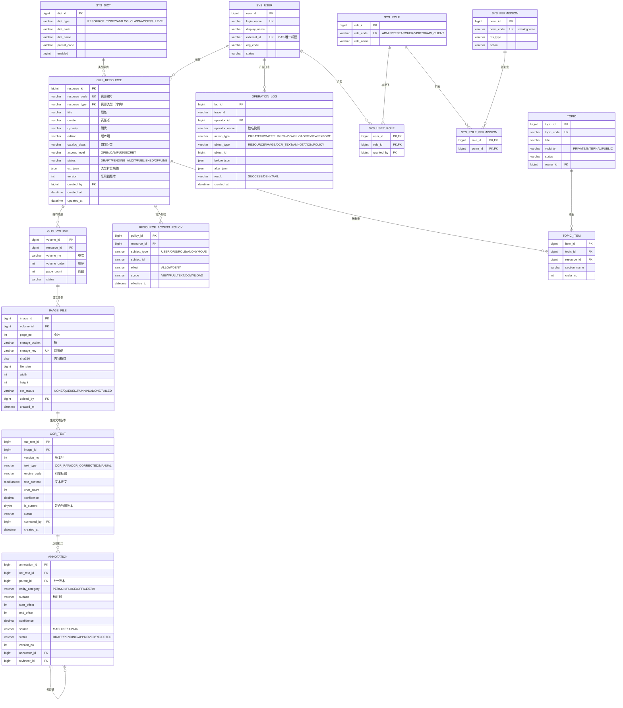
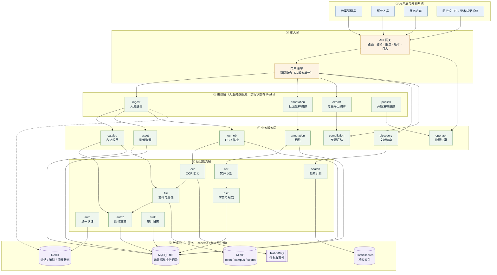
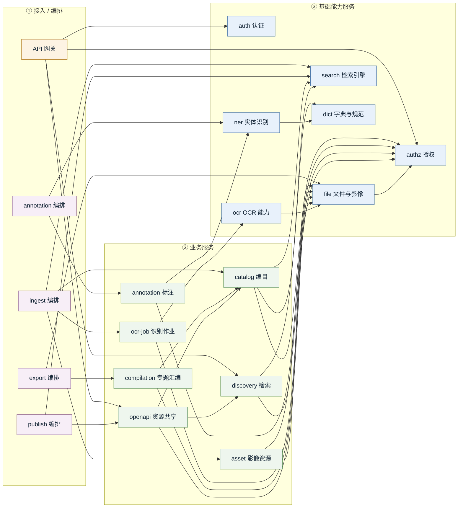
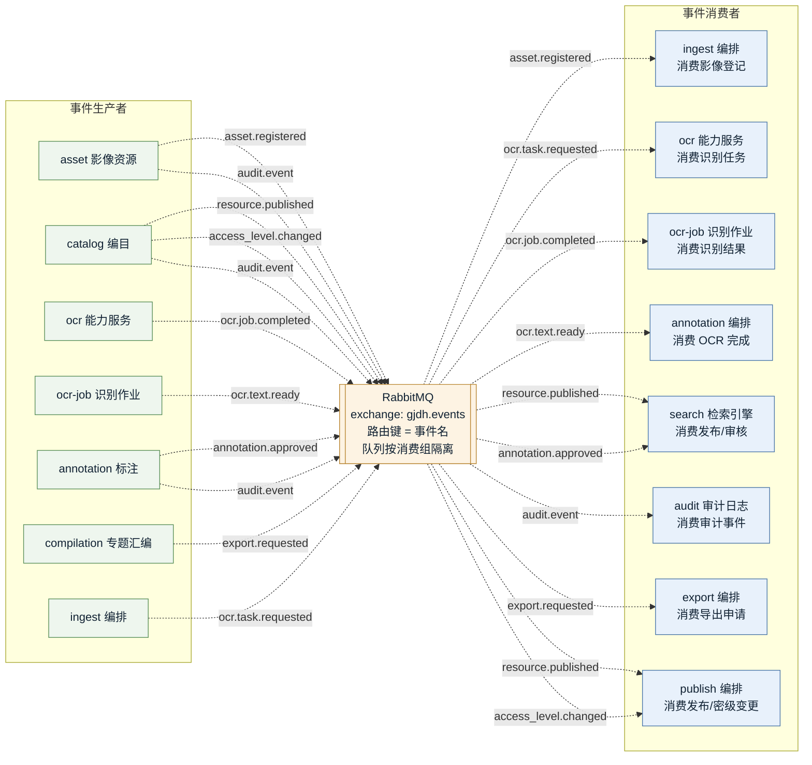
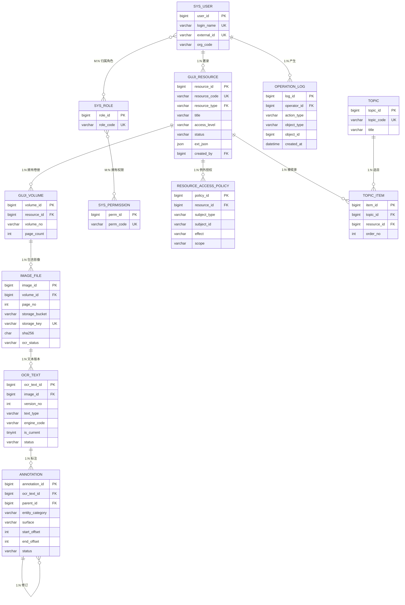

# 面向服务架构（SOA）系统设计——古籍文献数字化平台

**课程**：信息系统分析与设计（ISAD）　**实验类型**：系统分析与设计综合实验
**报告主题**：地方古籍文献数字化平台的面向服务设计与数据层设计
**参考教材**：《信息系统分析与设计（智能体实战版）》第 3 章（需求分析）、第 4 章（总体设计与架构风格）、附录 H（UML 建模、面向服务与数据层设计）

---

## 摘要

本报告针对某高校数字人文研究中心的"地方古籍文献数字化平台"，采用面向服务架构（SOA）思想完成系统设计：先按业务能力划分出 8 个基础能力服务、7 个业务服务与 4 个编排服务，再以接口契约、适配器、消息机制实现服务间的松耦合，最后给出 E-R 概念模型、15 张数据表（含题目要求的 6 张核心表）与影像文件的分层存储方案。设计遵循"高内聚、低耦合、单一职责、契约先行"的原则，使 OCR 引擎、检索实现与存储介质均可在不改动上游服务的前提下替换，并支持后续平滑扩展地方志、族谱等新资源类型。

---

# 第一部分　实验目的与需求分析

## 1.1 实验目的

1. 掌握以 SOA 思想对真实业务进行**服务边界划分**的方法：从业务能力出发识别服务、确定粒度、避免职责重叠与粒度过细。
2. 掌握**服务接口契约**的设计与描述方法（资源、方法、路径、参数、状态码、异常码、幂等与版本）。
3. 掌握**服务解耦**的工程手段：契约解耦、数据所有权隔离、适配器模式、持久化与业务分离、同步/异步通信选型。
4. 掌握**概念模型—逻辑模型—物理表**的数据库设计流程，能结合数字人文业务设计密级隔离与版本留痕的数据结构。
5. 使设计成果（服务清单、契约、E-R 图、数据表）前后一致，可用于后续编码与验收。

## 1.2 业务需求分析

### 1.2.1 用户角色与核心用例

| 角色 | 核心用例 | 权限特征 |
| --- | --- | --- |
| 档案管理员 | 上传古籍扫描影像、著录/修订元数据、分派与审核标注、发布资源 | 可写元数据，可审核，可处理涉密资源 |
| 研究人员 | OCR 文本校对、实体标注、文献检索、导出专题数据集 | 可写校对稿与标注，导出需授权 |
| 匿名访客 | 公开古籍浏览、简单检索、在线阅读 | 仅见"开放"级资源，禁止下载未开放/涉密资源 |
| 上层系统（图书馆门户、学术成果系统） | 元数据获取、全文与影像链接、成果引用回链 | 以应用身份调用开放接口，按配额限流 |
| 系统管理员 | 用户与角色管理、字典与规范档维护、策略配置 | 管理面权限，不直接读写古籍业务数据 |

### 1.2.2 功能需求（FR）

- **FR1 影像采集**：支持单页/整册批量上传，自动校验完整性（SHA-256）、生成缩略图与 IIIF 切片，记录页序。
- **FR2 元数据著录**：按《古籍著录规则》著录题名、著者、版本、卷册、分类等，支持资源类型扩展项。
- **FR3 OCR 识别**：按页或按册发起识别，支持多引擎与竖排/繁体/异体字参数，输出文本、行块坐标与置信度。
- **FR4 文本校对**：人工校对形成新版本，保留原始 OCR 版本与修订痕迹。
- **FR5 实体标注**：对人物、地名、职官、纪年进行标注，机器预标 + 人工确认，支持审核与版本链。
- **FR6 文献检索**：元数据、全文、实体三类检索，支持分面聚合与相关性排序，结果按密级过滤。
- **FR7 专题汇编**：创建专题、选目排序、生成汇编成果与数据集导出（含脱敏与水印）。
- **FR8 资源共享**：向门户与成果系统提供 REST 与 OAI-PMH 接口，支持增量同步与应用级配额。
- **FR9 审计留痕**：记录谁、何时、对哪条记录执行了何种操作，支持按资源/操作者/时间检索。

### 1.2.3 非功能需求（NFR）

| 编号 | 需求 | 说明与目标 |
| --- | --- | --- |
| NFR1 | 权限隔离 | 开放/校内/涉密三级，涉密资源不得经外网与第三方引擎处理 |
| NFR2 | 可替换性 | OCR 引擎、检索实现、数据库可替换，替换不影响上层业务 |
| NFR3 | 可扩展性 | 新增地方志、族谱等资源类型不需改动核心表结构与服务契约 |
| NFR4 | 性能 | 检索 P95 < 800 ms；单页影像首字节 < 1.5 s；OCR 单页均值 < 40 s（异步） |
| NFR5 | 可靠性 | 长耗时任务可重试、可补偿；影像与元数据最终一致 |
| NFR6 | 可追溯 | 元数据、OCR、标注的每次变更均可追溯到操作者与时间 |

## 1.3 设计假设（明确假设条件）

| 编号 | 假设 |
| --- | --- |
| H1 | 平台部署在校内私有云，技术栈为 Java 17 + Spring Boot 3 + MySQL 8.0 + MinIO + Elasticsearch 8 + RabbitMQ + Redis，网关使用 Kong 或 Spring Cloud Gateway |
| H2 | 学校已有统一身份认证（CAS/OAuth 2.0），平台不自建密码体系，只做身份映射与本地授权 |
| H3 | 一期规模约 5 万册、300 万页影像，单页 TIFF/JPEG 约 20～60 MB，日均访问 3000～5000 人次 |
| H4 | OCR 采用私有化 PaddleOCR（古籍竖排模型）为主引擎，可选接商业引擎；涉密资源**只允许**本地引擎处理 |
| H5 | 平台以"模块化单体 + 独立部署单元"起步，服务边界按 SOA 划分，后续可按边界平滑拆分，无需一次性重构 |
| H6 | 业务标识（资源编号）由平台生成，主键采用雪花 ID，不依赖数据库自增，便于更换数据库与分库 |

## 1.4 教材方法论的落地映射

教材第 4 章指出：SOA 的本质是"**把共享业务能力做成服务**"，由服务总线/API 网关承担路由、协议转换与统一治理，代价是要认真治理接口、版本与权限；同时强调"**不要为了用微服务而把每个功能都拆成独立服务**"。本报告据此确定三条落地策略：

1. **先分能力、再定服务**：按业务能力（编目、影像、识别、标注、检索、汇编、共享）划分限界上下文，而非按数据表或页面拆分；
2. **共享能力下沉**：OCR、实体识别、文件存储、检索、字典、审计做成基础能力服务，被多个业务服务复用，对应教材"复用稳定业务服务"的诉求；
3. **治理优先**：所有对外能力统一经网关暴露，契约先行、版本可控、错误码统一，对应教材"需要治理服务接口、版本、权限"的提醒。

---

# 第二部分　问题一——面向服务设计

## 2.1 服务边界划分

### 2.1.1 划分原则

| 原则 | 含义 | 在本平台的具体应用 |
| --- | --- | --- |
| P1 业务能力对齐 | 以业务能力而非数据表为划分依据，一个服务对应一个限界上下文 | "著录 + 卷册 + 版本项"同属编目，合为一个服务；影像页序与访问凭据同属影像资源，合为一个服务 |
| P2 数据主权 | 一个服务独占一组表，其他服务只能通过接口读写其数据 | 古籍主表只由 catalog-service 写入，检索服务不得直接 UPDATE 元数据表，只能接收索引事件 |
| P3 复用人格化 | 被两个以上业务服务使用的能力必须下沉为基础能力服务 | OCR 同时被"入库编排"和"重新识别"使用，故独立为 ocr-service |
| P4 变化隔离 | 易变技术实现封装在服务内部，对外只暴露稳定契约 | 引擎差异封装在 ocr-service 的适配器中；ES 查询 DSL 封装在 search-service 中 |
| P5 编排与业务分离 | 编排服务只推进流程状态与补偿，不持有业务数据、不直接访问数据库 | ingest-orchestrator 只发指令与订阅事件，古籍数据始终由 catalog-service 落库 |
| P6 粒度适中 | 不为单表建服务，也不建"万能古籍服务" | 19 个服务覆盖 5 类核心业务域，最大服务（catalog）约 3 张表，最小服务仅 1 张表 |
| P7 依赖单向 | 编排层 → 业务层 → 基础能力层的单向依赖，禁止反向调用 | 基础服务不回调业务服务；业务服务不直接调用外部系统 |

### 2.1.2 三层服务结构

```text
接入层    ┌─────────────── API 网关（路由/鉴权/限流/日志/版本） ───────────────┐
          │                      门户 BFF（页面聚合，不算服务）                    │
          └──────────────────────────────┬──────────────────────────────────────┘
                                         │
编排层    ingest            annotation          export              publish
          入库编排           标注生产编排         专题导出编排          开放发布编排
                                         │
业务层    catalog   asset    ocr-job   annotation   discovery   compilation   openapi
          编目      影像资源   识别作业    标注         检索         专题汇编        资源共享
                                         │
基础层    auth   authz   file   ocr   ner   search   audit   dict
          认证    授权     文件    OCR   NER    检索     审计    字典
```

### 2.1.3 边界判定的关键取舍

1. **OCR"能力"与"作业"分离**：`ocr-service` 只负责"把一张图变成一段带坐标的文本"，是可复用能力；`ocr-job-service` 负责业务语义（谁发起、属于哪册、走什么审核、文本版本如何流转）。二者分离后，未来接入古籍自动标点、表格识别等新能力时无需改动业务服务。
2. **标注能力与标注业务分离**：`ner-service` 输出"候选实体 + 位置 + 置信度"，不落审核状态；`annotation-service` 管理标注任务、审核与版本。这样 NER 可被"人名规范档建设""地名库补全"等其他项目直接复用（对应业务约束 3）。
3. **不单独设"用户管理服务"**：用户、角色、授权的管理面接口收敛在 `authz-service` 内，避免与认证服务职责重叠；`auth-service` 只做身份认证与令牌签发。
4. **不设"搜索索引管理服务"**：索引写入/删除/查询统一由 `search-service` 承担，业务服务只发事件、不直连 Elasticsearch，因此将来替换为其他检索引擎只需改这一个服务。

## 2.2 核心服务清单

### 2.2.1 基础能力服务（8 个）

| 编号 | 服务名称（英文） | 核心职责 | 主要功能 | 服务调用关系 |
| --- | --- | --- | --- | --- |
| F-01 | 统一认证服务 `auth-service` | 身份认证与令牌签发，不承载授权判断 | 对接学校 CAS/OAuth2、令牌签发与校验、会话续期、登出、匿名会话标识 | 被网关与全部业务服务调用（校验令牌）；不调用其他业务服务 |
| F-02 | 授权与用户管理服务 `authz-service` | 权限决策点（PDP）与用户/角色/授权管理 | 用户与角色维护、角色授权、三级密级策略判定、资源例外授权（ACL）、`/check` 决策、访问票据签发 | 被网关、全部业务服务、文件服务调用；读取本服务用户/角色/策略表 |
| F-03 | 文件与影像服务 `file-service` | 大文件可靠存取与影像派生 | 分片上传、断点续传、SHA-256 校验与去重、对象存储桶隔离、短期签名 URL、IIIF 切片与缩略图、水印叠加、孤儿文件对账 | 被业务/编排服务调用；调用 `authz-service` 校验访问票据后下发文件 |
| F-04 | OCR 能力服务 `ocr-service` | 把影像转换为结构化文本，屏蔽引擎差异 | 引擎适配（SPI）、任务队列与配额、批量识别、结果标准化（行块坐标、置信度、阅读顺序）、引擎健康检查与熔断 | 被 `ocr-job-service` 与入库编排调用；读取对象存储影像；发布 `ocr.job.completed` 事件 |
| F-05 | 实体识别能力服务 `ner-service` | 输出候选实体，不含审核业务 | 人物/地名/职官/纪年识别、别名归一、位置偏移与置信度、批量预标、模型版本标识 | 被 `annotation-service` 与标注编排调用；读取 `dict-service` 规范档；发布 `ner.batch.completed` |
| F-06 | 检索引擎服务 `search-service` | 屏蔽搜索引擎实现，提供统一索引与查询契约 | 索引创建与映射管理、文档写入/删除、检索 DSL（元数据/全文/实体）、分面聚合、密级过滤条件注入、同义词与拼音分析 | 被 `discovery-service`、`openapi-service`、编排服务调用；不访问业务数据库 |
| F-07 | 审计日志服务 `audit-service` | 操作留痕的集中记录与查询 | 订阅审计事件、异步批量落库、哈希链防篡改、按资源/操作者/时间检索、日志导出与归档 | 被全部服务"发事件"（不阻塞主流程）；提供审计查询接口给管理端 |
| F-08 | 字典与规范服务 `dict-service` | 受控词表与规范档管理，支撑资源类型扩展 | 资源类型字典（古籍/方志/族谱）、四部分类、密级与状态字典、人名规范档、地名词表、扩展属性模板（JSON Schema） | 被 catalog、annotation、ner、front、搜索等调用；被编排服务用于校验 |

### 2.2.2 业务服务（7 个）

| 编号 | 服务名称（英文） | 核心职责 | 主要功能 | 服务调用关系 |
| --- | --- | --- | --- | --- |
| B-01 | 古籍编目服务 `catalog-service` | 古籍资源主数据与著录业务的唯一写入口 | 资源主记录增删改查、卷册与篇目维护、版本项与责任者著录、扩展属性校验、著录提交与状态流转（草稿→待审→发布→下线） | 调用 `authz-service`（鉴权）、`dict-service`（字典校验）、`search-service`（发布后索引）、`audit-service`（发审计事件）；被入库编排调用 |
| B-02 | 影像资源服务 `asset-service` | 影像与古籍的绑定关系及影像访问策略 | 影像登记与页序排序、页序校正、影像与卷册绑定、影像清单、生成"影像访问票据"、封面上传与替换 | 调用 `file-service`（存储/切片）、`authz-service`（策略校验）、`audit-service`；被入库编排调用 |
| B-03 | OCR 作业服务 `ocr-job-service` | 识别业务的作业管理与文本版本管理 | 创建作业与批次、按页拆分任务、进度查询、失败重试、文本版本落库与"当前版本"切换、校对任务分派与状态机 | 经消息队列派发识别任务（异步）、调用 `file-service`（取图）与 `authz-service`；消费 `ocr.job.completed` 落库文本版本；发布 `ocr.text.ready` |
| B-04 | 标注服务 `annotation-service` | 标注任务、标注记录与审核发布 | 标注增删改查、批量导入、审核（通过/驳回）、版本链维护、实体归一（调用规范档）、标注统计与导出 | 调用 `ner-service`（预标）、`authz-service`、`dict-service`、`search-service`（发布索引）、`audit-service`；被标注编排调用 |
| B-05 | 文献检索服务 `discovery-service` | 面向用户的检索业务与结果脱敏 | 元数据/全文/实体检索、分面筛选、相关性排序、同义词扩展、密级过滤与结果字段脱敏、检索词日志 | 调用 `search-service`（查询）、`authz-service`（过滤条件）、`dict-service`；被门户与编排调用 |
| B-06 | 专题汇编服务 `compilation-service` | 专题与数据集的组织与生成 | 专题创建与发布、选目与排序、专题说明撰写、导出申请、汇编成果元数据、引用格式生成 | 调用 `catalog-service`（取元数据）、`authz-service`、`file-service`（取影像）、`audit-service`；向导出编排发 `compilation.export.requested` |
| B-07 | 资源共享服务 `openapi-service` | 对外统一开放出口 | 应用注册与密钥管理、配额与限流、REST 开放接口、OAI-PMH 数据提供、增量同步游标、开放数据包分发与下载统计 | 调用 `discovery-service`、`catalog-service`、`file-service`；被外部系统调用；发布 `openapi.access.logged` |

### 2.2.3 编排服务（4 个）

| 编号 | 服务名称（英文） | 核心职责 | 主要功能 | 服务调用关系 |
| --- | --- | --- | --- | --- |
| O-01 | 入库编排 `ingest-orchestrator` | 一册古籍从上传到可检索的全流程推进 | 校验批次、登记影像、创建编目草稿、绑定页序、派发 OCR、触发索引、失败回滚与补偿、进度查询 | 调用 `catalog`→`asset`→`ocr-job`→`search`；订阅 `asset.registered`，发布 `ocr.task.requested` |
| O-02 | 标注生产编排 `annotation-orchestrator` | 从 OCR 完成到标注发布的生产流水线 | 触发 NER 预标、按册生成标注任务、分派研究者、审核通过后发布索引、异常转人工 | 调用 `ner-service`、`annotation-service`；订阅 `ocr.text.ready`；发布 `annotation.published` |
| O-03 | 专题导出编排 `export-orchestrator` | 专题数据集导出的异步作业 | 复核选目权限、生成导出清单、逐项取元数据与影像、加水印与脱敏、打包至对象存储、通知与审计 | 调用 `compilation`、`authz`、`catalog`、`file`、`audit`；订阅 `compilation.export.requested` |
| O-04 | 开放发布编排 `publish-orchestrator` | 资源密级变更与对外发布的一致性推进 | 密级变更后失效缓存与索引重建、通知门户与成果系统、OAI 增量推送、回滚 | 订阅 `resource.published`/`resource.access_level.changed`；调用 `search`、`openapi`、`audit` |

> **粒度说明**：全平台 19 个服务，其中基础能力 8 个（平均 1.5 张表）、业务服务 7 个（平均 2～3 张表）、编排服务 4 个（无业务表）。编排服务不设数据库，仅用 Redis 保存流程实例状态，避免"编排即业务"的职责倒挂。

---

## 2.3 服务接口契约

选择 **F-04 OCR 能力服务**（异步任务型、体现适配器与幂等）与 **B-01 古籍编目服务**（同步资源型、体现乐观锁与状态机）两个代表性服务进行设计。统一约定：JSON 传输（`Content-Type: application/json`）、UTF-8、字段采用 camelCase（数据库 snake_case 由持久层映射）、时间为 ISO-8601 带时区、分页从 1 开始、金额与坐标不涉及。

### 2.3.1 契约一：OCR 能力服务（`ocr-service`）

#### 接口 1-A：创建识别作业

| 项目 | 内容 |
| --- | --- |
| 服务名称 | OCR 能力服务 `ocr-service` |
| 服务职责 | 把影像页转换为结构化文本：屏蔽各引擎差异、统一坐标与置信度输出，以异步作业方式支撑业务服务与编排服务的批量识别需求 |
| 接口名称及用途 | `createOcrJob`——为指定影像页创建一个识别作业，异步入队，立即返回作业号 |
| 请求方式 | `POST` |
| 接口路径 | `/api/v1/ocr/jobs` |
| 幂等性 | 支持，`Idempotency-Key` 在 24 小时内重复提交返回同一作业 |
| 权限 | `ocr:job:create`；调用方须为业务服务或编排服务（应用凭据） |

**请求头**

```http
Authorization: Bearer <access_token>
Content-Type: application/json
X-Request-Id: 8f3a1c92-7d4e-4c1a-9b2f-0d6e5a7c1b33
Idempotency-Key: OCR-IMG-202610120000731-v1
```

**请求体**

```json
{
  "imageId": 202610120000731,
  "imageRef": {
    "storageKey": "GJ-2026-000123/J001/001_a1b2c3d4.tif",
    "mimeType": "image/tiff",
    "width": 4820,
    "height": 7210
  },
  "resourceAccessLevel": "CAMPUS",
  "engineHint": "AUTO",
  "options": {
    "layout": "VERTICAL_RTL",
    "charset": "TRADITIONAL",
    "keepPunctuation": true,
    "returnBBox": true,
    "denoise": true
  },
  "priority": "NORMAL",
  "callbackUrl": "https://gjdh.example.edu/api/v1/ocr/callback",
  "operatorId": 10086
}
```

**请求参数字段说明**

| 字段 | 类型 | 必填 | 说明 |
| --- | --- | --- | --- |
| imageId | BIGINT | 是 | 影像页 ID，用于回填结果与去重 |
| imageRef.storageKey | VARCHAR | 是 | 对象存储键，服务据此取图；不接受外链，避免 SSRF |
| resourceAccessLevel | ENUM | 是 | `OPEN`/`CAMPUS`/`SECRET`，决定引擎路由：`SECRET` 只允许本地引擎 |
| engineHint | ENUM | 否 | `AUTO`/`PADDLE_GUJI_V2`/`COMMERCIAL_X`/`LOCAL_SECRET`，默认 `AUTO` 由路由策略决定 |
| options.layout | ENUM | 否 | 版式：`VERTICAL_RTL`（竖排右起）、`HORIZONTAL_LTR` |
| options.charset | ENUM | 否 | `TRADITIONAL`/`SIMPLIFIED`/`MIXED` |
| priority | ENUM | 否 | `LOW`/`NORMAL`/`HIGH`，影响队列权重 |
| callbackUrl | VARCHAR | 否 | 作业完成回调地址；不传则仅支持轮询 |

**响应（HTTP 202 Accepted）**

```json
{
  "code": "0",
  "message": "accepted",
  "data": {
    "jobId": "OCR-20261120-000312",
    "status": "QUEUED",
    "engineCode": "paddle_guji_v2",
    "estimatedSeconds": 35,
    "pollUrl": "/api/v1/ocr/jobs/OCR-20261120-000312",
    "acceptedAt": "2026-11-20T09:12:31+08:00"
  },
  "traceId": "8f3a1c92-7d4e-4c1a-9b2f-0d6e5a7c1b33"
}
```

#### 接口 1-B：查询识别作业结果

| 项目 | 内容 |
| --- | --- |
| 接口名称及用途 | `getOcrJob`——按作业号查询状态与结果；完成时返回文本与行块坐标 |
| 请求方式 | `GET` |
| 接口路径 | `/api/v1/ocr/jobs/{jobId}` |
| 权限 | `ocr:job:read`，且只能查询本应用提交的作业 |

**响应（HTTP 200，成功）**

```json
{
  "code": "0",
  "message": "success",
  "data": {
    "jobId": "OCR-20261120-000312",
    "imageId": 202610120000731,
    "status": "SUCCEEDED",
    "engineCode": "paddle_guji_v2",
    "engineVersion": "2.7.1",
    "durationSeconds": 31,
    "result": {
      "textType": "OCR_RAW",
      "charCount": 486,
      "confidence": 0.9412,
      "text": "……（识别正文，保留异体字与朱笔批注标记）",
      "blocks": [
        { "blockNo": 1, "text": "第一行文字", "bbox": [312, 480, 1460, 612], "confidence": 0.96 },
        { "blockNo": 2, "text": "第二行文字", "bbox": [312, 640, 1420, 772], "confidence": 0.93 }
      ]
    },
    "finishedAt": "2026-11-20T09:13:02+08:00"
  },
  "traceId": "8f3a1c92-7d4e-4c1a-9b2f-0d6e5a7c1b33"
}
```

**异常返回（统一错误结构）**

```json
{
  "code": "OCR_IMAGE_NOT_FOUND",
  "message": "影像不存在或不可访问",
  "detail": { "imageId": 202610120000731, "reason": "object not found in bucket guji-campus" },
  "traceId": "8f3a1c92-7d4e-4c1a-9b2f-0d6e5a7c1b33",
  "timestamp": "2026-11-20T09:12:31+08:00",
  "path": "/api/v1/ocr/jobs"
}
```

| 错误码 | HTTP | 含义 | 调用方处理建议 |
| --- | --- | --- | --- |
| `OCR_INVALID_PARAM` | 400 | 参数缺失或枚举非法（如 width ≤ 0） | 修正参数，不重试 |
| `OCR_IMAGE_NOT_FOUND` | 404 | 对象存储中不存在该影像 | 检查入库流程，转人工 |
| `OCR_UNSUPPORTED_FORMAT` | 415 | 格式不在白名单（TIFF/JPEG/PNG） | 转码后重试 |
| `OCR_FORBIDDEN_ENGINE` | 403 | 涉密资源请求了非本地引擎 | 改用 `LOCAL_SECRET`，禁止重试同一引擎 |
| `OCR_FORBIDDEN_SCOPE` | 403 | 令牌缺少 `ocr:job:create` 或跨应用访问 | 重新申请授权 |
| `OCR_DUPLICATE_JOB` | 409 | 同一影像同一版本已有运行中作业 | 复用已有 jobId |
| `OCR_QUOTA_EXCEEDED` | 429 | 超出应用配额或引擎并发上限 | 退避重试（建议 30 s 起，指数退避） |
| `OCR_ENGINE_UNAVAILABLE` | 503 | 引擎不可用（超时/熔断） | 可重试；连续失败转本地引擎并告警 |
| `OCR_INTERNAL_ERROR` | 500 | 结果规范化或落库失败 | 可重试一次，仍失败进入死信队列 |

### 2.3.2 契约二：古籍编目服务（`catalog-service`）

#### 接口 2-A：新建古籍著录

| 项目 | 内容 |
| --- | --- |
| 服务名称 | 古籍编目服务 `catalog-service` |
| 服务职责 | 古籍资源主数据的唯一写入口：著录校验、卷册结构维护、状态流转（草稿→待审→发布→下线），并产生审计留痕 |
| 接口名称及用途 | `createResource`——新建一条古籍资源著录记录，返回资源 ID 与版本号，初始状态为草稿 |
| 请求方式 | `POST` |
| 接口路径 | `/api/v1/catalog/resources` |
| 幂等性 | 支持，`Idempotency-Key` 与 `resourceCode` 双重去重 |
| 权限 | `catalog:write`（档案管理员）；普通研究者只读 |

**请求体**

```json
{
  "resourceCode": "FZ-2026-000001",
  "resourceType": "LOCAL_GAZETTEER",
  "title": "（康熙）吴县志",
  "alternativeTitle": "吴县志",
  "creator": "（清）汤斌 修",
  "dynasty": "清",
  "edition": "清康熙三十年刻本",
  "catalogClass": "史部·地理类",
  "holdingOrgCode": "SUDA-LIB-GJ",
  "volumeCount": 12,
  "accessLevel": "CAMPUS",
  "description": "记述吴县地理、建置、职官、人物、艺文，缺卷七至卷八。",
  "extAttrs": {
    "谱籍": "江苏苏州",
    "始迁祖": "—",
    "刻工": "黄氏"
  },
  "operatorId": 10086
}
```

**响应（HTTP 201 Created）**

```json
{
  "code": "0",
  "message": "created",
  "data": {
    "resourceId": 730100000000012345,
    "resourceCode": "FZ-2026-000001",
    "version": 1,
    "status": "DRAFT",
    "accessLevel": "CAMPUS",
    "createdBy": 10086,
    "createdAt": "2026-11-20T09:20:11+08:00",
    "auditLogId": 918273645001
  },
  "traceId": "b71e0d55-2a49-4f0e-8a51-3c9d2e7f4a10"
}
```

#### 接口 2-B：修订著录（乐观锁）

| 项目 | 内容 |
| --- | --- |
| 接口名称及用途 | `updateResource`——修订元数据；携带 `version` 实现乐观锁，避免并发覆盖 |
| 请求方式 | `PUT` |
| 接口路径 | `/api/v1/catalog/resources/{resourceId}` |
| 一致性 | 版本号匹配才更新，成功后 `version + 1`，并写入审计日志（含变更前后差异） |
| 权限 | `catalog:write`；涉密资源需 `catalog:write:secret` |

**请求体（节选）**

```json
{
  "version": 3,
  "title": "（康熙）吴县志（校点本）",
  "accessLevel": "OPEN",
  "changeReason": "已完成校点，申请对外开放",
  "operatorId": 10086
}
```

**响应（HTTP 200）**

```json
{
  "code": "0",
  "message": "updated",
  "data": {
    "resourceId": 730100000000012345,
    "version": 4,
    "status": "PENDING_AUDIT",
    "accessLevel": "OPEN",
    "updatedAt": "2026-11-20T10:02:44+08:00",
    "changedFields": ["title", "accessLevel"],
    "auditLogId": 918273645002
  },
  "traceId": "b71e0d55-2a49-4f0e-8a51-3c9d2e7f4a10"
}
```

**异常返回**

```json
{
  "code": "CATALOG_VERSION_CONFLICT",
  "message": "记录已被其他用户修改，请刷新后重试",
  "detail": { "resourceId": 730100000000012345, "clientVersion": 3, "currentVersion": 4 },
  "traceId": "b71e0d55-2a49-4f0e-8a51-3c9d2e7f4a10",
  "timestamp": "2026-11-20T10:02:44+08:00",
  "path": "/api/v1/catalog/resources/730100000000012345"
}
```

| 错误码 | HTTP | 含义 | 调用方处理建议 |
| --- | --- | --- | --- |
| `CATALOG_INVALID_PARAM` | 400 | 必填字段缺失、`accessLevel` 枚举非法 | 按 `detail.fieldErrors` 修正 |
| `CATALOG_DUPLICATE_CODE` | 409 | `resourceCode` 已存在 | 换号或走"修订"接口 |
| `CATALOG_VERSION_CONFLICT` | 409 | 乐观锁冲突 | 重新拉取最新版本后合并提交 |
| `CATALOG_NOT_FOUND` | 404 | 资源不存在或已删除 | 提示用户，不重试 |
| `CATALOG_FORBIDDEN` | 403 | 无写权限或跨机构越权 | 申请权限 |
| `CATALOG_INVALID_STATE` | 422 | 状态机不允许（如已发布记录直接回退草稿） | 走"下线"再"修订"流程 |
| `CATALOG_DICT_UNMATCHED` | 422 | `resourceType`/`catalogClass` 不在字典中 | 联系管理员补充字典 |

> **契约一致性说明**：`resourceCode`、`title`、`accessLevel`、`status`、`version`、`createdBy` 等字段与第三部分 `guji_resource` 表字段一一对应；`extAttrs` 落地为 `ext_json`；`auditLogId` 对应 `operation_log.log_id`，从而保证接口、模型与表结构三者可追溯。

## 2.4 服务解耦与通信机制

### 2.4.1 契约解耦：接口是唯一的依赖面

- 采用 **OpenAPI 3.0 契约先行**：契约文件纳入代码仓库，服务端与调用方分别生成桩与客户端，接口变更先改契约、评审通过后再实现。
- **版本策略**：路径带主版本（`/api/v1`），仅允许"新增可选字段/新增接口"的向后兼容变更；破坏性变更另开 `/api/v2` 并保留 `Deprecation` 响应头与迁移期。
- **消费者驱动契约测试**：编排服务对 catalog/ocr 的调用以契约测试固化，基础服务升级不得破坏既有消费者。
- **统一响应信封与错误码**：`{ code, message, data, traceId }`，错误码全局登记（`OCR_*`、`CATALOG_*`、`AUTH_*`），避免各服务自造格式导致调用方硬编码。

### 2.4.2 数据解耦：一服务一库一主权

- 每个服务独占 schema（`db_catalog`、`db_asset`、`db_ocr`、`db_annotation`、`db_authz`、`db_audit`…），**禁止跨库 JOIN 与跨库事务**。
- 跨服务只传 ID 与契约字段，不传表结构。例如影像表只保存 `resource_id`，题名由查询时调 catalog 获取，避免"改题名要改三张表"。
- 检索索引中的题名、责任者属于**读模型冗余**（供分面与排序），不是业务主数据冗余，允许存在并由事件驱动最终一致。
- 跨服务一致性采用**状态机 + 最终一致 + 对账**：`resource.published` 事件驱动索引更新，夜间对账任务比对 DB 与索引条数、抽查内容哈希，差异自动重建。

### 2.4.3 适配器隔离第三方 OCR 引擎

```text
ocr-service
 ├─ OcrJobController            // 契约层：/api/v1/ocr/jobs
 ├─ OcrJobAppService            // 应用层：幂等、配额、引擎路由、任务状态机
 ├─ OcrEngine (interface)       // 适配器接口（SPI）
 │    ├─ PaddleGujiEngineAdapter      // 私有化开源引擎
 │    ├─ CommercialXEngineAdapter     // 商业引擎（HTTP + 签名）
 │    ├─ LocalSecretEngineAdapter     // 涉密内网引擎，不可出网
 │    └─ MockEngineAdapter            // 测试用
 └─ OcrResultNormalizer         // 结果标准化：坐标系/置信度/阅读顺序
```

适配器接口（稳定契约，不随引擎变化）：

```java
public interface OcrEngine {
    String engineCode();                                  // 唯一标识，写入 ocr_text.engine_code
    String engineVersion();
    boolean supports(EngineCapability capability);         // 竖排/繁体/表格/手写
    RecognizeResult recognize(RecognizeRequest request);   // 超时由外层装饰器控制
}
```

**隔离效果**：新增/替换引擎只需实现 `OcrEngine` 并在配置中心注册，`/api/v1/ocr/jobs` 契约、`ocr_text` 表结构、上游 `ocr-job-service` 均不变。引擎差异（认证方式、重试语义、错误码、坐标体系）全部在适配器内部消化；`OcrResultNormalizer` 统一输出"行块 + 置信度 + 阅读顺序"，避免上游按引擎分支处理。熔断、限流、超时、重试由装饰器统一包装，引擎实现只关注识别本身。

### 2.4.4 数据库访问与业务逻辑分离

| 层次 | 职责 | 本平台做法 |
| --- | --- | --- |
| 接口层 Controller | 协议转换、参数校验、鉴权注解 | 只做 DTO ↔ 领域对象转换，不含 SQL |
| 应用层 AppService | 用例编排、事务边界、幂等、事件发布 | 事务仅覆盖单库；跨服务用事件 |
| 领域层 Domain | 业务规则（状态机、密级规则、页序规则） | 纯 Java 对象，不依赖框架与 SQL |
| 持久层 Repository | 数据存取，接口在领域层定义、实现在基础设施层 | MyBatis-Plus/JPA 实现，SQL 集中在 Mapper |
| 迁移层 | 表结构版本化 | Flyway 脚本随代码发布，禁止手工改库 |

**换库可替换性**：主键用雪花 ID 而非自增；时间统一 UTC 存储、展示时区转换；避免存储过程、触发器、厂商私有函数；复杂检索从关系库剥离到 `search-service`（JSON 契约，可替换为其他引擎）；对象存储采用 S3 兼容协议，MinIO 可替换为 Ceph/OSS 而不改业务代码。

### 2.4.5 同步调用的场景与理由

| 场景 | 调用链 | 为什么必须同步 |
| --- | --- | --- |
| 元数据著录提交 | 前端 → 网关 → catalog → authz → dict | 用户点击"保存"必须立即知道成功与否；写入需在同一事务内校验字典与权限，失败要立刻回滚并提示 |
| 文献检索 | 前端 → 网关 → discovery → search → authz | 交互式查询，用户等待结果；链路总耗时需控制在 800 ms 内，异步化只会增加复杂度 |
| 影像浏览取图 | 前端 → 网关 → asset → authz → file | 必须实时判定当前用户对**这一页**的密级权限并签发短期票据，绝不允许"先给图后判权" |
| 权限决策 `/check` | 各业务服务 → authz | 低延迟强需求（目标 < 20 ms），失败时按"拒绝"处理；用 Redis 缓存策略，TTL 60 s，策略变更发失效事件 |
| 作业进度轮询 | 前端 → ocr-job → ocr | 用户查看"识别到第几页"，需要即时读数 |

### 2.4.6 异步消息的场景与理由

| 场景 | 消息/事件 | 为什么用消息队列 |
| --- | --- | --- |
| OCR 识别 | `ocr.task.requested` → `ocr.job.completed` | 单页 20～60 s，整册 300 页需数小时，HTTP 同步必然超时；队列天然支持削峰、限流（引擎并发 4）、失败重试与死信 |
| NER 预标 | `ocr.text.ready` → `ner.batch.completed` | 依赖 OCR 完成，属流水线触发；批量预标耗时长且可重试 |
| 索引更新 | `resource.published`、`annotation.approved` → search 写索引 | 检索是"近实时"而非强一致；索引写失败不应回滚主业务，重试即可 |
| 审计留痕 | 全部服务的 `audit.event` | 审计是旁路关注点，不能拖慢主流程，也不能因审计库故障导致业务失败 |
| 密级变更联动 | `resource.access_level.changed` | 一次变更要扇出到索引、缓存、门户、成果系统多方，发布/订阅模式避免变更方认识所有下游 |
| 专题数据集导出 | `compilation.export.requested` → 打包完成通知 | 可能涉及上千页影像加水印，耗时分钟级到小时级；用户关闭页面也应继续执行 |
| 对外增量同步 | `oai.sync.requested` | 门户与成果系统按天同步，异步可错峰、可重放 |

### 2.4.7 典型端到端流程（同步 + 异步混合）

以"档案管理员上传一册 320 页古籍"为例：

1. **同步**：前端分片直传 `file-service`，每片返回校验结果；上传完成后**同步**调用 `POST /api/v1/catalog/resources` 创建草稿并拿到 `resourceId`（用户需要立即看到"已建档"）。
2. **异步**：`ingest-orchestrator` 收到 `asset.registered` 事件，按页派发 `ocr.task.requested`，每页一条消息进入 `ocr.queue`，消费者按引擎并发度拉取；失败的进入重试队列（3 次指数退避）后转死信队列并告警。
3. **异步**：`ocr.job.completed` 汇总为册级进度，`ocr-job-service` 落库文本版本并置 `is_current=1`，发布 `ocr.text.ready`。
4. **异步**：`annotation-orchestrator` 触发 NER 预标与标注任务分派，研究者收到待办通知。
5. **异步**：审核通过后发布 `annotation.approved`，`search-service` 增量更新索引；`publish-orchestrator` 通知门户。
6. **同步**：管理员在列表页查询进度、访客检索浏览，均为同步读。

**一致性保障**：全链路使用幂等键（`imageId + engineCode + versionNo` 唯一约束）；编排服务用状态机（`PENDING → RUNNING → SUCCEEDED / FAILED / COMPENSATED`）记录流程；失败采用 Saga 补偿（OCR 作业置 `FAILED` 并保留旧版本为当前版本；导出失败删除临时对象与临时表记录）；夜间对账比对"已登记影像数 = 已生成文本数 + 待处理数"。

---

# 第三部分　问题二——数据层设计

## 3.1 E-R 概念模型

### 3.1.1 实体清单

| 编号 | 实体（表名） | 说明 | 主键 | 主要属性 | 外键 |
| --- | --- | --- | --- | --- | --- |
| E1 | 古籍资源 `guji_resource` | 一"种"古籍的著录主体，资源类型的总入口（古籍/方志/族谱共用） | `resource_id` | resource_code、resource_type、title、creator、dynasty、edition、catalog_class、access_level、status、ext_json | resource_type → `sys_dict`；created_by/updated_by → `sys_user` |
| E2 | 卷册 `guji_volume` | 一种古籍下的卷/册，是影像的组织单位 | `volume_id` | volume_no、volume_order、page_count、binding、status | resource_id → `guji_resource` |
| E3 | 影像文件 `image_file` | 一页扫描影像的元数据（文件本体在对象存储） | `image_id` | page_no、storage_bucket、storage_key、sha256、file_size、width、height、ocr_status | volume_id → `guji_volume` |
| E4 | OCR 文本 `ocr_text` | 某一页某一版本的识别/校对文本 | `ocr_text_id` | version_no、text_type、engine_code、text_content、char_count、confidence、is_current、status | image_id → `image_file`；corrected_by → `sys_user` |
| E5 | 标注记录 `annotation` | 文本中的一处实体标注（可多版本） | `annotation_id` | entity_category、surface、start_offset、end_offset、confidence、source、status、version_no | ocr_text_id → `ocr_text`；parent_id → `annotation`（自关联）；annotator_id/reviewer_id → `sys_user` |
| E6 | 用户 `sys_user` | 平台用户，含校内人员与外部应用账号 | `user_id` | login_name、display_name、external_id（CAS）、org_code、status | — |
| E7 | 角色 `sys_role` | 角色定义，如管理员/研究者/访客/应用 | `role_id` | role_code、role_name、description | — |
| E8 | 权限 `sys_permission` | 权限项，按"资源类型 + 动作"定义 | `perm_id` | perm_code、res_type、action、description | — |
| E9 | 用户角色 `sys_user_role` | 用户与角色的多对多关联 | (`user_id`,`role_id`) | granted_by、granted_at | user_id → `sys_user`；role_id → `sys_role` |
| E10 | 角色权限 `sys_role_permission` | 角色与权限的多对多关联 | (`role_id`,`perm_id`) | — | role_id → `sys_role`；perm_id → `sys_permission` |
| E11 | 资源访问策略 `resource_access_policy` | 在密级默认规则之外的例外授权/禁止 | `policy_id` | subject_type、subject_id、effect、scope、effective_from、effective_to | resource_id → `guji_resource` |
| E12 | 操作日志 `operation_log` | 操作留痕（谁、何时、对什么、做了什么、结果） | `log_id` | trace_id、operator_id、action_type、object_type、object_id、before_json、after_json、result | operator_id → `sys_user`（弱关联，见 3.1.4） |
| E13 | 专题 `topic` | 专题汇编的容器 | `topic_id` | topic_code、title、visibility、status、owner_id | owner_id → `sys_user` |
| E14 | 专题选目 `topic_item` | 专题与古籍的多对多关联及排序 | `item_id` | section_name、order_no、note | topic_id → `topic`；resource_id → `guji_resource` |
| E15 | 字典 `sys_dict` | 受控词表：资源类型、分类、密级、状态、规范档 | `dict_id` | dict_type、dict_code、dict_name、parent_code、sort_no、enabled | — |

### 3.1.2 联系清单与基数

| 编号 | 联系 | 参与实体 | 基数 | 业务含义与约束 |
| --- | --- | --- | --- | --- |
| R1 | 拥有卷册 | 古籍资源 — 卷册 | 1 : N（0..n） | 一种古籍含若干卷册；卷册不可脱离古籍存在 |
| R2 | 包含影像 | 卷册 — 影像文件 | 1 : N（0..n） | 一册含若干页影像；`(volume_id, page_no)` 唯一 |
| R3 | 生成文本 | 影像文件 — OCR 文本 | 1 : N（0..n） | 一页可有多个文本版本（OCR 原始/校对稿），仅一个 `is_current=1` |
| R4 | 承载标注 | OCR 文本 — 标注记录 | 1 : N（0..n） | 标注依附于具体文本版本；文本改版后标注需重新校准（新版本重建） |
| R5 | 修订链 | 标注记录 — 标注记录 | 1 : N（0..n，自关联） | `parent_id` 指向上一版本，形成不可变修订链 |
| R6 | 著录责任 | 用户 — 古籍资源 | 1 : N | `created_by`/`updated_by` 记录著录人 |
| R7 | 授权例外 | 古籍资源 — 资源访问策略 | 1 : N（0..n） | 一条资源可对多个主体（用户/机构/角色）授予 VIEW/FULLTEXT/DOWNLOAD |
| R8 | 归属角色 | 用户 — 角色 | M : N | 经 `sys_user_role` 关联；一人可多角色 |
| R9 | 角色授权 | 角色 — 权限 | M : N | 经 `sys_role_permission` 关联 |
| R10 | 专题收录 | 专题 — 古籍资源 | M : N | 经 `topic_item` 关联，含板块与排序 |
| R11 | 类型归类 | 字典 — 古籍资源 | 1 : N | `resource_type` 取字典值，新增方志/族谱只加字典项 |
| R12 | 行为留痕 | 用户 — 操作日志 | 1 : N | 日志保留操作者姓名快照，用户删除后日志仍可读 |
| R13 | 审计对象 | 操作日志 — 业务实体 | N : 1（逻辑关联） | 通过 `(object_type, object_id)` 弱关联，**不建物理外键**（见 3.1.4） |

### 3.1.3 E-R 图（Mermaid）



### 3.1.4 关键建模决策

1. **OCR 文本挂在"影像页"而非"卷册"**：古籍识别以页为单位，页级模型可支持"单页重识别""单页校对”，且文本与影像一一对应，避免整册重排时无法定位差异；册级全文由 `ocr_text` 聚合或检索库承担。
2. **密级放主表、例外放策略表**：`guji_resource.access_level` 是资源的**默认**访问级别（三选一），`resource_access_policy` 只记录"默认规则之外的例外"（某课题组成员可调阅某涉密文献）。这样既满足三级隔离，又避免为每类用户复制一份资源记录。
3. **版本用"链 + 当前标记"**：`ocr_text` 用 `version_no` + `is_current`，`annotation` 用 `version_no` + `parent_id`。物理不覆盖、不删除，满足"修改可追溯"；`is_current` 避免每次查询都做 `MAX(version_no)` 子查询。
4. **操作日志对业务表不建物理外键**：审计对象横跨多表（资源、影像、文本、标注、策略），若建外键则删除资源时日志会被级联约束阻塞，且日志需长期保留而业务数据可能归档。故采用 `(object_type, object_id)` 弱关联 + `object_code` 快照。
5. **用 `ext_json` 而非"每类资源一张表"**：地方志需要"舆图数量"、族谱需要"谱籍/始迁祖"，若为每类建表会导致服务与查询分叉。以"公共字段列 + 扩展 JSON + 字典驱动的校验模板"实现扩展，新增资源类型不改表结构。
6. **`sys_user_role` / `sys_role_permission` 独立成表**：避免在用户表存角色字符串（违反 1NF），也便于按角色批量授权与回收。

---

## 3.2 核心数据表设计

### 3.2.0 全局约定

| 项目 | 约定 |
| --- | --- |
| 数据库 / 字符集 | MySQL 8.0，InnoDB，`utf8mb4_0900_ai_ci`（支持生僻字与异体字） |
| 主键 | 雪花 ID（BIGINT），业务不依赖自增，便于换库与拆分 |
| 时间 | `DATETIME(3)`，统一按 UTC 存储，接口层输出 ISO-8601 带时区 |
| 软删除 | 业务主表含 `is_deleted TINYINT`，唯一索引与 `is_deleted` 组合使用 |
| 审计字段 | `created_by`、`created_at`、`updated_by`、`updated_at` 为业务表标配 |
| 索引命名 | 主键 `pk_`、唯一 `uk_`、普通 `idx_`；复合索引遵循"等值在前、范围在后" |
| 外键策略 | 同库内使用物理外键（`ON DELETE RESTRICT`）；跨服务/跨库不建外键，由应用保证 |

### 3.2.1 古籍主表 `guji_resource`（E1）

| 字段名称 | 数据类型 | 主键/外键 | 允许空 | 索引 | 说明 |
| --- | --- | --- | --- | --- | --- |
| resource_id | BIGINT | PK | 否 | pk_resource | 古籍资源 ID（雪花） |
| resource_code | VARCHAR(32) | — | 否 | uk_resource_code | 资源编号，如 `FZ-2026-000001` |
| resource_type | VARCHAR(16) | FK → sys_dict(dict_code) | 否 | idx_resource_type | 资源类型：`GUJI`/`LOCAL_GAZETTEER`/`GENEALOGY` |
| title | VARCHAR(255) | — | 否 | idx_title_prefix（前缀） | 题名，含卷数括注 |
| title_pinyin | VARCHAR(255) | — | 是 | idx_title_pinyin | 题名拼音（全拼，供拼音检索与排序） |
| creator | VARCHAR(255) | — | 是 | idx_creator_prefix | 责任者（著者/编者/修纂者），含朝代前缀 |
| dynasty | VARCHAR(32) | — | 是 | idx_dynasty | 朝代，如"清""明" |
| edition | VARCHAR(128) | — | 是 | — | 版本项（刻/抄/石印/活字） |
| catalog_class | VARCHAR(64) | — | 是 | idx_catalog_class | 四部分类号，如"史部·地理类" |
| holding_org_code | VARCHAR(32) | — | 是 | idx_holding_org | 收藏机构编码 |
| volume_count | INT | — | 否（默认 0） | — | 卷册数量（冗余统计值，由卷册维护时同步更新） |
| access_level | VARCHAR(16) | — | 否（默认 `CAMPUS`） | idx_access_level | 访问级别：`OPEN`/`CAMPUS`/`SECRET` |
| status | VARCHAR(16) | — | 否（默认 `DRAFT`） | idx_status | 状态：`DRAFT`/`PENDING_AUDIT`/`PUBLISHED`/`OFFLINE` |
| description | TEXT | — | 是 | — | 内容提要/附注 |
| ext_json | JSON | — | 是 | — | 类型扩展属性（方志的舆图数、族谱的谱籍等），按字典模板校验 |
| version | INT | — | 否（默认 1） | — | 乐观锁版本号 |
| is_deleted | TINYINT | — | 否（默认 0） | idx_deleted | 软删除标记 |
| created_by | BIGINT | FK → sys_user(user_id) | 否 | — | 著录人 |
| created_at | DATETIME(3) | — | 否 | idx_created_at | 创建时间 |
| updated_by | BIGINT | FK → sys_user(user_id) | 否 | — | 最后修改人 |
| updated_at | DATETIME(3) | — | 否 | idx_updated_at | 最后修改时间 |

> 索引说明：`uk_resource_code` 保证编号唯一；`idx_access_level + idx_status + idx_updated_at` 支撑"按密级 + 状态 + 时间"的列表页高频查询；题名/责任者建前缀索引，兼顾模糊检索与索引体积。

### 3.2.2 卷册表 `guji_volume`（E2）

| 字段名称 | 数据类型 | 主键/外键 | 允许空 | 索引 | 说明 |
| --- | --- | --- | --- | --- | --- |
| volume_id | BIGINT | PK | 否 | pk_volume | 卷册 ID |
| resource_id | BIGINT | FK → guji_resource | 否 | idx_volume_resource | 所属古籍 |
| volume_no | VARCHAR(32) | — | 否 | — | 卷次标识，如"卷一""卷十二" |
| volume_order | INT | — | 否 | uk_volume_order（与 resource_id 组合） | 册序，用于排序与翻页 |
| page_count | INT | — | 否（默认 0） | — | 实际页数（与 image_file 计数对齐） |
| binding | VARCHAR(32) | — | 是 | — | 装帧形式（线装/蝴蝶装/毛装） |
| remark | VARCHAR(255) | — | 是 | — | 残缺说明、缺卷记录 |
| status | VARCHAR(16) | — | 否（默认 `DRAFT`） | — | 卷册状态 |
| created_at | DATETIME(3) | — | 否 | — | 创建时间 |
| updated_at | DATETIME(3) | — | 否 | — | 更新时间 |

> 唯一约束：`uk_volume_order (resource_id, volume_order)`，防止同一古籍出现重复册序。

### 3.2.3 影像文件表 `image_file`（E3）

| 字段名称 | 数据类型 | 主键/外键 | 允许空 | 索引 | 说明 |
| --- | --- | --- | --- | --- | --- |
| image_id | BIGINT | PK | 否 | pk_image | 影像 ID |
| volume_id | BIGINT | FK → guji_volume | 否 | idx_image_volume | 所属卷册 |
| page_no | INT | — | 否 | uk_image_page（volume_id + page_no） | 页序，从 1 开始 |
| storage_bucket | VARCHAR(64) | — | 否 | — | 对象存储桶：`guji-open`/`guji-campus`/`guji-secret` |
| storage_key | VARCHAR(512) | — | 否 | uk_storage_key | 对象键，如 `GJ-2026-000123/J001/001_a1b2c3d4.tif` |
| file_name | VARCHAR(255) | — | 否 | — | 原始文件名 |
| mime_type | VARCHAR(64) | — | 否 | — | `image/tiff`、`image/jpeg` |
| file_size | BIGINT | — | 否 | — | 字节数 |
| sha256 | CHAR(64) | — | 否 | idx_sha256 | 内容指纹，用于去重与完整性校验 |
| width | INT | — | 否 | — | 像素宽 |
| height | INT | — | 否 | — | 像素高 |
| dpi | INT | — | 是 | — | 扫描分辨率 |
| thumbnail_key | VARCHAR(512) | — | 是 | — | 缩略图对象键（异步生成） |
| ocr_status | VARCHAR(16) | — | 否（默认 `NONE`） | idx_ocr_status | `NONE`/`QUEUED`/`RUNNING`/`DONE`/`FAILED`，供列表页快速过滤 |
| upload_by | BIGINT | FK → sys_user | 否 | — | 上传人 |
| created_at | DATETIME(3) | — | 否 | — | 上传时间 |
| is_deleted | TINYINT | — | 否（默认 0） | — | 软删除（替换影像时置 1，不物理删除以便回溯） |

> 说明：`ocr_status` 是"状态投影"而非文本内容，避免列表页对 `ocr_text` 做 `NOT EXISTS` 子查询；`sha256` 唯一性由应用层判重（同一本书不同页可能内容相同，故不建唯一索引）。

### 3.2.4 OCR 文本表 `ocr_text`（E4）

| 字段名称 | 数据类型 | 主键/外键 | 允许空 | 索引 | 说明 |
| --- | --- | --- | --- | --- | --- |
| ocr_text_id | BIGINT | PK | 否 | pk_ocr_text | 文本版本 ID |
| image_id | BIGINT | FK → image_file | 否 | idx_text_image | 所属影像页 |
| version_no | INT | — | 否 | uk_text_version（image_id + version_no） | 版本号，从 1 递增 |
| text_type | VARCHAR(16) | — | 否 | — | `OCR_RAW`（机器原始）/`OCR_CORRECTED`（人工校对）/`MANUAL`（全人工录入） |
| engine_code | VARCHAR(32) | — | 是 | — | 引擎标识（`paddle_guji_v2`/`commercial_x`/`manual`） |
| engine_version | VARCHAR(32) | — | 是 | — | 引擎版本，用于结果复现与效果对比 |
| text_content | MEDIUMTEXT | — | 是 | 全文索引可选 | 页级文本正文（单页通常 < 4 KB） |
| char_count | INT | — | 否（默认 0） | — | 字符数（用于统计与分页） |
| confidence | DECIMAL(5,4) | — | 是 | — | 平均置信度 0～1 |
| layout_json | JSON | — | 是 | — | 行块坐标与阅读顺序（超大文本不宜另行建表） |
| status | VARCHAR(16) | — | 否（默认 `DRAFT`） | idx_text_status | `DRAFT`/`CORRECTING`/`REVIEWED`/`PUBLISHED` |
| is_current | TINYINT | — | 否（默认 1） | idx_text_current（image_id + is_current） | 是否当前生效版本，同页仅一条为 1 |
| corrected_by | BIGINT | FK → sys_user | 是 | — | 校对/录入人 |
| corrected_at | DATETIME(3) | — | 是 | — | 校对完成时间 |
| created_at | DATETIME(3) | — | 否 | — | 版本创建时间 |

> 版本管理：切版在事务内"先将旧版 `is_current` 置 0，再插入新版并置 1"，并校验同一 `image_id` 仅一条为 1；历史版本永不删除，供差异比对与回溯。`text_content` 使用 `MEDIUMTEXT` 而非 `LONGTEXT`，单页文本远小于 16 MB，避免大字段拖累行外存储。

### 3.2.5 标注记录表 `annotation`（E5）

| 字段名称 | 数据类型 | 主键/外键 | 允许空 | 索引 | 说明 |
| --- | --- | --- | --- | --- | --- |
| annotation_id | BIGINT | PK | 否 | pk_annotation | 标注 ID |
| ocr_text_id | BIGINT | FK → ocr_text | 否 | idx_ann_text | 所属文本版本（决定了偏移基准） |
| parent_id | BIGINT | FK → annotation（自关联） | 是 | idx_ann_parent | 上一版本标注 ID，形成修订链 |
| entity_category | VARCHAR(16) | — | 否 | idx_ann_category | `PERSON`/`PLACE`/`OFFICE`/`ERA`/`OTHER` |
| surface | VARCHAR(128) | — | 否 | — | 标注原文（如"范文正公"） |
| start_offset | INT | — | 否 | — | 在 `text_content` 中的起始字符偏移（闭区间） |
| end_offset | INT | — | 否 | — | 结束偏移；约束 `end_offset > start_offset` |
| normalized_code | VARCHAR(64) | — | 是 | idx_ann_normalized | 归一后规范实体编码（指向规范档/地名库） |
| confidence | DECIMAL(5,4) | — | 是 | — | 机器预标置信度 |
| source | VARCHAR(16) | — | 否 | — | `MACHINE`/`HUMAN`/`IMPORTED` |
| status | VARCHAR(16) | — | 否（默认 `PENDING`） | idx_ann_status | `DRAFT`/`PENDING`/`APPROVED`/`REJECTED` |
| version_no | INT | — | 否（默认 1） | — | 标注版本号 |
| annotator_id | BIGINT | FK → sys_user | 是 | — | 标注人（人工） |
| reviewer_id | BIGINT | FK → sys_user | 是 | — | 审核人 |
| reviewed_at | DATETIME(3) | — | 是 | — | 审核时间 |
| remark | VARCHAR(255) | — | 是 | — | 驳回原因/存疑说明 |
| created_at | DATETIME(3) | — | 否 | — | 创建时间 |
| updated_at | DATETIME(3) | — | 否 | — | 更新时间 |

> 设计要点：① 标注记录与**具体文本版本**绑定，文本改版后旧标注保留但不再生效，避免偏移错乱；② 审核只改 `status`，不覆盖原记录，驳回后由研究者基于 `parent_id` 派生新版本；③ 复合索引 `idx_ann_text_cat (ocr_text_id, entity_category, status)` 支撑"按页取某类已通过标注"的高频查询。

---

### 3.2.6 用户表 `sys_user`（E6）

| 字段名称 | 数据类型 | 主键/外键 | 允许空 | 索引 | 说明 |
| --- | --- | --- | --- | --- | --- |
| user_id | BIGINT | PK | 否 | pk_user | 用户 ID |
| login_name | VARCHAR(64) | — | 否 | uk_login_name | 登录名（校内工号/邮箱前缀） |
| display_name | VARCHAR(64) | — | 否 | — | 显示姓名 |
| external_id | VARCHAR(128) | — | 是 | uk_external_id | 统一身份认证（CAS/OAuth）中的唯一标识，用于免密登录映射 |
| user_type | VARCHAR(16) | — | 否（默认 `STAFF`） | idx_user_type | `STAFF`（校内）/`EXTERNAL`（校外合作）/`APP`（应用账号） |
| org_code | VARCHAR(32) | — | 是 | idx_user_org | 所属机构编码，用于按机构授权 |
| email | VARCHAR(128) | — | 是 | — | 通知邮箱 |
| phone_enc | VARCHAR(256) | — | 是 | — | 手机号密文（AES-GCM，仅必要场景展示后四位） |
| status | VARCHAR(16) | — | 否（默认 `ACTIVE`） | — | `ACTIVE`/`DISABLED`/`LOCKED` |
| last_login_at | DATETIME(3) | — | 是 | — | 最后登录时间 |
| created_at | DATETIME(3) | — | 否 | — | 创建时间 |
| is_deleted | TINYINT | — | 否（默认 0） | — | 软删除 |

### 3.2.7 权限模型表族（E7–E10）

**（1）角色表 `sys_role`**

| 字段名称 | 数据类型 | 主键/外键 | 允许空 | 索引 | 说明 |
| --- | --- | --- | --- | --- | --- |
| role_id | BIGINT | PK | 否 | pk_role | 角色 ID |
| role_code | VARCHAR(32) | — | 否 | uk_role_code | `SYS_ADMIN`/`ARCHIVIST`/`RESEARCHER`/`VISITOR`/`API_CLIENT` |
| role_name | VARCHAR(64) | — | 否 | — | 角色名称 |
| data_scope | VARCHAR(16) | — | 否（默认 `ALL`） | — | 数据范围：`ALL`/`OWN_ORG`/`SELF`，用于机构隔离 |
| description | VARCHAR(255) | — | 是 | — | 角色说明 |
| created_at | DATETIME(3) | — | 否 | — | 创建时间 |

**（2）权限表 `sys_permission`**

| 字段名称 | 数据类型 | 主键/外键 | 允许空 | 索引 | 说明 |
| --- | --- | --- | --- | --- | --- |
| perm_id | BIGINT | PK | 否 | pk_permission | 权限 ID |
| perm_code | VARCHAR(64) | — | 否 | uk_perm_code | 权限码，如 `catalog:write`、`annotation:review`、`resource:download`、`api:read` |
| res_type | VARCHAR(32) | — | 否 | idx_perm_res | 作用资源类型：`RESOURCE`/`IMAGE`/`OCR_TEXT`/`ANNOTATION`/`POLICY` |
| action | VARCHAR(16) | — | 否 | — | 动作：`READ`/`WRITE`/`DELETE`/`REVIEW`/`DOWNLOAD`/`EXPORT` |
| description | VARCHAR(255) | — | 是 | — | 说明 |

**（3）用户角色关联表 `sys_user_role`**

| 字段名称 | 数据类型 | 主键/外键 | 允许空 | 索引 | 说明 |
| --- | --- | --- | --- | --- | --- |
| user_id | BIGINT | PK、FK → sys_user | 否 | pk_user_role（user_id, role_id） | 用户 |
| role_id | BIGINT | PK、FK → sys_role | 否 | idx_ur_role | 角色 |
| granted_by | BIGINT | FK → sys_user | 是 | — | 授权人 |
| granted_at | DATETIME(3) | — | 否 | — | 授权时间 |

**（4）角色权限关联表 `sys_role_permission`**

| 字段名称 | 数据类型 | 主键/外键 | 允许空 | 索引 | 说明 |
| --- | --- | --- | --- | --- | --- |
| role_id | BIGINT | PK、FK → sys_role | 否 | pk_role_perm（role_id, perm_id） | 角色 |
| perm_id | BIGINT | PK、FK → sys_permission | 否 | idx_rp_perm | 权限 |

### 3.2.8 资源访问策略表 `resource_access_policy`（E11）

| 字段名称 | 数据类型 | 主键/外键 | 允许空 | 索引 | 说明 |
| --- | --- | --- | --- | --- | --- |
| policy_id | BIGINT | PK | 否 | pk_policy | 策略 ID |
| resource_id | BIGINT | FK → guji_resource | 否 | idx_policy_resource | 适用资源 |
| subject_type | VARCHAR(16) | — | 否 | uk_policy_subject（组合） | 授权对象类型：`USER`/`ORG`/`ROLE`/`ANONYMOUS` |
| subject_id | VARCHAR(64) | — | 否 | uk_policy_subject（组合） | 对象标识（user_id / org_code / role_code / `*`） |
| effect | VARCHAR(8) | — | 否 | — | `ALLOW`/`DENY`，DENY 优先级高于 ALLOW |
| scope | VARCHAR(16) | — | 否 | uk_policy_subject（组合） | 授予范围：`VIEW`/`FULLTEXT`/`DOWNLOAD` |
| reason | VARCHAR(255) | — | 是 | — | 授权依据（涉密调阅审批单号、课题编号） |
| effective_from | DATETIME(3) | — | 是 | idx_policy_time | 生效时间，空表示立即 |
| effective_to | DATETIME(3) | — | 是 | idx_policy_time | 失效时间，空表示长期；**涉密调阅必须填写** |
| created_by | BIGINT | FK → sys_user | 否 | — | 授权人 |
| created_at | DATETIME(3) | — | 否 | — | 创建时间 |

> 唯一约束 `uk_policy_subject (resource_id, subject_type, subject_id, scope)`，同一资源对同一对象同一范围只有一条策略。**三级密级的默认规则不写入本表**，而是固化为 `authz-service` 的策略代码（策略即代码），本表只承载例外，避免策略表随资源数量线性膨胀。

### 3.2.9 操作日志表 `operation_log`（E12）

| 字段名称 | 数据类型 | 主键/外键 | 允许空 | 索引 | 说明 |
| --- | --- | --- | --- | --- | --- |
| log_id | BIGINT | PK | 否 | pk_log | 日志 ID（雪花，天然递增） |
| trace_id | VARCHAR(64) | — | 否 | idx_log_trace | 全链路追踪号，与接口返回一致，可串联一次请求的多条日志 |
| operator_id | BIGINT | FK → sys_user（弱关联） | 是 | idx_log_operator（operator_id, created_at） | 操作者；匿名访问记 0 或 NULL |
| operator_name | VARCHAR(64) | — | 是 | — | 操作者姓名快照（用户改名或删除后仍可追溯） |
| operator_role | VARCHAR(32) | — | 是 | — | 操作时的角色快照，便于权限审计 |
| operator_ip | VARCHAR(45) | — | 是 | — | 客户端 IP（兼容 IPv6） |
| user_agent | VARCHAR(255) | — | 是 | — | 客户端标识 |
| action_type | VARCHAR(32) | — | 否 | idx_log_action（action_type, created_at） | `CREATE`/`UPDATE`/`DELETE`/`PUBLISH`/`OFFLINE`/`DOWNLOAD`/`REVIEW`/`EXPORT`/`LOGIN`/`POLICY_GRANT` |
| object_type | VARCHAR(32) | — | 否 | idx_log_object（object_type, object_id, created_at） | `RESOURCE`/`VOLUME`/`IMAGE`/`OCR_TEXT`/`ANNOTATION`/`POLICY`/`USER` |
| object_id | BIGINT | — | 否 | idx_log_object（组合） | 对象 ID |
| object_code | VARCHAR(64) | — | 是 | idx_log_code | 对象业务编号快照，如 `FZ-2026-000001`，便于业务人员按编号查日志 |
| before_json | JSON | — | 是 | — | 变更前关键字段（仅存变更字段的旧值，非全表快照） |
| after_json | JSON | — | 是 | — | 变更后关键字段 |
| result | VARCHAR(16) | — | 否 | idx_log_result | `SUCCESS`/`DENY`/`FAIL` |
| detail | VARCHAR(512) | — | 是 | — | 补充说明（拒绝原因、失败堆栈摘要） |
| created_at | DATETIME(3) | — | 否 | idx_log_time | 操作时间；按月 RANGE 分区，热数据保留 12 个月，冷数据归档 |

> 日志写入采用**异步批量**（`audit-service` 每 200 ms 或每 500 条落一批），避免同步写日志放大主链路 RT；分区与归档策略保证单表规模可控。

### 3.2.10 专题汇编表（E13、E14）

**（1）专题表 `topic`**

| 字段名称 | 数据类型 | 主键/外键 | 允许空 | 索引 | 说明 |
| --- | --- | --- | --- | --- | --- |
| topic_id | BIGINT | PK | 否 | pk_topic | 专题 ID |
| topic_code | VARCHAR(32) | — | 否 | uk_topic_code | 专题编号 |
| title | VARCHAR(255) | — | 否 | idx_topic_title | 专题名称 |
| description | TEXT | — | 是 | — | 专题说明/编例 |
| visibility | VARCHAR(16) | — | 否（默认 `INTERNAL`） | — | `PRIVATE`/`INTERNAL`/`PUBLIC` |
| status | VARCHAR(16) | — | 否（默认 `DRAFT`） | idx_topic_status | `DRAFT`/`PUBLISHED`/`ARCHIVED` |
| owner_id | BIGINT | FK → sys_user | 否 | idx_topic_owner | 创建人（研究人员） |
| created_at | DATETIME(3) | — | 否 | — | 创建时间 |
| updated_at | DATETIME(3) | — | 否 | — | 更新时间 |

**（2）专题选目表 `topic_item`**

| 字段名称 | 数据类型 | 主键/外键 | 允许空 | 索引 | 说明 |
| --- | --- | --- | --- | --- | --- |
| item_id | BIGINT | PK | 否 | pk_topic_item | 选目 ID |
| topic_id | BIGINT | FK → topic | 否 | uk_topic_resource（topic_id, resource_id） | 所属专题 |
| resource_id | BIGINT | FK → guji_resource | 否 | idx_item_resource | 被收录古籍 |
| section_name | VARCHAR(64) | — | 是 | — | 板块名（如"水利文献""人物传记"） |
| order_no | INT | — | 否（默认 0） | — | 板块内排序 |
| note | VARCHAR(255) | — | 是 | — | 编者按/选录理由 |
| created_at | DATETIME(3) | — | 否 | — | 收录时间 |

### 3.2.11 字典表 `sys_dict`（E15）

| 字段名称 | 数据类型 | 主键/外键 | 允许空 | 索引 | 说明 |
| --- | --- | --- | --- | --- | --- |
| dict_id | BIGINT | PK | 否 | pk_dict | 字典 ID |
| dict_type | VARCHAR(32) | — | 否 | uk_dict_code（dict_type, dict_code） | 字典类型：`RESOURCE_TYPE`/`CATALOG_CLASS`/`ACCESS_LEVEL`/`RESOURCE_STATUS`/`ENTITY_CATEGORY` |
| dict_code | VARCHAR(32) | — | 否 | uk_dict_code（组合） | 字典值 |
| dict_name | VARCHAR(64) | — | 否 | — | 显示名称 |
| parent_code | VARCHAR(32) | — | 是 | — | 上级字典值（如"史部"下的"地理类"） |
| sort_no | INT | — | 否（默认 0） | — | 排序 |
| ext_schema | JSON | — | 是 | — | 该资源类型的扩展属性校验模板（JSON Schema），供 catalog 校验 `ext_json` |
| enabled | TINYINT | — | 否（默认 1） | — | 是否启用 |

### 3.2.12 三级密级的权限判定规则（与表结构对应）

| 资源级别 | 匿名访客 | 校内用户（研究者） | 档案管理员 | 判定依据 |
| --- | --- | --- | --- | --- |
| `OPEN` 开放 | 可浏览、可检索、可看**低清**影像；**禁止批量下载** | 可看高清、可申请数据集导出 | 全权限 | `access_level=OPEN` + 角色 `VISITOR` 仅授 `READ` |
| `CAMPUS` 校内 | 检索结果**不出现**该记录 | 可浏览、可校对、可标注 | 全权限 | `access_level=CAMPUS` + 登录态 + `user_type=STAFF` |
| `SECRET` 涉密 | 完全不可见 | 默认不可见，需 `resource_access_policy` 的 `ALLOW`（限时、限用途） | 经审批可管理 | 默认 DENY，仅策略表 `effect=ALLOW` 放行；`DENY` 优先级最高 |

> 判定顺序（`authz-service` 内的策略链）：身份认证 → 角色权限（`sys_role_permission`）→ 资源密级默认规则 → 策略表例外（DENY 优先）→ 时效校验 → 输出决策与访问票据。这样"三级隔离"由数据（`access_level`）+ 规则（策略代码）+ 例外（策略表）三者共同保证，且全部判定可审计。

## 3.3 影像文件存储方案

### 3.3.1 为什么不把大图直接存入数据库

| 影响维度 | 具体后果 |
| --- | --- |
| 行与页存储 | MySQL 单行上限 65535 字节，`LONGBLOB` 会触发行外存储与溢出页，单页 20～60 MB 的 TIFF 使每行跨越大量页，随机读放大严重 |
| 缓冲池与内存 | InnoDB Buffer Pool 被大字段挤占，热数据（元数据、索引页）被换出，命中率骤降，全库查询变慢 |
| 事务与日志 | 大字段写入产生巨量 undo/redo 与 binlog，主从复制延迟升高，长事务与锁持有时间变长 |
| 备份与恢复 | 单库体积从 GB 级膨胀到 TB 级，备份窗口不可接受，恢复演练困难 |
| 并发与扩展 | 数据库连接与 IO 成为瓶颈，无法横向扩展；影像读取（顺序大 IO）与业务写入（随机小 IO）互相干扰 |
| 能力缺失 | 无法做 CDN 加速、无法按区域切片（IIIF）、无法设置生命周期与冷热分层、无法直接对接第三方影像处理 |

### 3.3.2 数据库与文件存储的分工

| 存储 | 适合存放 | 本平台内容 |
| --- | --- | --- |
| 关系数据库 | 结构化、强一致、需事务与关联查询、体量小、变更频繁 | 古籍元数据、卷册、影像**元信息**（键、大小、指纹、尺寸）、OCR 文本、标注、权限、日志 |
| 对象存储（MinIO/S3） | 大二进制、一次写多次读、按对象寻址、需生命周期管理 | 原始 TIFF/JPEG 影像、缩略图、IIIF 切片、导出数据包、水印成品 |

> 结论：数据库存"**指针与描述**"，对象存储存"**内容**"。这是"元数据与文件分离"原则的直接落地，也满足业务约束 1（影像、文本、结构化元数据分开存储）。

### 3.3.3 关联方式与存储布局

- **关联键**：`image_file.storage_bucket + storage_key` 唯一标识一个对象；`sha256` 作为内容指纹用于去重与完整性校验；`page_no` 维护页序。
- **对象键规范**：`{resourceCode}/{volumeNo}/{pageNo}_{sha256前8位}.{ext}`，例如 `GJ-2026-000123/J001/001_a1b2c3d4.tif`。按资源编号分前缀，便于批量归档与迁移，也避免单目录对象过多。
- **桶按密级隔离**：`guji-open`、`guji-campus`、`guji-secret` 三个桶，桶策略禁止匿名读；`guji-secret` 桶仅内网可达，且只有本地 OCR 引擎与授权管理端可访问。
- **访问方式**：业务侧从不直接暴露 `storage_key` 给前端。`file-service` 校验访问票据后签发**短期签名 URL**（默认 5 分钟，涉密 60 秒且一次性），高清下载追加水印（用户名 + 时间 + 用途），实现"看得到但带不走"。
- **一致性**：写入顺序为"先写对象存储 → 再写 `image_file` 元数据事务"；若元数据写入失败，对象成为孤儿，由每日对账任务按 `sha256` 扫描清理。删除采用软删 + 对象生命周期延迟 30 天物理删除，防止误删不可恢复。

### 3.3.4 文件权限与资源权限的一致性

1. **单一判定源**：所有访问判定都调用 `authz-service`，`file-service` 不自行判断密级，只接受带签名的"访问票据"（含 `imageId`、`scope`、`exp`、`nonce`、签名）。
2. **票据绑定对象**：票据与具体 `image_id` 绑定，不能拿 A 页的票据取 B 页；票据一次性使用并短期有效，防止链接扩散。
3. **桶策略兜底**：即使应用层被绕过，桶级策略仍禁止匿名与跨域直读；涉密桶不配置公网出口。
4. **密级变更联动**：资源密级调整时，`publish-orchestrator` 发布 `resource.access_level.changed`，`file-service` 立即失效相关缓存与签名 URL，并触发对象在桶之间的迁移（如 `CAMPUS → SECRET` 需移入涉密桶）。
5. **全链路留痕**：每次取图/下载由 `audit-service` 记录 `object_type=IMAGE`、`action_type=DOWNLOAD`、操作者、IP、用途，满足"谁在何时下载了哪一页"的追责需求。

---

# 第四部分　系统架构图

## 4.1 系统总体架构图



**图 4-1　系统总体架构图**

1. **分层单向依赖**：用户层 → 接入层 → 编排层 → 业务层 → 基础能力层 → 数据层，箭头不逆流。编排服务不连接 MySQL，只把流程状态放 Redis，确保"编排不持有业务数据"。
2. **数据主权可见**：只有数据所有者连数据库——`catalog`、`asset`、`ocr-job`、`annotation`、`authz`、`audit`、`dict` 各连 MySQL 的独立 schema；`file` 只连对象存储；`search` 只连 Elasticsearch；`discovery` 与 `openapi` 不直连任何存储，必须经 `search`、`file` 等基础服务取数。
3. **外部系统统一入口**：图书馆门户与学术成果系统只能经网关调用 `openapi`，获得的是"开放级"数据视图，无法绕过权限直连业务服务或对象存储。
4. **图面取舍**：为避免连线交叉，图中只画主要依赖（业务服务对基础能力的完整调用见图 4-2a），详细的数据表归属见 3.2 与 3.3。

## 4.2 SOA 服务关系图

为同时满足"层次清楚"与"区分同步/异步"两个要求，将服务关系拆成两张互补的子图：**图 4-2a** 只画同步调用（实线），**图 4-2b** 只画异步消息（虚线，经 RabbitMQ）。二者合并即完整的服务关系。

### 4.2.1 同步调用关系（图 4-2a）



**图 4-2a　同步调用关系**（全部为 REST/JSON 调用；`authz` 是唯一被所有业务服务同步调用的基础服务，其决策结果以 Redis 缓存，TTL 60 s）

### 4.2.2 异步消息关系（图 4-2b）



**图 4-2b　异步消息关系**（全部经 RabbitMQ；同一事件可有多个消费组，`audit.event` 由各业务服务普遍发布，图中只画两条代表线；消息按"业务键 + 版本"幂等消费，失败进入重试队列与死信队列）

**表 4-3　两张子图的线型与场景对照**

| 线型/路径 | 含义 | 涉及服务对 | 典型场景 |
| --- | --- | --- | --- |
| 图 4-2a 实线 | 同步 HTTP 调用（超时 2 s，可熔断降级，失败快速返回） | 网关→认证/授权；编排→业务；业务→基础 | 著录提交、检索、取图票据校验、权限判定 |
| 图 4-2b 虚线 | 异步消息（至少一次投递，消费端幂等，失败重试 + 死信队列） | 业务→MQ→能力/编排/审计 | OCR 任务、索引更新、审计留痕、导出打包、密级变更联动 |

## 4.3 E-R 图（核心实体）

> 完整版（15 个实体，含字典、策略、专题选目、权限关联表）见 **3.1.3**；此处按"核心实体及其关系"给出主干视图，便于阅读。



**图 4-3　核心实体 E-R 图**（主外键与 3.2 各表一致；`ANNOTATION` 的自关联表达标注修订链，`RESOURCE_ACCESS_POLICY` 承载三级密级之外的例外授权）

---

# 第五部分　总结

## 5.1 设计决策与业务约束的对应关系

| 业务约束 | 设计响应 | 落地位置 |
| --- | --- | --- |
| ① 影像、OCR 文本、元数据分开存储 | 元数据进 MySQL；影像进对象存储（桶按密级分）；页级 OCR 文本独立成表并只存文本与坐标，不存图像 | 3.2.3、3.2.4、3.3 |
| ② 三级密级权限隔离 | 资源默认密级 + 角色权限 + 策略表例外（DENY 优先），判定集中在 `authz` 并签发短期票据 | 3.2.1、3.2.8、3.2.12、3.3.4 |
| ③ OCR、标注为可复用独立能力 | 能力与业务分离：`ocr` / `ner` 只输出标准化结果，`ocr-job` / `annotation` 承载业务与审核 | 2.1.3、2.4.3 |
| ④ 操作留痕 | 全服务发审计事件 → `audit` 异步落库；日志含操作者、时间、对象、动作、前后值、traceId | 2.2.1、3.2.9 |
| ⑤ 松耦合、可替换引擎与数据库 | 契约先行 + 版本策略 + 适配器 SPI + 数据主权 + Repository 分层 | 2.4.1—2.4.4 |
| ⑥ 支持新增方志、族谱 | 资源类型字典化 + `ext_json` 扩展属性 + 扩展属性 JSON Schema 模板，服务与表结构不变 | 3.1.4、3.2.11 |

## 5.2 可扩展性验证：新增"族谱"资源类型需要改什么

1. `sys_dict` 增加 `RESOURCE_TYPE=GENEALOGY` 及其扩展属性模板（谱籍、始修年份、房派），**不改表结构**；
2. `catalog-service` 按模板校验 `ext_json`，著录界面动态渲染扩展项，**不改接口契约**（`extAttrs` 已在契约中预留）；
3. 检索分面在 `search-service` 的映射中增加字段，`discovery` 的查询参数复用现有分面机制；
4. 若族谱需要"支系树"这类新结构，再新增独立服务与表，通过 `resource_id` 关联，不影响既有古籍链路。

## 5.3 与教材知识点的对应

| 教材内容 | 本报告中的体现 |
| --- | --- |
| 第 3 章需求分析：功能/非功能需求、用例与角色 | 1.2 的 FR/NFR 表与角色—用例矩阵 |
| 第 4 章架构风格：SOA"把共享业务能力做成服务"，需治理接口、版本、权限 | 2.1 划分原则、2.2 三层清单、2.4.1 契约与版本治理 |
| 第 4 章设计原则：高内聚低耦合、单一职责 | 服务边界 P1–P7，OCR 能力与作业分离、密级默认与例外分离 |
| 第 4 章组件图：以组件与接口表达结构 | 4.1 总体架构图、4.2 服务关系图 |
| 附录 H 数据层：范式、索引、ORM 与持久化分离 | 3.2 表设计与索引说明、2.4.4 分层与换库策略 |
| 第 9 章实施与测试 | 2.4.7 端到端流程、5.4 后续验证计划 |

## 5.4 局限与后续工作

1. **性能验证不足**：检索 P95 与影像首字节指标需在压测环境验证；OCR 并发度需按引擎实测调整队列权重。
2. **分布式一致性**：当前以"状态机 + 最终一致 + 对账"实现，未引入分布式事务；跨服务补偿（Saga）需补充失败注入测试。
3. **安全加固**：涉密资源的"人—用途—时限"三元授权应结合审批流；导出数据需增加数字水印与泄露追溯。
4. **数据治理**：人名/地名规范档的质量决定标注与检索效果，后续需建立规范档维护流程与质量评估指标。

## 5.5 实验小结

本实验以古籍数字化这一"非典型"业务为对象，完整走通了"需求 → 服务划分 → 契约设计 → 解耦与通信 → 概念模型 → 逻辑表 → 存储方案"的设计链路。体会最深的三点：其一，SOA 的难点不在"拆"，而在**边界**——OCR 的"能力"与"作业"若不分，复用与替换都无从谈起；其二，**契约是唯一的耦合面**，版本、错误码、幂等这些"细节"恰恰是解耦的实质；其三，数据层设计必须回应业务约束，三级密级用"默认 + 例外"、版本管理用"链 + 当前标记"、审计用"弱关联 + 快照"，都是业务规则在表结构上的直接投影。设计仍有性能与一致性方面的验证缺口，将在后续实验中通过压测与故障注入补足。
