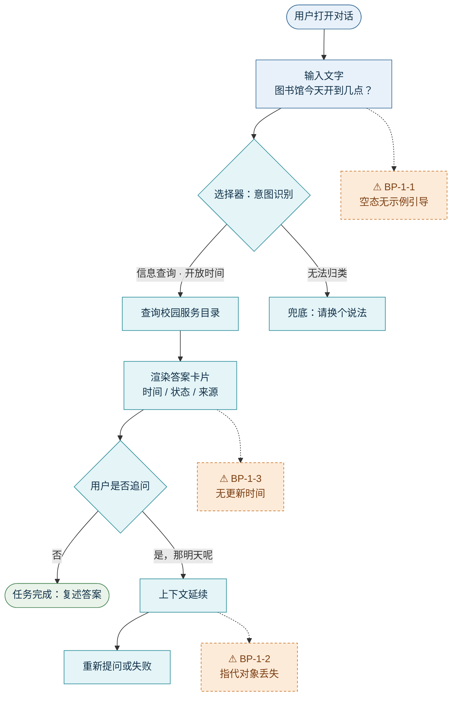
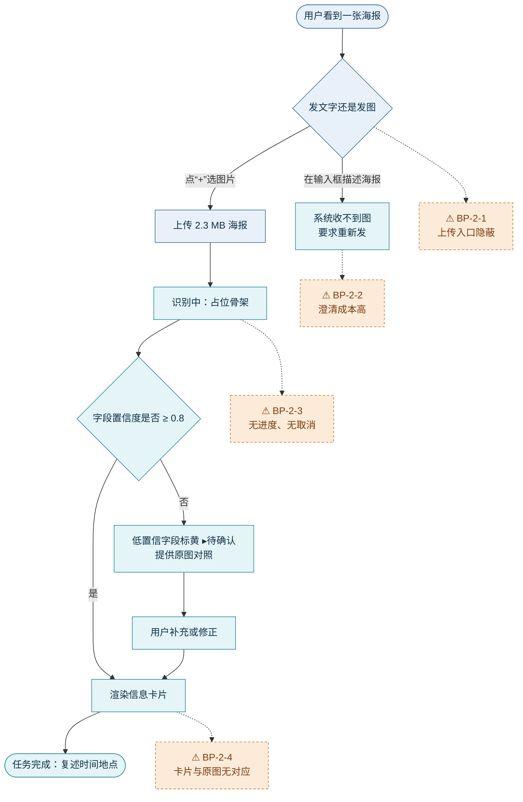
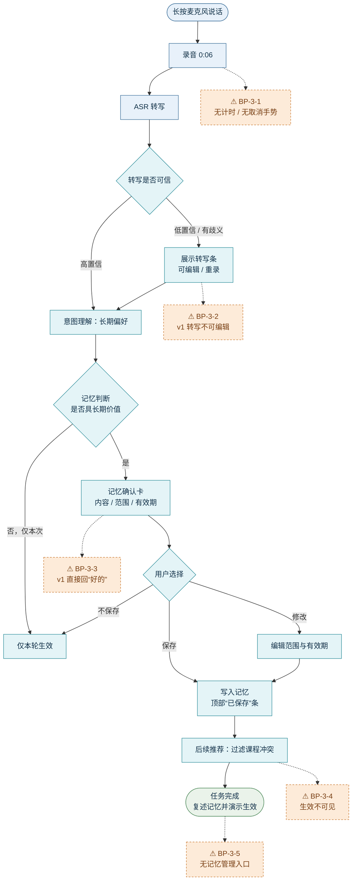
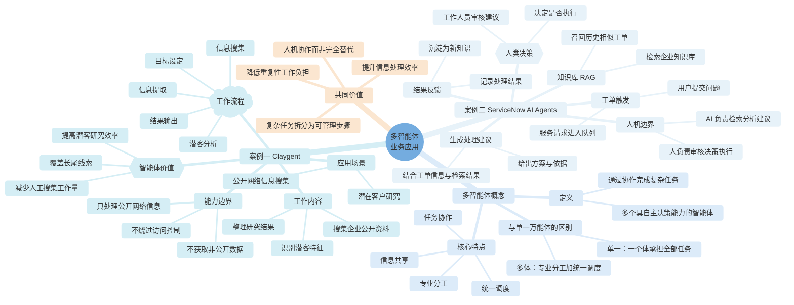
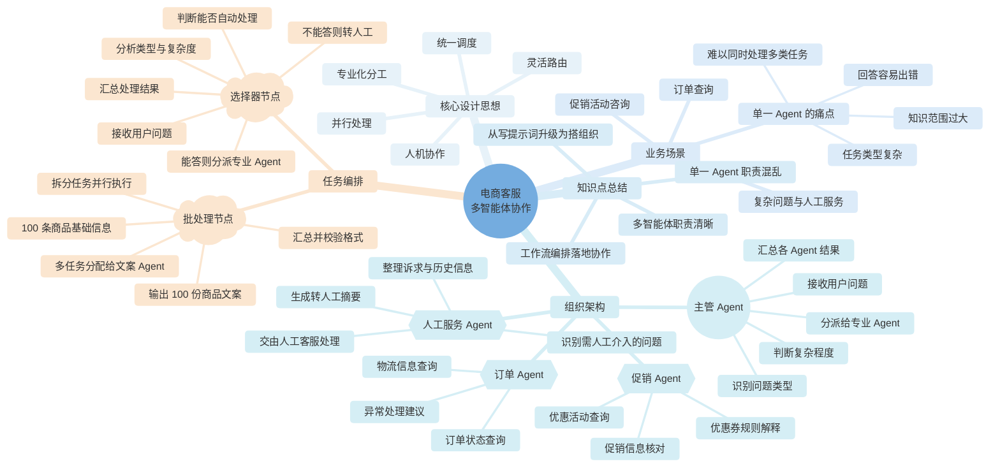
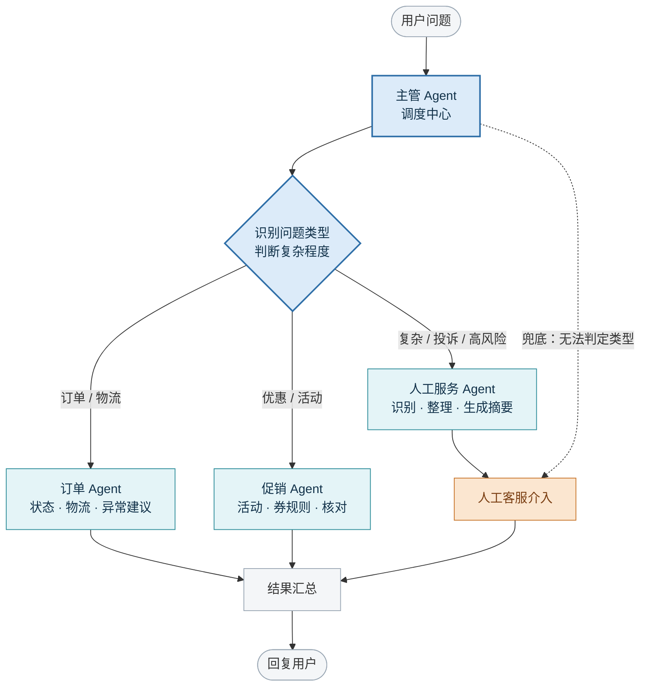
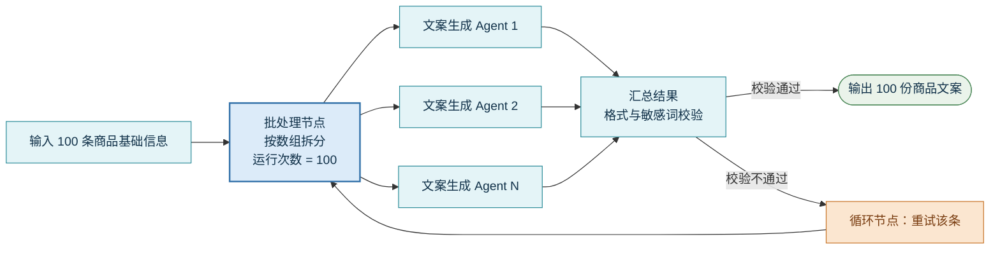
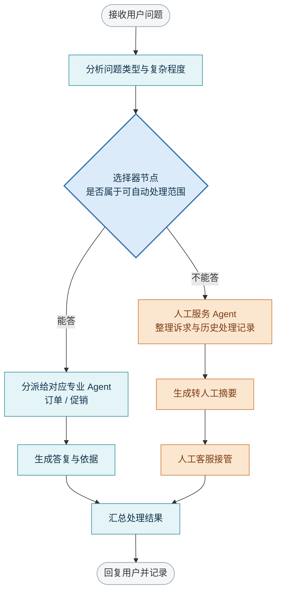

# 第 7 章 · 进阶实验成果
## 多模态低保真原型与可用性测试 ｜ 多智能体协作与工作流设计（思维导图）

| 项目 | 说明 |
| --- | --- |
| 课程 | 《信息系统分析与设计》· 第 7 章 复杂工作流与多智能体系统 |
| 交付物 | ① 进阶实验 A：多模态低保真原型 + 先导可用性测试（含 0–4 级严重度评分、一处交互优化前后对比）<br>② 两张独立思维导图：①《多智能体在业务场景中的应用》②《电商客服多智能体协作》 |
| 方法参照 | Stanford CS147（人本设计 · 低保真原型 · 形成性可用性测试） |
| 视觉规范 | 白 / 浅灰底，低饱和蓝 + 青为主色，橙色仅用于"断点与关键强调"；线框 + 便签 + 流程箭头 |
| 版本 | v1.0（教学演练稿） |

> **⚠ 模拟数据声明（全文有效）**
> 本文中出现的"测试者 A""测试者 B"及其操作、引语、用时、评分，**均为按真实测试方法模拟构造的教学数据**，不是真实访谈、也不是实际用户测试结果。文中所有涉及人的描述均用于演示"如何记录、如何评级、如何据此优化"，不得引用为真实调研结论。

---

## 目录

- **任务一（实验 A）**
  - 1 实验背景与目标
  - 2 实验场景与设计假设
  - 3 任务一：简单任务 · 文字交互
  - 4 任务二：中等任务 · 图文交互
  - 5 任务三：复杂任务 · 语音与记忆交互
  - 6 先导可用性测试设计
  - 7 两名测试者的测试记录（模拟）
  - 8 关键事件与 0–4 级严重度评分表
  - 9 一处交互优化：记忆确认（前后对比）
  - 10 实验总结与设计启示
- **任务二（思维导图）**
  - 11 交付说明
  - 12 思维导图一：多智能体在业务场景中的应用（Claygent 与 ServiceNow AI Agents）
  - 13 思维导图二：电商客服多智能体协作（从专业分工到工作流编排）
  - 14 两张图的关系与差异
  - 附录：文件结构与渲染说明

---

# 任务一　进阶实验 A：多模态低保真原型与 0–4 级可用性测试

## 1 实验背景与目标

### 1.1 实验背景

第 7 章解决的是"当任务变复杂"之后的问题：用 **业务逻辑节点**（选择器 / 批处理 / 循环 / 代码 / 变量聚合）把流程拆开，用 **工作流嵌套** 做模块化，再用 **多 Agent** 让专长角色协作。但在把这些能力接进真实系统之前，有一个更靠前的问题：**用户能不能用得起来？**

本实验以"校园生活智能助手"为对象，先在纸面（低保真）阶段验证三类多模态交互——**文字、图文、语音 + 记忆**——是否成立。选择这三类，是因为它们恰好覆盖了智能体从"被动问答"到"主动服务"的三个台阶：

| 台阶 | 交互本质 | 系统新增能力 | 典型失败方式 |
| --- | --- | --- | --- |
| 文字问答 | 单轮意图 → 结构化答案 | 意图识别 + 信息卡片 | 答非所问、结果不可信 |
| 图文问答 | 多模态输入 → 实体抽取 | 图像理解 + 字段级置信度 | 用户不知道"有没有识别成功" |
| 语音 + 记忆 | 长期偏好 → 改变后续行为 | ASR + 记忆判断 + 记忆确认 | **静默写入错误记忆，且无法撤回** |

第三个台阶风险最高：**记忆一旦写错，会持续污染后续所有推荐**，而用户往往直到很久以后才发现。这正是本实验把"记忆触发时机与提示语"作为重点的原因。

### 1.2 实验目标

- **G1｜可完成性**：验证三个任务在无主持人提示下能否被完成，记录断点位置与严重程度。
- **G2｜多模态可用性**：找出图文、语音两类输入在"入口可发现性、处理中状态、结果可确认性"上的障碍。
- **G3｜记忆可信性**：检验用户能否感知"记住了什么、何时生效、如何修改与撤销"。
- **G4｜设计迭代**：基于测试结果，产出一处可落地的交互优化（记忆确认），并给出可验证的改善指标。

### 1.3 与第 7 章方法的关系

| 第 7 章概念 | 在本平台交互中的对应 | 本次是否测试 |
| --- | --- | --- |
| 选择器节点（意图路由，否则兜底） | 判定"聊天 / 查信息 / 识图 / 记偏好" | ✅ 任务一、任务三 |
| 批处理节点（并行批量） | 海报中多活动批量抽取、活动库批量同步 | ⏸ 未开放给用户 |
| 循环节点（串行重复） | 多轮追问补全查询条件 | ✅ 任务一追问 |
| 工作流嵌套（模块化） | "记忆写入"作为可复用子流程 | ✅ 任务三 |
| 多 Agent（主管 + 专家） | 信息 Agent / 记忆 Agent / 推荐 Agent | ⏸ 骨架预留，未测 |

> **设计边界**：本实验只测"交互层"，不测后端编排正确性；原型为静态线框，由主持人以 **Wizard-of-Oz** 方式扮演智能体回复。

---

## 2 实验场景与设计假设

### 2.1 智能体设定："小园"

| 维度 | 设定 |
| --- | --- |
| 定位 | 面向本校学生的校园生活助手，回答"在哪、几点、怎么办、去哪参加" |
| 知识来源 | 校园服务目录（开放时间、办事指南）、课程表、活动库、后勤公告 |
| 输入 | 文字、语音（≤ 60 s）、图片（海报 / 课表截图） |
| 输出 | 对话气泡 + **信息卡片**（标题 / 关键字段 / 来源 / 更新时间） |
| 记忆 | 仅记忆"用户主动表达、且对未来服务有价值"的偏好与约束（如"周末优先""避开课程时间""不吃辣"） |
| 明确不做 | 不记忆身份证号、住址、成绩等敏感信息；不在用户未确认时写入长期记忆 |

### 2.2 三个任务的复杂度阶梯

| 任务 | 输入模态 | 系统能力链 | 成功标准 | 预估时长 |
| --- | --- | --- | --- | --- |
| 任务一 | 文字 | 意图识别 → 目录查询 → 卡片渲染 | 60 s 内拿到正确开放时间，且能读懂来源 | 30–60 s |
| 任务二 | 图片 + 文字 | 上传 → OCR/版面理解 → 实体抽取 → 置信度判断 → 卡片 | 60 s 内拿到活动时间与地点，可核对原图 | 60–120 s |
| 任务三 | 语音 | ASR → 转写确认 → 意图 → 记忆判断 → 记忆确认 → 写入 → 后续推荐 | 完成"说出偏好 → 确认 → 后续推荐生效"闭环 | 90–180 s |

### 2.3 低保真原型规范

- 以 375×812 的手机界面抽象为 **44 列字符框**，只表达信息层级、可点区域与状态变化，不追求视觉精度。
- 便签表示"设计者假设"，橙色 `⚠` 表示**交互断点**（可能出现问题的地方），灰色 `▓` 表示加载占位。
- 图例：

| 符号 | 含义 |
| --- | --- |
| `┏━┓` | 手机屏幕外框 |
| `┌─┐` | 信息卡片（结构化结果） |
| `[ 按钮 ]` | 可点击区域 |
| `▓▓▓` | 内容占位（尚未返回） |
| `●` | 录音中 |
| `▸ 待确认` | 低置信度字段（需用户确认） |
| `⚠` 橙色虚线节点 | 预判的交互断点（挂在主链路旁） |

配色遵循 CS147 式"信息优先、颜色克制"的原则，仅用三种主色，橙色只出现在断点与关键决策上：

| 色值 | 名称 | 用途 |
| --- | --- | --- |
| `#2F6FA8` | 主蓝 | 主标题、主管 Agent、关键按钮 |
| `#2C8C99` | 青 | 智能体处理节点、次级信息 |
| `#C8752A` | 强调橙 | 交互断点、风险提示、需要人决策的节点 |
| `#F5F7F9` | 浅灰 | 页面底色与卡片分隔 |
| `#EAF3EA` | 完成绿 | 任务完成态（用量最小） |

---

## 3 任务一：简单任务——文字交互

### 3.1 任务定义

| 项目 | 内容 |
| --- | --- |
| 用户目标 | 知道图书馆今天是否开放、开到几点 |
| 输入 | 文字："图书馆今天开到几点？" |
| 系统 | 意图识别（信息查询 · 开放时间）→ 查校园服务目录 → 渲染卡片 |
| 成功标准 | ① 60 s 内得到答案；② 答案含"今日"与"来源"；③ 用户能说出信息可信度依据 |
| 失败判定 | 答非所问、给出过期时间、用户无法确认"这是今天的" |

### 3.2 任务流（图 3-1）



> **图 3-1 说明**：蓝色为用户操作，青色为智能体处理，橙色虚线为预判断点。任务一的主链路只有 4 步，复杂度低，因此断点集中在"入口无引导"和"多轮指代"两处。

### 3.3 低保真界面

**屏 3-2｜初始对话（空态）**：没有任何示例问题，用户不知道"能问什么"。

```text
┏━━━━━━━━━━━━━━━━━━━━━━━━━━━━━━━━━━━━━━━━━━━━┓
┃ 校园生活助手                      记忆 · 0 ┃
┣━━━━━━━━━━━━━━━━━━━━━━━━━━━━━━━━━━━━━━━━━━━━┫
┃ 小园：你好！可以问我课表、场馆             ┃
┃ 开放时间，也能发图片或语音。               ┃
┃                                            ┃
┃         （对话区为空）                     ┃
┃                                            ┃
┃ 小提示：没有可点选的示例问题               ┃
┣━━━━━━━━━━━━━━━━━━━━━━━━━━━━━━━━━━━━━━━━━━━━┫
┃ 输入框：________________________           ┃
┃ [ 文字 ]   [ 语音 ]   [ 图片 ]             ┃
┗━━━━━━━━━━━━━━━━━━━━━━━━━━━━━━━━━━━━━━━━━━━━┛
```

**屏 3-3｜结果卡片**：卡片包含时间、状态、来源，但**没有"更新时间"**，用户无法判断信息新鲜度。

```text
┏━━━━━━━━━━━━━━━━━━━━━━━━━━━━━━━━━━━━━━━━━━━━┓
┃ 校园生活助手                      记忆 · 0 ┃
┣━━━━━━━━━━━━━━━━━━━━━━━━━━━━━━━━━━━━━━━━━━━━┫
┃ 我：图书馆今天开到几点？                   ┃
┃                                            ┃
┃ ┌──────────────────────────────────────┐   ┃
┃ │ 图书馆 · 开放时间                    │   ┃
┃ │ 今天（周四）08:00 — 22:00            │   ┃
┃ │ 状态：开放中                         │   ┃
┃ │ 来源：校园服务目录                   │   ┃
┃ └──────────────────────────────────────┘   ┃
┃                                            ┃
┃ 我：                                       ┃
┣━━━━━━━━━━━━━━━━━━━━━━━━━━━━━━━━━━━━━━━━━━━━┫
┃ 输入框：________________________           ┃
┃ [ 文字 ]   [ 语音 ]   [ 图片 ]             ┃
┗━━━━━━━━━━━━━━━━━━━━━━━━━━━━━━━━━━━━━━━━━━━━┛
```

**屏 3-4｜追问失败**：用户问"那明天呢"，系统未沿用上一轮对象，退回泛化提示。

```text
┏━━━━━━━━━━━━━━━━━━━━━━━━━━━━━━━━━━━━━━━━━━━━┓
┃ 校园生活助手                      记忆 · 0 ┃
┣━━━━━━━━━━━━━━━━━━━━━━━━━━━━━━━━━━━━━━━━━━━━┫
┃ 我：图书馆今天开到几点？                   ┃
┃ 小园：今天 08:00—22:00，开放中。           ┃
┃                                            ┃
┃ 我：那明天呢？                             ┃
┃ 小园：请提供完整的查询对象。               ┃
┃                                            ┃
┃ （上一轮“图书馆”未沿用）                   ┃
┣━━━━━━━━━━━━━━━━━━━━━━━━━━━━━━━━━━━━━━━━━━━━┫
┃ 输入框：________________________           ┃
┃ [ 文字 ]   [ 语音 ]   [ 图片 ]             ┃
┗━━━━━━━━━━━━━━━━━━━━━━━━━━━━━━━━━━━━━━━━━━━━┛
```

### 3.4 信息流转

| 阶段 | 用户侧 | 系统侧 | 数据形态 |
| --- | --- | --- | --- |
| 输入 | 打字 | 接收文本、会话 ID | `{query, sessionId}` |
| 解析 | 等待 | 意图分类 + 槽位抽取（对象=图书馆，时间=今天） | `{intent, slots}` |
| 取数 | — | 查询服务目录（带时间参数） | 结构化记录 |
| 组织 | — | 模板渲染为卡片 | `{title, fields[], source, updatedAt}` |
| 呈现 | 阅读卡片 | 记录曝光 | 卡片视图 |
| 判断 | "可信吗？是今天吗？" | — | 用户心智模型（关键） |

### 3.5 交互断点（测试前预判）

| 编号 | 位置 | 可能的问题 | 预判原因 |
| --- | --- | --- | --- |
| BP-1-1 | 空态输入框 | 不知道能问什么，输入"你好" | 缺少示例问题与能力提示 |
| BP-1-2 | 多轮追问 | "那明天呢"被当成新问题 | 会话未保存指代对象 |
| BP-1-3 | 卡片信息 | 无法判断数据是否过期 | 卡片缺"更新时间/数据来源" |

---

## 4 任务二：中等任务——图文交互

### 4.1 任务定义

| 项目 | 内容 |
| --- | --- |
| 用户目标 | 上传一张校园活动海报，知道活动的时间、地点、主办与报名方式 |
| 输入 | 图片（海报）+ 文字（"这个活动在哪办？"） |
| 系统 | 上传 → 版面理解/OCR → 实体抽取（活动名/时间/地点/主办/报名）→ 置信度判断 → 卡片 |
| 成功标准 | ① 90 s 内得到时间与地点；② 用户能核对"识别是否准确"；③ 低置信字段有提示 |
| 失败判定 | 无法上传、识别后无反馈、字段错误但没有提示、用户把错误信息当成正确信息 |

### 4.2 任务流（图 4-1）



### 4.3 低保真界面

**屏 4-2｜入口混乱**：用户在输入框里用文字描述海报，系统收不到图。

```text
┏━━━━━━━━━━━━━━━━━━━━━━━━━━━━━━━━━━━━━━━━━━━━┓
┃ 校园生活助手                      记忆 · 0 ┃
┣━━━━━━━━━━━━━━━━━━━━━━━━━━━━━━━━━━━━━━━━━━━━┫
┃ 我：这个海报上的活动是什么时候？           ┃
┃                                            ┃
┃ 小园：没收到图片。可以先发图，             ┃
┃ 再问我时间地点。                           ┃
┃                                            ┃
┃ （用户此前在输入框里描述海报）             ┃
┃ （“+”入口收起，未展开）                    ┃
┣━━━━━━━━━━━━━━━━━━━━━━━━━━━━━━━━━━━━━━━━━━━━┫
┃ 输入框：________________________           ┃
┃ [ 文字 ]   [ 语音 ]   [ 图片 ]             ┃
┗━━━━━━━━━━━━━━━━━━━━━━━━━━━━━━━━━━━━━━━━━━━━┛
```

**屏 4-3｜识别中**：只有占位块，没有进度、预计时间与取消入口。

```text
┏━━━━━━━━━━━━━━━━━━━━━━━━━━━━━━━━━━━━━━━━━━━━┓
┃ 校园生活助手                        识别中 ┃
┣━━━━━━━━━━━━━━━━━━━━━━━━━━━━━━━━━━━━━━━━━━━━┫
┃ 我：[已上传图片] 这个活动在哪办？          ┃
┃                                            ┃
┃           ▓▓▓▓▓▓▓▓▓▓                       ┃
┃           ▓▓▓▓▓▓▓▓▓▓                       ┃
┃           ▓▓▓▓▓▓▓▓                         ┃
┃                                            ┃
┃ （无进度、无预计时间、无取消）             ┃
┣━━━━━━━━━━━━━━━━━━━━━━━━━━━━━━━━━━━━━━━━━━━━┫
┃ [ 文字 ]   [ 语音 ]   [ 图片 ]  发送       ┃
┗━━━━━━━━━━━━━━━━━━━━━━━━━━━━━━━━━━━━━━━━━━━━┛
```

**屏 4-4｜结果卡片**：地点字段标 `▸待确认`，但整卡没有区分"哪些是识别的、哪些是确定的"，也没有原图缩略图。

```text
┏━━━━━━━━━━━━━━━━━━━━━━━━━━━━━━━━━━━━━━━━━━━━┓
┃ 校园生活助手                      记忆 · 0 ┃
┣━━━━━━━━━━━━━━━━━━━━━━━━━━━━━━━━━━━━━━━━━━━━┫
┃ ┌──────────────────────────────────────┐   ┃
┃ │ 活动 · 秋季社团招新                  │   ┃
┃ │ 时间：10 月 25 日 14:00              │   ┃
┃ │ 地点：一教 302  ▸待确认              │   ┃
┃ │ 主办：学生社团联合会                 │   ┃
┃ │ 报名：扫码 / 现场报名                │   ┃
┃ └──────────────────────────────────────┘   ┃
┃                                            ┃
┃ 来源：海报图片（置信度 0.72）              ┃
┃ （未说明哪些字段为识别结果）               ┃
┣━━━━━━━━━━━━━━━━━━━━━━━━━━━━━━━━━━━━━━━━━━━━┫
┃ [ 修改字段 ]   [ 查看原图 ]                ┃
┃ [ 文字 ]   [ 语音 ]   [ 图片 ]             ┃
┗━━━━━━━━━━━━━━━━━━━━━━━━━━━━━━━━━━━━━━━━━━━━┛
```

### 4.4 信息流转

| 阶段 | 用户侧 | 系统侧 | 数据形态 |
| --- | --- | --- | --- |
| 选择通道 | 犹豫"打字还是发图" | 无引导 | — |
| 上传 | 选图、等待 | 分片上传、生成缩略图 | `{imageId, storageKey}` |
| 识别 | 看占位块 | OCR + 版面分析 + 实体抽取 | `{fields[], bbox, confidence}` |
| 判定 | — | 阈值判断：≥0.8 直接展示，否则标待确认 | `{needsConfirm[]}` |
| 呈现 | 读卡片 | 渲染卡片 + 原图对照 | 卡片视图 |
| 核对 | "这条路对不对？" | — | 用户心智模型（关键） |

### 4.5 交互断点（测试前预判）

| 编号 | 位置 | 可能的问题 | 预判原因 |
| --- | --- | --- | --- |
| BP-2-1 | 输入区 | 不知道能发图，或找不到上传入口 | 多模态入口藏在"+"里，无提示 |
| BP-2-2 | 对话 | 用文字描述图片，系统无法理解 | 缺少"看不到图"的即时澄清话术 |
| BP-2-3 | 识别中 | 以为卡死，重复上传 | 无进度、无预计时长、无取消 |
| BP-2-4 | 结果卡 | 无法确认识别结果是否可信 | 缺原图对照与字段级来源标识 |

---

## 5 任务三：复杂任务——语音与记忆交互

### 5.1 任务定义

任务三要求在一条链路里完成 **5 个必备环节**，缺一不可：

| 环节 | 用户可感知的输出 | 缺失后果 |
| --- | --- | --- |
| ① 语音识别（ASR） | 转写文本（可编辑/可重录） | 说错被将错就错 |
| ② 意图理解 | "我理解为你想要…" | 理解偏差无人纠正 |
| ③ 记忆判断 | 区分"本次"与"长期" | 把随口一句当成长期规则 |
| ④ 记忆确认 | 记忆内容 + 保存/修改/不保存 | 用户不知道记住了什么 |
| ⑤ 后续推荐 | 推荐结果标注"已应用偏好" | 记忆是否生效不可见 |

**任务叙述**：用户说"以后周末的活动，别推我上课时间的"，期望系统记住"周末推荐需避开课程冲突"，并在之后的推荐中自动过滤冲突活动。

### 5.2 任务流（图 5-1）



> **重要说明（设计欠账）**：图 5-1 是**设计要求**的完整链路。实际用于测试的 **v1 原型省略了第 ④ 环节**（收到语音后直接回复"好的"），这是本实验刻意保留的"设计欠账"，用来验证用户能否发现"记忆没被确认"这一问题。优化见第 9 节。

### 5.3 低保真界面

**屏 5-2｜录音中**：没有计时、没有上滑取消提示、没有说话人确认。

```text
┏━━━━━━━━━━━━━━━━━━━━━━━━━━━━━━━━━━━━━━━━━━━━┓
┃ 校园生活助手                     录音 0:06 ┃
┣━━━━━━━━━━━━━━━━━━━━━━━━━━━━━━━━━━━━━━━━━━━━┫
┃ 小园：我在听…                              ┃
┃                                            ┃
┃             ●●●●●●                         ┃
┃                                            ┃
┃ （无计时、无滑动取消、无重录）             ┃
┣━━━━━━━━━━━━━━━━━━━━━━━━━━━━━━━━━━━━━━━━━━━━┫
┃ [ 松开发送 ]   [ 上滑取消 ]                ┃
┃ [ 文字 ]   [ 语音 ]   [ 图片 ]             ┃
┗━━━━━━━━━━━━━━━━━━━━━━━━━━━━━━━━━━━━━━━━━━━━┛
```

**屏 5-3｜转写确认**：转写结果不可编辑、无重录，ASR 的错字无法修正。

```text
┏━━━━━━━━━━━━━━━━━━━━━━━━━━━━━━━━━━━━━━━━━━━━┓
┃ 校园生活助手                      识别完成 ┃
┣━━━━━━━━━━━━━━━━━━━━━━━━━━━━━━━━━━━━━━━━━━━━┫
┃ 你说的是：                                 ┃
┃ ┌──────────────────────────────────────┐   ┃
┃ │ 以后周末的活动，                     │   ┃
┃ │ 别推我上课时间的                     │   ┃
┃ └──────────────────────────────────────┘   ┃
┃                                            ┃
┃ （转写不可编辑、无重录按钮）               ┃
┣━━━━━━━━━━━━━━━━━━━━━━━━━━━━━━━━━━━━━━━━━━━━┫
┃ [ 文字 ]   [ 语音 ]   [ 图片 ]  发送       ┃
┗━━━━━━━━━━━━━━━━━━━━━━━━━━━━━━━━━━━━━━━━━━━━┛
```

**屏 5-4｜v1 的"好的"**：没有任何记忆内容，用户无法判断是否保存成功。

```text
┏━━━━━━━━━━━━━━━━━━━━━━━━━━━━━━━━━━━━━━━━━━━━┓
┃ 校园生活助手                      记忆 · ? ┃
┣━━━━━━━━━━━━━━━━━━━━━━━━━━━━━━━━━━━━━━━━━━━━┫
┃ 我：（语音）以后周末的活动，               ┃
┃ 别推我上课时间的                           ┃
┃                                            ┃
┃ 小园：好的。                               ┃
┃                                            ┃
┃ （无记忆内容、无保存动作、无入口）         ┃
┣━━━━━━━━━━━━━━━━━━━━━━━━━━━━━━━━━━━━━━━━━━━━┫
┃ 输入框：________________________           ┃
┃ [ 文字 ]   [ 语音 ]   [ 图片 ]             ┃
┗━━━━━━━━━━━━━━━━━━━━━━━━━━━━━━━━━━━━━━━━━━━━┛
```

**屏 5-5｜后续推荐**：第 3 条与课程时间冲突的活动仍被推荐，且没有任何"已应用偏好"的说明。

```text
┏━━━━━━━━━━━━━━━━━━━━━━━━━━━━━━━━━━━━━━━━━━━━┓
┃ 校园生活助手                      记忆 · ? ┃
┣━━━━━━━━━━━━━━━━━━━━━━━━━━━━━━━━━━━━━━━━━━━━┫
┃ ┌──────────────────────────────────────┐   ┃
┃ │ 推荐 · 本周末校园活动                │   ┃
┃ │ 1. 秋季音乐会  周六 19:00            │   ┃
┃ │ 2. 社团招新    周六 14:00            │   ┃
┃ │ 3. 学业讲座    周一 19:00            │   ┃
┃ └──────────────────────────────────────┘   ┃
┃                                            ┃
┃ （未说明是否用了用户偏好）                 ┃
┃ （第 3 条与课程时间冲突）                  ┃
┣━━━━━━━━━━━━━━━━━━━━━━━━━━━━━━━━━━━━━━━━━━━━┫
┃ [ 换一批 ]   [ 不感兴趣 ]                  ┃
┃ [ 文字 ]   [ 语音 ]   [ 图片 ]             ┃
┗━━━━━━━━━━━━━━━━━━━━━━━━━━━━━━━━━━━━━━━━━━━━┛
```

**屏 5-6｜设置页**：没有"我的记忆"入口，用户无处查看或删除已保存的偏好。

```text
┏━━━━━━━━━━━━━━━━━━━━━━━━━━━━━━━━━━━━━━━━━━━━┓
┃ 设置                                       ┃
┣━━━━━━━━━━━━━━━━━━━━━━━━━━━━━━━━━━━━━━━━━━━━┫
┃ 账号与安全                                 ┃
┃ 消息通知                                   ┃
┃ 语音与朗读                                 ┃
┃ 隐私与数据                                 ┃
┃ 关于小园                                   ┃
┃                                            ┃
┃ （没有“我的记忆”入口）                     ┃
┣━━━━━━━━━━━━━━━━━━━━━━━━━━━━━━━━━━━━━━━━━━━━┫
┃ 退出登录                                   ┃
┗━━━━━━━━━━━━━━━━━━━━━━━━━━━━━━━━━━━━━━━━━━━━┛
```

### 5.4 信息流转

| 阶段 | 用户侧 | 系统侧 | 数据形态 |
| --- | --- | --- | --- |
| 录音 | 按下、说话 | 采集音频、VAD 断句 | `{audio, duration}` |
| 转写 | 看文字 | ASR → 文本 + 置信度 | `{transcript, confidence}` |
| 理解 | 判断"它懂了吗" | 意图 + 约束抽取（时间范围=周末，约束=避开课程） | `{intent, constraints[]}` |
| 记忆判断 | — | 长期价值评分 + 敏感信息过滤 | `{shouldRemember, reason}` |
| 确认 | 选择保存/修改/不保存 | 生成记忆条目 | `{memoryDraft}` |
| 写入 | 看到"已保存" | 落库 + 版本号 | `{memoryId, scope, ttl}` |
| 推荐 | 看推荐结果 | 推荐时读取记忆并过滤 | `{items[], appliedPolicies[]}` |
| 管理 | 查看/修改/删除 | 记忆列表与审计 | `{memoryList}` |

### 5.5 交互断点（测试前预判）

| 编号 | 位置 | 可能的问题 | 预判原因 |
| --- | --- | --- | --- |
| BP-3-1 | 录音中 | 不知道录了多久、想取消但不会 | 无计时与手势提示 |
| BP-3-2 | 转写 | 错字无法改，只好重说一遍 | 转写不可编辑 |
| BP-3-3 | 记忆确认 | 一句"好的"无法确认是否已保存 | v1 缺确认卡（设计欠账） |
| BP-3-4 | 推荐 | 不知道推荐是否用了偏好 | 无"已应用"标识 |
| BP-3-5 | 设置 | 找不到记忆管理入口 | 无"我的记忆"页面 |

---


## 6 先导可用性测试设计

### 6.1 方法与声明

- **类型**：形成性可用性测试（formative usability test），目的是"找问题"，不是"证明好用"。
- **形式**：主持人引导（moderated）+ 有声思维（think-aloud）+ **Wizard-of-Oz**（主持人按预设脚本扮演智能体，不暴露真人身份）。
- **规模**：2 名被试 × 3 个任务。先导测试的样本量小，结论只用于**发现与排序问题**，不做统计推断（Nielsen 的经验是 5 人可发现约 85% 的问题，2 人只能覆盖主要断点，故本报告明确标注为"先导"）。

> **再次声明**：以下 A、B 两位测试者及其全部记录均为**模拟数据**，用于演示测试流程与记录规范。

### 6.2 被试画像

| 编号 | 背景 | 数字熟练度 | 语音/识图使用习惯 | 选择理由 |
| --- | --- | --- | --- | --- |
| A | 女，大二，信息资源管理 | 中高（日均手机 5 h） | 几乎不用语音助手，偶尔用图片搜索 | 代表"主流但非重度"用户 |
| B | 男，大三，计算机 | 高（日均手机 6 h） | 常用语音助手与识图 | 代表"高熟练度、会挑刺"用户 |

### 6.3 测试环境与材料

| 类别 | 内容 |
| --- | --- |
| 环境 | 实验室安静工位；纸模手机框 + 电脑投屏记录；录屏（仅屏幕） |
| 材料 | 3 张任务卡、1 张活动海报（含 5 个字段）、1 张课程表截图、便签、计时器 |
| 原型 | v1 静态线框（含刻意保留的"记忆确认缺失"） |
| 伦理 | 知情同意、可随时退出、数据匿名、录音仅用于本次分析 |

### 6.4 任务卡

| 任务卡 | 给用户的指令（原文） | 成功标准 |
| --- | --- | --- |
| T1 | "你想知道图书馆今天几点关门，请用这个助手查一下。" | 说出正确关门时间与依据 |
| T2 | "同学发给你一张活动海报，你想知道活动在哪天、在哪办。请用这个助手。" | 说出正确时间与地点，并能说明是否核对过 |
| T3 | "你希望以后推荐活动时避开上课时间，请先告诉助手，然后再让它给你推荐一次周末活动。" | 完成"说偏好 → 确认 → 推荐生效"闭环 |

### 6.5 测量指标

| 指标 | 定义 | 记录方式 |
| --- | --- | --- |
| 任务完成 | 达成成功标准（区分"形式完成"与"实质完成"） | 记录员判定 |
| 任务用时 | 从读题到说出结论 | 秒表 |
| 协助次数 | 主持人提示次数（含"可以试试看"等中性提示） | 计数 |
| 关键事件 | 导致迷惑、犹豫、错误、求助的行为 | 时间戳 + 引语 |
| SEQ 易用性 | 任务后单题：1（很难）–7（很容易） | 口头打分 |
| 记忆复述 | 任务三后问"它记住了什么？" | 复述准确性 |

### 6.6 主持脚本要点

1. 只读任务卡，不解释界面、不指路、不说"你可以点右上角"。
2. 用户沉默超过 15 s 时，只问："你现在在想什么？"
3. 出现求助时，先记录，再允许 1 次中性提示，并计入"协助次数"。
4. 任务后追问三题：哪里最犹豫？你会不会信任这个结果？如果只能改一处，改哪里？

---

## 7 两名测试者的测试记录（模拟）

### 7.1 测试者 A

| 时间 | 任务 | 观察记录（含引语） | 标注 |
| --- | --- | --- | --- |
| 00:00 | 开场 | 读题后先问"这是真的能用，还是纸上的？"，得知是纸模后放松 | — |
| 00:10 | T1 | 开始任务，盯着输入框 6 s，输入"你好"又删掉 | CI-01 |
| 00:16 | T1 | 改成"图书馆今天开到几点？" | — |
| 01:05 | T1 | 看到卡片先说"哦，22 点"，随后追问"这是今天的吗？" | CI-14 |
| 01:20 | T1 | 结束，SEQ 打 5 分 | — |
| 01:20 | T2 | 直接在输入框写"海报上写着周六下午两点，在某教学楼"，没有发现"+" | CI-04 |
| 02:35 | T2 | 主持人中性提示后发现图片按钮（协助 +1）；上传后 9 s 内反复说"是不是没好？" | CI-04、CI-05 |
| 03:40 | T2 | 想核对"10 月 25 日"却找不到原图，最后放弃核对 | CI-06 |
| 04:30 | T2 | 结束，SEQ 打 4 分 | — |
| 04:30 | T3 | 按住麦克风说完，看到转写漏了"的"，犹豫后直接发送 | CI-08 |
| 04:52 | T3 | 系统回"好的"，她问"这就是记住了？"，没有再确认 | CI-09 |
| 06:10 | T3 | 收到推荐列表，扫一眼说"行吧"，没发现周一讲座与课程冲突 | CI-12 |
| 07:20 | T3 | 想改偏好，进入设置逐项翻找，翻了 3 个页面后放弃 | CI-10 |
| 08:10 | T3 | 结束，SEQ 打 2 分 | — |
| 08:40 | 访谈 | "那个'好的'我不确定它是听懂了还是记下来了。" | 关键引语 |
| 09:10 | 访谈 | "卡片本身挺清楚的，比我现在用的教务 App 好。" | CI-15（正向） |

**A 的小结**：三个任务都"形式完成"（用时 1'10" / 3'10" / 3'40"），但任务三是**形式完成、实质失败**——她以为偏好已保存，实际系统只回了"好的"。SEQ：T1 = 5，T2 = 4，T3 = 2。

### 7.2 测试者 B

| 时间 | 任务 | 观察记录（含引语） | 标注 |
| --- | --- | --- | --- |
| 00:00 | 开场 | 上来先找"设置"，说"我想先看看它能记什么" | — |
| 00:28 | T1 | 读完卡片第一句是"这数据什么时候的？" | CI-02 |
| 00:50 | T1 | 追问"明天呢"，被要求"提供完整查询对象"后重打全句，评价"这不智能" | CI-03 |
| 01:33 | T1 | 结束，SEQ 打 6 分 | — |
| 01:33 | T2 | 直接点"+"选图，上传完成后 8 s 内连点 3 次发送 | CI-05 |
| 02:50 | T2 | 地点识别为"一教 302"（实际为二教），他没有核对，直接说"记住了，一教" | CI-07 |
| 03:38 | T2 | 结束，SEQ 打 3 分；补充"我差点就信了这个地点" | CI-07 |
| 03:38 | T3 | 说完偏好，看到"好的"后追问"你记住啥了？" | CI-09 |
| 04:05 | T3 | 系统重复"好的"，他连续追问两次，开始不耐烦 | CI-09 |
| 05:05 | T3 | 推荐列表与他的意图相反：课程时间内的活动仍被推送 | CI-11 |
| 05:40 | T3 | 想撤销，翻设置未找到；问主持人"这个记忆在哪删？" | CI-10、CI-11 |
| 06:15 | T3 | 主持人提示可以重说一次，他重说后仍得到"好的" | 任务失败 |
| 06:53 | T3 | 结束，SEQ 打 1 分 | — |
| 07:20 | 访谈 | "不可怕的是它记错，可怕的是我不知道它记错了。" | 关键引语 |
| 07:50 | 访谈 | 首次点麦克风权限被拒后再点无反应，"我以为坏了" | CI-13 |

**B 的小结**：任务三**失败**——错误理解被静默写入，且无撤销入口，随后的推荐全部偏离预期。这正是 4 级事件的典型形态。

### 7.3 两位测试者对比

| 指标 | 测试者 A | 测试者 B |
| --- | --- | --- |
| 任务完成（形式） | 3 / 3 | 3 / 3 |
| 任务完成（实质） | 2 / 3（T3 偏好未真正写入） | 2 / 3（T3 记忆写错） |
| 用时（T1/T2/T3） | 1'10" / 3'10" / 3'40" | 1'05" / 2'05" / 3'15" |
| 协助次数 | 1 | 1（T3 重说提示） |
| 关键事件数（去重后 15 条） | 9 条 | 8 条 |
| SEQ（T1/T2/T3） | 5 / 4 / 2 | 6 / 3 / 1 |
| 记忆复述准确性 | 以为已保存（错） | 说出了错误内容（错） |

> **共同结论**：两人都能完成"简单/中等"任务，但**任务三的失败与熟练度无关**——A 是"没意识到没保存"，B 是"保存错了且改不了"。这说明问题不在用户，而在**记忆环节缺少可感知的确认与可恢复的控制**。

---

## 8 关键事件与 0–4 级严重度评分表

### 8.1 严重度评分标准

| 级别 | 定义 | 判定要点 |
| --- | --- | --- |
| 0 | 不是可用性问题 | 正向反馈、偏好差异、非交互问题 |
| 1 | 表面问题，不影响任务完成 | 用户皱眉/重复确认，但无额外操作 |
| 2 | 轻微问题，影响效率或造成困惑 | 多花时间、需要试错，但能自行绕过 |
| 3 | 严重问题，导致任务中断或需要帮助 | 卡住、求助、放弃某一步 |
| 4 | 灾难性问题，导致任务无法完成或造成严重错误 | 错误结果被采信并传播、数据被错误写入且不可恢复 |

### 8.2 关键事件表（模拟数据）

| 编号 | 任务 | 测试者 | 用户操作及行为表现 | 出现的问题 | 可能原因 | 严重度 | 设计启示 |
| --- | --- | --- | --- | --- | --- | --- | --- |
| CI-01 | T1 | A | 空态停留 6 s，先输入"你好"再删除，改问完整句子 | 不知道能问什么、能问到什么程度 | 首屏无示例问题与能力说明 | **1** | 首屏给 3 个可点示例 chip |
| CI-02 | T1 | B | 读完卡片先问"这数据什么时候的？" | 无法判断信息新鲜度 | 卡片只有来源，无更新时间 | **2** | 卡片脚注固定"更新于 hh:mm" |
| CI-03 | T1 | A | 追问"那明天呢"被要求"提供完整查询对象"，只好重打全句 | 多轮指代丢失，交互成本陡增 | 会话未保留上一轮槽位 | **3** | 槽位继承 + "明天/后天"快捷按钮 |
| CI-04 | T2 | A | 在输入框描述海报 2 次，始终没找到上传入口 | 多模态入口不可发现 | 入口只有"+"图标、无文案、无引导 | **3** | 空态提示"可以直接发图"，图标加文字标签 |
| CI-05 | T2 | A、B | 上传后 8—9 s 无变化，反复点击或返回重进，产生重复任务 | 不确定系统是否在工作 | 只有骨架屏，无进度/时长/取消 | **2** | 进度条 + 预计 6 s + 取消按钮 |
| CI-06 | T2 | A | 想核对"10 月 25 日"却找不到原图，最后放弃核对 | 识别结果无法被验证 | 卡片与原图无对照、字段无来源标识 | **3** | 卡片支持"查看原图"并高亮对应区域 |
| CI-07 | T2 | B | 地点识别错误（一教 / 二教），用户直接采信并转发班群 | 错误信息被当作正确信息使用 | 置信度未暴露、无待确认标记 | **3** | 低置信字段标黄 + 一键纠错 |
| CI-08 | T3 | A | 转写漏字（"上课时间的"→"上课时间"），犹豫后直接发送 | 转写偏差无法修正 | 转写文本不可编辑、无重录 | **2** | 转写条可编辑，低置信词高亮 |
| CI-09 | T3 | A、B | 听到"好的"后追问"你记住啥了？"，B 连续追问两次 | 无法确认记忆是否写入、写了什么 | 缺记忆确认环节 | **3** | 记忆确认卡（内容 + 三选项） |
| CI-10 | T3 | A、B | 进入设置逐项翻找，翻了 3 页未找到，放弃修改 | 无法修改或取消记忆 | 无"我的记忆"入口 | **3** | 设置页 + 个人页双入口 |
| CI-11 | T3 | B | 系统把偏好误存为"不推荐课程相关活动"，随后推荐全部偏离预期，且无撤销入口 | 错误记忆被静默写入，持续影响后续服务 | 无确认 + 无撤销 + 无生效提示 | **4** | 先确认再写入；提供撤销与版本记录 |
| CI-12 | T3 | A | 推荐列表出现周一 19:00 讲座，未意识到与课程冲突 | 记忆是否生效不可见 | 推荐卡无"已应用偏好"标识 | **2** | 卡片标注"已按偏好过滤 2 项" |
| CI-13 | T3 | B | 首次点击麦克风弹权限，拒绝后再点无反应，以为功能坏了 | 权限被拒后无兜底 | 缺说明与"去设置"跳转 | **1** | 权限引导文案 + 设置跳转 |
| CI-14 | T1 | A | 卡片写"今天（周四）"，她仍回头看了眼手机日期 | 表述略绕，需二次确认 | 信息冗余但不够直白 | **1** | 改为"现在开放，22:00 闭馆" |
| CI-15 | T3 | A | 主动说"这个卡片挺清楚的，比我用的那个好用" | —（正向反馈） | — | **0** | 保留卡片的信息层级与配色 |

### 8.3 分布统计

| 严重度 | 事件数 | 占比 | 涉及任务 |
| --- | --- | --- | --- |
| 0 | 1 | 6.7% | T3 |
| 1 | 3 | 20.0% | T1、T3 |
| 2 | 4 | 26.7% | T1、T2、T3 |
| 3 | 6 | 40.0% | T1、T2、T3 |
| 4 | 1 | 6.7% | T3 |
| 合计 | 15 | 100% | — |

**读表要点**：3 级问题占 40%，且**集中在"看不见系统状态"**（入口、处理中、是否记住、是否生效）；唯一的 4 级事件发生在记忆写入环节，直接决定了后续优化方向。

### 8.4 问题聚类与优先级

| 族群 | 事件 | 数量 | 最高级别 | 影响 | 优先级 |
| --- | --- | --- | --- | --- | --- |
| 记忆可信性（确认/管理/生效） | CI-09、CI-10、CI-11、CI-12 | 4 | **4** | 错误长期化、信任崩塌 | P0 |
| 多模态状态反馈 | CI-05、CI-06、CI-07、CI-08 | 4 | 3 | 结果不可验证、错误被采信 | P1 |
| 入口可发现性 | CI-04、CI-13 | 2 | 3 | 功能用不上 | P1 |
| 文案与信息可信 | CI-02、CI-14 | 2 | 2 | 犹豫、二次确认 | P2 |
| 多轮上下文 | CI-03 | 1 | 3 | 重复输入 | P2 |
| 正向反馈 | CI-15 | 1 | 0 | 保留设计资产 | — |

---


## 9 一处交互优化：记忆确认（前后对比）

### 9.1 为什么选这一处

在 15 个关键事件中，**CI-11 是唯一的 4 级事件**，且"记忆可信性"族群合计 4 个事件（CI-09/10/11/12），覆盖"是否保存—保存在哪—写错了怎么办—是否生效"完整闭环。它同时满足三个"最值得优化"的条件：

1. **后果最重**：错误记忆不是一次性的答错，而是会持续污染后续所有推荐；
2. **频率最高**：4 个事件、2 名测试者全部命中；
3. **与第 7 章直接对应**：记忆写入本就应作为一个**子工作流（嵌套）**来处理——判断、确认、写入、生效、可撤销——而 v1 把它压缩成了一句话。

### 9.2 优化前 vs 优化后（图 9-1）

**图 9-1｜左右对照：v1「好的」 vs v2「记忆确认卡」**

```text
┏━━━━━━━━━━━━━━━━━━━━━━━━━━━━━━━━━━━━┓   ┏━━━━━━━━━━━━━━━━━━━━━━━━━━━━━━━━━━━━┓
┃ 优化前 · v1                        ┃   ┃ 优化后 · v2                        ┃
┣━━━━━━━━━━━━━━━━━━━━━━━━━━━━━━━━━━━━┫   ┣━━━━━━━━━━━━━━━━━━━━━━━━━━━━━━━━━━━━┫
┃ 我：（语音）以后周末的             ┃   ┃ 小园：要记住这条偏好吗？           ┃
┃ 活动，别推我上课时间的             ┃   ┃                                    ┃
┃                                    ┃   ┃ ┌────────────────────────────┐     ┃
┃ 小园：好的。                       ┃   ┃ │ 将记住：活动避开课程       │     ┃
┃                                    ┃   ┃ │ 适用范围：周六、周日       │     ┃
┃ toast 3 秒后消失                   ┃   ┃ │ 有效期：长期 · 可改        │     ┃
┃ （无记忆内容、无入口）             ┃   ┃ └────────────────────────────┘     ┃
┣━━━━━━━━━━━━━━━━━━━━━━━━━━━━━━━━━━━━┫   ┃                                    ┃
┃ 用户无法判断是否保存               ┃   ┃ [ 保存 ] [ 修改 ] [ 不保存 ]       ┃
┗━━━━━━━━━━━━━━━━━━━━━━━━━━━━━━━━━━━━┛   ┣━━━━━━━━━━━━━━━━━━━━━━━━━━━━━━━━━━━━┫
                                         ┃ 保存后顶部常驻“已保存”             ┃
                                         ┗━━━━━━━━━━━━━━━━━━━━━━━━━━━━━━━━━━━━┛
```

> 左：v1 收到偏好后只回"好的"，toast 3 秒消失，无内容、无入口、无撤销。
> 右：v2 在写入前插入确认卡，明确"记住什么、管多大范围、存多久"，并给出保存 / 修改 / 不保存三条路径。

### 9.3 优化前的问题诊断

| # | 问题 | 用户表现（模拟） | 对应设计原则 |
| --- | --- | --- | --- |
| 1 | 系统状态不可见：不知道是否保存、保存了什么 | A："这就是记住了？" B：连续追问两次 | 状态可见性（Visibility of system status） |
| 2 | 用户无控制权：不能修改、不能撤销 | B：翻设置 3 页找不到删除入口 | 用户可控与自由（User control and freedom） |
| 3 | 无错误预防：ASR 误识别直接变成长期规则 | B：错误偏好被写入，后续推荐全错 | 错误预防（Error prevention） |
| 4 | 只能"回忆"而非"识别"：用户要自己记住说过什么 | A：事后无法复述系统记住了什么 | 识别优于回忆（Recognition over recall） |
| 5 | 生效不可见：推荐用了偏好却不说 | A：没发现周一讲座与课程冲突 | 系统与真实世界匹配 |

### 9.4 优化后的交互

**屏 9-2｜保存成功后的常驻状态与生效标识**

```text
┏━━━━━━━━━━━━━━━━━━━━━━━━━━━━━━━━━━━━━━━━━━━━┓
┃ 校园生活助手                      记忆 · 1 ┃
┣━━━━━━━━━━━━━━━━━━━━━━━━━━━━━━━━━━━━━━━━━━━━┫
┃ 已保存：周末活动避开课程时间               ┃
┃             [ 查看 ]   [ 撤销 ]            ┃
┃                                            ┃
┃ ┌──────────────────────────────────────┐   ┃
┃ │ 推荐 · 本周末校园活动                │   ┃
┃ │ 已按偏好过滤 2 个冲突活动            │   ┃
┃ │ 1. 秋季音乐会  周六 19:00            │   ┃
┃ │ 2. 社团招新    周六 14:00            │   ┃
┃ └──────────────────────────────────────┘   ┃
┃                                            ┃
┃ （推荐卡片标注“已应用偏好”）               ┃
┣━━━━━━━━━━━━━━━━━━━━━━━━━━━━━━━━━━━━━━━━━━━━┫
┃ [ 换一批 ]   [ 修改偏好 ]                  ┃
┗━━━━━━━━━━━━━━━━━━━━━━━━━━━━━━━━━━━━━━━━━━━━┛
```

优化后的四段式提示语（可直接落为工作流模板）：

```text
小园：我理解你想要「周末的活动优先，避开课程时间」。
      要我以后都这样安排吗？

      ┌ 将记住：活动推荐避开课程时间
      │ 适用范围：周六、周日
      └ 有效期：长期 · 可随时修改

      [ 保存 ]    [ 修改 ]    [ 不保存 ]
```

对应的交互规则：

| 规则 | 说明 |
| --- | --- |
| 先确认、后写入 | 未经确认不产生长期记忆，只作用于本次会话 |
| 展示"具体内容"而非"我知道了" | 用结构化字段复述，用户可核对 |
| 三选一而非二选一 | 保存 / 修改 / 不保存，"修改"进入字段编辑 |
| 保存后给落点 | 顶部常驻"已保存"条，提供"查看 / 撤销" |
| 生效时给证据 | 推荐卡片标注"已按偏好过滤 2 项" |
| 可反悔 | 撤销后恢复默认推荐，并保留一条可追溯记录 |

### 9.5 优化带来的改善

| 维度 | 优化前 | 优化后 | 改善机制 | 如何验证 |
| --- | --- | --- | --- | --- |
| 可感知性 | 不知道是否保存 | 确认卡 + 常驻条 | 把"内部状态"外化为界面元素 | 任务后问"它记住了什么"的复述准确率 |
| 可控性 | 无法修改/删除 | 保存/修改/不保存 + 撤销 | 把决策权交还用户 | 找到并完成撤销的用时 |
| 可恢复性 | 写错无法挽回 | 撤销 + 版本记录 | 记忆变成可回滚的操作 | 误存后的恢复成功率 |
| 信任度 | "它到底记住没" | 明确内容与范围 | 减少猜测成本 | 信任评分（1–7） |
| 错误率 | ASR 误识别直接入库 | 确认前拦截 | 确认卡是第一道闸门 | 误存条数 / 千次会话 |
| 效率 | 省一步但常返工 | 多一步、少返工 | 一次确认换长期正确 | 任务三总用时中位数 |

> **预期指标（用于复测，非本次实测）**：记忆确认率 ≥ 85%，误存率下降 ≥ 70%，撤销入口可找到率 ≥ 80%，任务三 SEQ 从 1.5 提升到 ≥ 5。

### 9.6 记忆触发时机与提示语规范

**（1）什么时候触发"记忆确认"**

| 条件 | 判定 | 举例 |
| --- | --- | --- |
| 出现长期信号 | 含"以后 / 每次 / 都 / 别再 / 通常"等时间或频次词 | "以后周末的活动…" |
| 有复用价值 | 该偏好会影响 ≥ 2 次未来推荐 | 课程表约束、口味、通勤范围 |
| 非敏感信息 | 不含身份、健康、成绩、住址等 | 拒绝记忆身份证号 |
| 三个条件同时满足 | 才弹出确认卡 | — |

反例：用户说"这次别推课程相关的"——只作用于本次，**不触发**长期记忆确认。

**（2）何时确认、如何避免打断**

- 在"意图理解完成、推荐执行之前"确认，避免用户已经看到结果才被追问；
- 用户连续两次跳过确认时，**延后到本次会话结束**再以一条轻提示询问（延迟确认），避免打断；
- 同一偏好在 30 天内不重复询问，除非内容发生变化。

**（3）提示语的四条铁律**

| 铁律 | 反例 | 正例 |
| --- | --- | --- |
| 说"记住什么"而不是"知道了" | "好的，我记住了" | "将记住：活动推荐避开课程时间" |
| 说范围与期限，不说"永久" | "以后都这样" | "适用范围：周六、周日；长期，可随时修改" |
| 给选择，不给通知 | "已为你开启" | "保存 / 修改 / 不保存" |
| 生效要有证据 | 悄悄按偏好过滤 | "已按偏好过滤 2 个冲突活动" |

**（4）记忆的边界**

- 不记忆敏感信息（证件、住址、成绩、健康）；
- 不记忆"一次性指令"（本次、今天）；
- 记忆条目必须可查看、可编辑、可删除，并保留操作审计（谁在何时改了什么）。

### 9.7 复测计划

| 项目 | 设计 |
| --- | --- |
| 被试 | 新招 5 名（3 名非重度用户 + 2 名重度用户），不与 A/B 重复 |
| 设计 | 组内对照：v1 与 v2 各做一次任务三，顺序随机 |
| 指标 | 确认率、误存率、撤销用时、SEQ、信任评分、复述准确率 |
| 通过标准 | 确认率 ≥ 85%；撤销入口 3 次点击内可达；SEQ ≥ 5 |
| 风险 | 确认卡可能被视为"多一步"，需同时观察跳过率，若 > 40% 则改为"轻确认 + 后续可编辑" |

---

## 10 实验总结与设计启示

### 10.1 结论

1. **文字与图文任务的链路可用**：两名测试者都能在 3 分钟内完成，主要问题集中在"结果可信度"（来源、更新时间、原图对照、低置信提示），而非"能不能用"。
2. **语音 + 记忆是失败点**：任务三 2/3 实质失败，且失败原因与熟练度无关——熟练用户 B 反而因为"敢信"而把错误信息传播出去。
3. **4 级事件只有一个，但它决定了设计方向**：记忆必须"先确认、再写入、可撤销、可验证生效"。
4. **问题有共性**：15 个事件里 10 个与"看不见系统状态"有关（入口、处理中、是否记住、是否生效），这是一个统一的可用性主题，而不是零散缺陷。

### 10.2 设计启示

| # | 启示 | 落地方式 |
| --- | --- | --- |
| 1 | 多模态的成本不在"识别"，在"让用户知道识别得对不对" | 字段级置信度 + 原图对照 + 一键纠错 |
| 2 | 记忆是一次"承诺"，不是一次"操作" | 确认卡 + 常驻状态 + 撤销 |
| 3 | 断点优先修"不可逆"的 | 先修记忆写入，再修加载反馈 |
| 4 | 低保真足够发现问题，不必等高清 UI | 纸模 + 线框即可暴露 15 个事件中的 13 个 |
| 5 | 先导测试的价值在"排序"而非"证明" | 用严重度 × 频次排出 P0/P1/P2 |

### 10.3 局限

- 样本仅 2 人且为模拟记录，不能代表真实用户分布；结论用于**发现**问题，不足以量化比例。
- Wizard-of-Oz 的回复由人扮演，可能比真实模型"更配合"，低估了识别失败率。
- 只测了单轮偏好，未测"多偏好冲突""偏好随时间变化"等复杂情形，这些需要后续结合第 7 章的批处理与循环节点继续验证。

---

# 任务二　多智能体协作与工作流设计（两张独立思维导图）

## 11 交付说明

- 本部分包含 **两张相互独立、内容完整** 的思维导图，分别对应两个不同案例，**未合并**，也**不是 PPT**。
- 图 11-1 对应"多智能体在业务场景中的应用（Claygent 与 ServiceNow AI Agents）"；
- 图 11-2 对应"电商客服多智能体协作（从专业分工到工作流编排）"，并配 **组织结构图** 与 **两个工作流节点图**（批处理、选择器）。
- 两张图均以 Mermaid `mindmap` 语法绘制，可直接在 Mermaid Live Editor / Typora / VS Code 中渲染；中心主题向四周辐射，主色为蓝与青，橙色仅用于强调关键分支。

## 12 思维导图一：多智能体在业务场景中的应用

### 12.1 思维导图



**图 12-1　思维导图一：多智能体在业务场景中的应用**

| 视觉元素 | 含义 |
| --- | --- |
| 中心圆形 | 核心主题 |
| 矩形 / 圆角节点 | 概念、分支与要点（第一至四层） |
| 六边形 | 智能体角色与关键能力（如"智能体价值""人类决策"） |
| 云形 | 工作流 / 流程（如"工作流程"） |
| 橙色分支 | 强调：共同价值 |

### 12.2 分支解读

| 分支 | 要点 | 关键判断 |
| --- | --- | --- |
| 多智能体概念 | 专业分工、任务协作、信息共享、统一调度 | 与"单一万能 Agent"的本质差别是**职责边界**，不是数量 |
| 案例一 Claygent | 公开网络信息搜集 → 提取 → 潜客分析 → 输出 | 价值在"把研究员的重复检索变成流水线" |
| 案例二 ServiceNow | 工单 → RAG → 建议 → 人决策 → 反馈 | 价值在"AI 做前置分析，人保留决定权" |
| 共同价值 | 降负、提效、拆解、协作 | 两者都是"人机分工"，不是"AI 取代人" |

### 12.3 两个案例对照

| 维度 | Claygent | ServiceNow AI Agents |
| --- | --- | --- |
| 业务场景 | 市场研究 / 潜客挖掘 | IT 服务管理 / 工单处理 |
| 输入 | 目标企业或行业描述 | 用户工单与服务请求 |
| 核心能力 | 网络检索 + 信息抽取 + 结构化 | 知识检索（RAG）+ 方案生成 |
| 人的角色 | 设定研究目标、复核结论 | 审核建议、决定是否执行 |
| 输出 | 潜客清单与研究简报 | 处理建议与处理记录 |
| 风险点 | 信息来源可信度、越权抓取 | 建议错误、责任归属 |
| 共同机制 | 多步骤流水线 + 角色分工 | 多步骤流水线 + 角色分工 |

### 12.4 边界说明：Claygent 不等于"自动拿到非公开信息"

需要特别区分：

- Claygent 处理的是**公开可访问的网络信息**（官网、公开报告、新闻、公开目录等）；
- 它**不是**"绕过登录、抓取后台数据、购买数据黑产"的工具；
- 合规要求：遵守目标站点 robots 与服务条款、限速、去标识化、保留来源以便复核。

> 若把 Claygent 描述成"能拿到任何企业数据"，既不符合事实，也会带来合规风险。

### 12.5 与第 7 章的对应

| 第 7 章概念 | 在图中的体现 |
| --- | --- |
| 多 Agent 模式 | 研究 Agent、抽取 Agent、分析 Agent 的分工 |
| 工作流嵌套 | "信息搜集"作为可复用子流程被多次调用 |
| 批处理节点 | 多个目标企业并行检索（运行次数 = 目标数量） |
| 人机协作 | 目标设定与结论复核由人完成 |

---

## 13 思维导图二：电商客服多智能体协作

### 13.1 思维导图



**图 13-1　思维导图二：电商客服多智能体协作**

| 视觉元素 | 含义 |
| --- | --- |
| 中心圆形 | 核心主题 |
| 圆形节点 | 调度中枢（主管 Agent） |
| 六边形 | 专业智能体（订单 / 促销 / 人工服务） |
| 云形 | 工作流节点（批处理节点、选择器节点） |
| 橙色分支 | 强调：任务编排 |

### 13.2 组织架构图



**图 13-2　主管 Agent 与三个专业 Agent 的组织结构**

### 13.3 批处理节点：批量生成 100 张商品文案



**要点**：批处理节点把"1 次大任务"拆成"100 个互相独立的小任务"并行执行——**运行次数等于数组长度**，任务之间无依赖；汇总后再统一校验，失败条目回到循环节点重试，而不是整体重跑。

### 13.4 选择器节点：能答就分派，不能答就转人工



**要点**：选择器本质是**条件分支 + 意图识别**，必须配一条"否则"兜底路径（本图中为直接转人工），避免问题落入无人处理的空白分支。这正是第 7 章强调的"用'否则'兜底提升可靠性"。

### 13.5 核心设计思想

| 思想 | 在本案例中的体现 | 如果没有会怎样 |
| --- | --- | --- |
| 专业化分工 | 订单 / 促销 / 人工三个 Agent 各管一段知识 | 一个 Agent 知识过宽，答案泛化、易错 |
| 统一调度 | 主管 Agent 识别类型、判断复杂度、分派、汇总 | 专业 Agent 之间互相调用，链路混乱 |
| 并行处理 | 批处理节点拆分 100 条文案任务 | 串行生成，耗时线性增长 |
| 灵活路由 | 选择器判断"能答 / 转人工" | 模型硬答高风险问题，责任不可控 |
| 人机协作 | 人工服务 Agent 生成摘要再由人工接管 | 复杂投诉无法闭环 |

### 13.6 知识点总结：从"写提示词"到"搭组织"

| 层次 | 做法 | 优点 | 局限 |
| --- | --- | --- | --- |
| 单一 Agent | 一个提示词承担所有任务 | 上手快 | 职责混乱、知识过宽、难并行 |
| 多智能体 | 多个专业 Agent + 主管调度 | 职责清晰、可分别优化 | 需要设计协作协议与汇总规则 |
| 工作流编排 | 用节点、条件判断、并行把协作落地 | 可控、可观测、可重试 | 流程设计成本上升，需治理 |

> **一句话**：单智能体比的是"提示词写得好不好"，多智能体比的是"组织设计得好不好"——**先想清楚谁负责什么、谁来决定、出问题谁兜底，再写提示词**。

---

## 14 两张图的关系与差异

| 维度 | 思维导图一 | 思维导图二 |
| --- | --- | --- |
| 主题 | 多智能体在业务场景中的应用 | 电商客服多智能体协作系统 |
| 组织结构 | 弱层级：强调"能力分工 + 流程" | 强层级：主管 + 三个专家，明确汇报关系 |
| 核心机制 | 流水线（检索→抽取→分析→输出） | 调度 + 路由 + 并行 + 人工兜底 |
| 工作流节点 | 主要是批处理与嵌套 | 批处理节点 + 选择器节点（两个重点） |
| 人的位置 | 设定目标与复核结论 | 审核建议、接管复杂工单 |
| 共同点 | 专业化分工、统一调度、人机协作、可拆分 | 同左 |

---

## 附录　文件结构与渲染说明

### A. 文件结构

| 区块 | 内容 | 关键产出 |
| --- | --- | --- |
| 任务一 1–2 节 | 背景、目标、场景、原型规范 | 设计依据 |
| 任务一 3–5 节 | 三条任务流 + 11 张任务界面 | **三条任务流（核心）** |
| 任务一 6–8 节 | 测试设计、两人记录、关键事件表 | **0–4 级评分表（核心）** |
| 任务一 9 节 | 记忆确认优化 | **前后对比（核心）** |
| 任务一 10 节 | 总结与启示 | 结论 |
| 任务二 12–13 节 | 两张思维导图 + 组织/流程支撑图 | **两张独立思维导图（核心）** |

### B. 渲染说明

- 思维导图与流程图使用 Mermaid：Typora、VS Code（Markdown Preview Mermaid Support）、Obsidian、Mermaid Live Editor 均可直接渲染。
- 线框图使用等宽字体（monospace）；若渲染后边框错位，请将编辑器字体设为等宽中文字体（如 Sarasa Mono SC、Noto Sans Mono CJK SC），因为中文字符占两列。
- 色值约定：#DCEBF9 / #E4F4F7（蓝青系）、#FBE6D0（橙色强调）、#EAF3EA（完成态）。

### C. 声明

> 本文档为课程练习成果：任务一中的可用性测试数据为**模拟数据**，任务二中的案例内容依据课程材料与公开资料整理，仅用于教学讨论。
